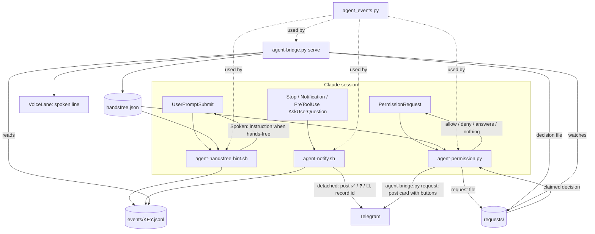

# Hands-free voice, tap approvals and question buttons in agent session topics

Line references point at commit `fe9836b`. This doc freezes at merge, so regenerate them against the new base if that commit is rebased away. Claude Code behaviour was verified on the hub's installed 2.1.310 on 2026-10-26. It auto-updates, so each check names what it saw.

This is the first of three designs. The Command topic is 0003 and the live call is 0004, drafted as issues in `design/issues/voice-agents-next/`. Voice approval was set aside, with the reasons and what would revive it in the same folder.

## Summary

[0001](0001-agent-voice.md) put voice behind a tap in each agent session topic. This change does three things, each its own step:

- **Prompts answered from Telegram, bound to the exact call.** A permission prompt in a detached personal session posts the call itself, the command or the path, with ✅ Allow and ✖ Deny. A question posts a button per option. Both are answered through Claude Code's `PermissionRequest` hook, which receives the exact call and returns the decision, so a tap can never land on a different prompt and nothing is typed into the pane.
- **Hands-free**, a per-topic switch. A heard note sends itself 10 seconds after its card appears, unless something is waiting for an answer. A finished turn arrives as one spoken line, written by the agent for the ear and announced on AirPods with no tap, plus a voice note of it.
- **A reply keyboard** in hands-free topics: 👁 Peek, ⎋ Esc and 🎙 Hands-free off, one tap each.

**Where to look:**

- **The hook answers prompts, not keystrokes** (D4, D5). Checks B1 to B6 and E verified it on 2.1.310, including that a terminal answer still wins and that the hook can see when that happens.
- **Tap approvals apply to every detached personal session**, not only hands-free ones (D4). That replaces today's blind 1 · Yes for those sessions, which is a visible change outside hands-free.
- **Auto-send holds whenever a prompt or question is open** (D1), because Enter on a permission dialog picks its highlighted Yes, and a leading digit picks an option.
- **What a prompt card shows** (D6): commands and paths, secrets redacted, file contents only as a line count, and nothing from journal notes.
- **The reply keyboard's scope in a forum group is unverified** (check K). Its buttons act on the topic they are pressed in either way.

## Goals and non-goals

**Goals**

1. Answer a permission prompt or a question from the phone with one tap, on exactly the call or question shown, never by typing into the pane.
2. Away from the desk, give an instruction and hear the outcome with at most one tap per exchange, in topics switched to hands-free.
3. Leave attached sessions, work sessions, and topics without hands-free as they are, apart from goal 1's cards.

**Non-goals**

- **Voice approval.** Set aside in `design/issues/voice-agents-next/voice-approvals.md`. Prompts are answered by tap.
- **Telegram cannot be fully hands-free.** Recording a note takes a press and voice notes do not play themselves. The spoken line as an announced text message is the part that reaches the ear with no tap. Fully hands-free conversation is 0004.
- **Nothing is spoken at the desk.** While a client is attached anywhere in the session's group, the hooks stay silent as today.
- **Work repositories.** A session outside the personal roots gets no new card, no spoken line and no hands-free. Its prompts keep today's 🔔 with metadata only.
- **Codex and OpenCode.** Codex has approval dialogs, but no hook reports them. OpenCode has no notify wiring. `/handsfree` is refused unless the pane runs Claude Code, and neither gets prompt cards.
- **Plan approvals** (`ExitPlanMode`) stay at the terminal. The hook returns nothing for them.

## Glossary

| Term | Meaning |
|---|---|
| **Session key** | The tmux session group name when the session belongs to a group, otherwise its name. A name with characters outside `[A-Za-z0-9._-]` has them replaced by `_`. Used for events, flags, requests, posts and the attach check |
| **Attached** | Any tmux client on any session of the key's group |
| **Event log** | `events/KEY.jsonl` under `/srv/services/agents`, one JSON line per hook event, written only by the hooks |
| **Request** | A prompt or question held open by `agent-permission.py`: a request file, its card, and a decision file the bridge writes |
| **Open request** | A request whose file exists, whose hook pid is alive, and which is younger than the hook's limit |
| **Spoken line** | The final line of an agent's reply, starting `Spoken:`, written for the ear |
| **Hands-free** | A per-session flag in `handsfree.json`, set by `/handsfree on` |

## How it works now

Only the parts this change touches. [doc/remote-agent-sessions.md] and [0001](0001-agent-voice.md) describe the rest.

| Behaviour today | Where |
|---|---|
| The notify hook exits early while any tmux client is attached to the session, before it builds the message | [agent-notify.sh L68-L80] |
| Claude's hooks are `Stop`, `Notification`, and `PreToolUse` matched to `AskUserQuestion` | [settings.json L24-L56] |
| A permission prompt reaches the hook as a `Notification` whose `message` names the tool but not its input | [agent-notify.sh L112-L116], [agent-notify.sh L157-L158] |
| A finished body is the last assistant text, flattened and cut to 400 characters | [agent-notify.sh L160-L191], [agent-notify.sh L232-L234] |
| Bodies go only to directories under the hook's personal roots, a list inside its heredoc. The bridge keeps its own, shorter list | [agent-notify.sh L84-L90], [agent-notify.sh L139-L149], [agent-bridge.py L327-L343] |
| `agent-bridge.py notify` posts and discards the message id | [agent-bridge.py L2643-L2651] |
| A question card lists options as text, to be answered at the terminal | [agent-notify.sh L215-L229] |
| 1 · Yes types `1` and Enter blind | [agent-bridge.py L143-L146], [agent-bridge.py L1818-L1820] |
| Plain text in a session topic is typed into the pane | [agent-bridge.py L1874-L1878] |
| Bridge state round-trips only its four known keys, and the voice lane keeps only valid `h` and `s` jobs, so anything else in either file is dropped on load | [agent-bridge.py L606-L671], [agent-bridge.py L991-L1004], [agent-bridge.py L1032-L1047] |
| Only `serve` builds the voice lane. `notify` and other subcommands cannot queue voice | [agent-bridge.py L2469-L2474] |
| The loop long-polls for 25 s, shorter only while voice work runs | [agent-bridge.py L2346-L2348] |
| New topics are muted through the user helper, which has `mute`, `status` and `clear` verbs | [agent-bridge.py L1483], [telegram-user.py L103-L109] |
| Messages are sent with notifications on | [agent-bridge.py L776-L811] |

**Verified on Claude Code 2.1.310, 2026-10-26**, in a scratch directory with throwaway hooks, using Haiku:

| Check | What was done | Result |
|---|---|---|
| B1 | `PermissionRequest` hook answering `allow`, then `deny`, headless | Allow ran the command. Deny refused it |
| B2 | The hook's input | `cwd`, `hook_event_name`, `permission_mode`, `permission_suggestions`, `prompt_id`, `session_id`, `tool_input`, `tool_name`, `transcript_path`. No tool-use id |
| B3 | Interactive, the hook waiting 8 s then printing nothing | The prompt was on screen at 5 s, while the hook waited, and stayed afterwards |
| B4 | Interactive, the hook waiting 8 s then answering `allow` | The prompt on screen closed at 8 s and the command ran |
| B5 | Interactive, `1` pressed at 4 s, the hook answering `deny` at 8 s | The command ran. The terminal answer won |
| B6 | Interactive, `1` pressed at 5 s, the hook logging the transcript size each second | The hook kept running after the answer. The transcript held steady from 1 s to 4 s, while the prompt was up, and grew at 5 s |
| C | `UserPromptSubmit` hook returning `additionalContext` asking for a `Spoken:` line | The reply ended "Spoken: Two plus two is four." |
| D | The `Stop` hook's input | It carries `last_assistant_message` |
| E | `PermissionRequest` matched to `AskUserQuestion`, answering `allow` with `updatedInput` adding `answers: {"Which colour?": "Green"}` | Claude Code showed "Which colour? → Green, Allowed by PermissionRequest hook", and the agent reported Green |

The same sessions showed two more things that shape the design. The permission dialog's options are 1 Yes, 2 "Yes, and always allow access to ...", 3 "Yes, and switch to auto mode" and 4 No, so a stray digit can widen the session's permissions. And sessions default to auto mode, where most calls never prompt, so a prompt that does appear is one the classifier escalated.

## Why the obvious approach fails

The obvious approach: switch on auto-send and auto-Listen, and post 1 · Yes for prompts as today.

| # | Mechanism | What goes wrong | Fixed by |
|---|---|---|---|
| 1 | Auto-send types text and Enter, and Enter on a permission dialog picks its highlighted Yes | A note arriving while a prompt is up approves it with no words | D1 |
| 2 | A digit acts at once on a numbered dialog, and options 2 and 3 widen permissions | A note starting "two" or "3 files" can switch the session to auto mode | D1 |
| 3 | 1 · Yes types blind | A tap after the prompt changed approves a different call | D4 |
| 4 | The permission notification names the tool, not its input | A card cannot show what will run | D4 |
| 5 | The hook keeps running after the prompt is answered elsewhere (B6) | A request outlives its prompt, keeps buttons live, and holds auto-send | D4 |
| 6 | The permission hook also fires for `AskUserQuestion` and `ExitPlanMode`, and an allow without answers is dropped for them | A blanket hook would show Allow and Deny on every question and plan | D4, D5 |
| 7 | Typed text in a session topic is typed into the pane | Typing "approve" or "yes" while a prompt is up presses Enter on it | D1 |
| 8 | The finished body is cut at 400 characters | A spoken line at the end of a long reply is lost | D2 |
| 9 | Listen voices the whole notification | Auto-speech reads the header, branch and change count | D2 |
| 10 | `notify` discards the message id, and only `serve` can queue voice | A spoken reply has nothing to attach to, and a hook cannot queue it | D3 |
| 11 | Both state files drop unknown entries on load | Flags, cursors and new job kinds vanish on the next re-exec | D1, D3 |
| 12 | The loop sleeps in a 25 s long poll | Countdowns, spoken lines and request cleanup run late | D3 |
| 13 | A ready voice job lives 24 h | An auto-send due during an outage types an instruction hours late | D1 |
| 14 | Unmuting a topic announces every message in it | AirPods read the header, the body and the cards, not only the spoken line | D3 |
| 15 | Grouped mobile sessions have their own names and their own clients | A phone attached through `vault-m` would not count as attached to `vault` | Session key |
| 16 | A card body is cut at 3,500 characters by `Telegram.send` | Allow could approve a command whose tail was never shown | D6 |
| 17 | A card shows tool inputs, which today never leave the hub | Tokens and journal text could reach Telegram | D6 |
| 18 | The hook's root list lives in a heredoc and the bridge's list differs | New hooks cannot reuse it, and a third copy would drift | D7 |

## Proposed design



Short-lived processes (hooks, `notify`, `request`) post messages and write files. Only `serve` queues voice, edits cards after the fact, and writes decisions. A new stdlib module, `agent_events.py`, is the one place that knows the session key, the attach check, the personal roots, the event log, the request files and the redaction rules. The hooks and the bridge import it instead of each holding a copy.

## Decisions

### D1. Hands-free is a per-session switch, and auto-send holds while anything waits for an answer

**Decision.** `/handsfree on|off|` (no argument reports) in a session topic. It is refused for a work session, and for a pane not running Claude Code (`#{pane_current_command}` is not `claude`). The flag lives in `handsfree.json`, written only by `serve`, atomically, mode 0600. In a hands-free topic a heard note's card reads "Sends in 10 s" with ✖ Cancel, ✏️ Edit and ✅ Send now. At its deadline it goes through the existing `send_heard`.

**The hold.** It is checked when the card is posted and again immediately before typing. While it holds, the card is tap-to-send and says why. It holds when:
- there is an open request for the key
- the latest event since the last `stop` or `prompt` is a `permission` or `question`
- a capture of the pane matches `Do you want to proceed\?|Enter to confirm|Esc to cancel`, the footers seen on 2.1.310
- the text's first word is a number, or the text is a single word

A small race remains between the last check and the keystroke, and the hold accepts it.

**Typed text** in any session topic is not typed into the pane while a request for that session is open. The bridge replies "a prompt is open, use its buttons" (row 7).

| Option | Pros | Cons |
|---|---|---|
| Global mode | One switch | Desk and away want opposite behaviour |
| **Per-session switch, off by default** | 0001 stays the default elsewhere | One more command |
| Auto-send with no hold | Simplest | Rows 1, 2 and 7 |

**Why.** The owner chose a confirm tap in 0001 so a mishearing never reaches an agent, and it stays wherever hands-free is off. The hold uses three independent signals because each alone can miss. A prompt marked person-only never runs the hook, the `permission` event arrives only after the TUI's idle notification, and the footer pattern is version-specific.

**Mechanics.**
- The deadline is stored in the job.
- A job overdue by more than 15 s becomes tap-to-send (row 13).
- `/handsfree off` turns open countdowns into tap cards.
- Cancel is Discard. Edit stops the countdown and asks for the corrected text as 0001 does.
- The card is never edited each second.
- `valid_job` accepts `deadline`.

**Consequences.** Hands-free never applies to Codex or OpenCode topics.

### D2. The agent writes the spoken line, the hooks carry it

**Decision.**
- **The hint hook.** `agent-handsfree-hint.sh`, a `UserPromptSubmit` hook, prints `additionalContext` only when the key is hands-free and the directory is a personal root: "End your reply with a final line starting `Spoken:` and one plain sentence of at most 25 words, for someone listening, with no code, paths or symbols." It writes a `prompt` event and always exits 0.
- **Finding the line.** `agent-notify.sh` takes the reply from `last_assistant_message` when the payload has it, else from the transcript as today. When the final non-empty line outside a code fence matches `^\**Spoken:\**\s*(.+)$`, it is the event's `spoken` and is removed from the posted body.
- **The fallback.** Without one, `spoken` is the first sentence of the reply with markdown, code spans and paths removed, cut at the first `.`, `?` or `!` followed by a space, at most 200 characters.
- **Work sessions.** Both are null outside the personal roots.

| Option | Pros | Cons |
|---|---|---|
| **Agent writes it, verified by check C** | It knows what mattered. No extra model | None for Claude. The other agents get no hands-free at all |
| First sentence only | No setup | Often a preamble |
| A small hosted model | Good output | A key, a cost per turn, content to a third service |

**Why.** The owner chose the agent. Extracting before the 400-character cut fixes row 8, and speaking only the line fixes row 9. Requiring the last line keeps a mention of `Spoken:` mid-reply from being taken.

**Consequences.**
- A final `Spoken:` line is removed from every posted body.
- After `/handsfree off`, an agent may keep writing the line for the rest of its conversation. It is still removed, so it is harmless.
- Switching the source to `last_assistant_message` can change a body. That is accepted, and Isolation scopes the snapshot to payloads without the field.

### D3. Spoken replies are queued by the daemon from the event log

**Decision.**
- **Recording the id.** `agent-notify.sh` writes its event after posting, so a detached event carries the `message_id` that `notify --print-id` returns. An attached event is written without one.
- **Reading the log.** `serve` reads the event logs of hands-free sessions each loop pass, and the long poll drops to 3 s while any session is hands-free or any request is open (row 12).
- **The cursor.** It lives in a new file, `event-cursors.json`, owned by `serve`, as `{key: {"inode": n, "seq": n}}`. On first sight of a file, or when its inode changes, the cursor starts at the end, so old events are never replayed.
- **What is spoken.** For a `stop` event of a hands-free, detached session with a `spoken` line and a `message_id`, at most 120 s old, `serve`:
  - posts the spoken line as a text reply to the ✅ message, with notifications on
  - queues a speak job keyed `S<message_id>`, replying to the ✅ message
- **Notifications.** Every other message the bridge or the hooks send to a hands-free topic goes with `disable_notification` (row 14).
- **The topic.** `/handsfree on` records whether the topic was muted, through the helper's `status` verb, and unmutes it through a new `unmute` verb. `off` restores the recorded state. Both run the helper as a child, the way the daily prune does, so the loop never waits on it.
- **The queue.** Hear jobs run before speak jobs. An `S` job is dropped, its text already sent, when three or more jobs wait. `valid_key` and `valid_job` accept the `S` prefix.

| Option | Pros | Cons |
|---|---|---|
| **Text line announced, voice note quiet** | Announce reads only the spoken line. The voice note is there for more | Two messages per turn |
| Voice note only | One message | A tap per reply |
| `notify` posts the spoken line itself | No polling | `notify` cannot queue voice, so speech still needs the daemon |

**Why.** The owner chose text plus a voice note. Writing after the post fixes the missing id, and the daemon fixes "only `serve` queues voice" (row 10). A separate cursor file avoids both state files dropping unknown entries (row 11). Starting at the end and the 120 s age limit stop stale turns from being spoken after an outage.

**Consequences.** `serve` deletes event logs older than 7 days during its daily prune, so the hooks never delete.

### D4. Permission prompts are answered by tap through the hook

**Decision.** `agent-permission.py` is a `PermissionRequest` hook for every tool, with a 900-second timeout. It returns nothing at once:
- for `ExitPlanMode`
- for any session that is attached or not a personal root
- when `handsfree.json` has `"cards": false`, the kill switch
- on any error

`AskUserQuestion` goes to D5. Otherwise it:

1. creates `requests/KEY-ID.json` (0600) with a random 12-character `ID`, its pid, `created`, the tool and the card text from D6,
2. runs `agent-bridge.py request KEY ID`, which posts the card with ✅ Allow and ✖ Deny (callback data `p:a:ID` and `p:d:ID`) and writes its message id into the request file,
3. every half second, takes `KEY-ID.decision` by renaming it to `KEY-ID.claimed`, and prints `allow`, or `deny` with the message "Denied from Telegram",
4. gives up after 840 seconds, or as soon as the transcript grows past its size one second after the hook started, which B6 showed happens when the prompt is answered elsewhere,
5. writes `KEY-ID.done` holding `allowed`, `denied`, `answered elsewhere` or `timed out`, then removes its request and claim files. It does the same on SIGTERM and SIGHUP.

Allow is always a one-time allow, never "always".

**The daemon.**
- **Writing decisions.** `serve` writes `KEY-ID.decision` only while the request is open. A late tap gets "already answered".
- **Updating the card.** On each pass it reads `done` files and edits the card: "✅ Allowed", "✖ Denied", "Answered at the terminal", or "Timed out, answer at the terminal". A timed-out card gets 👁 Peek and ⎋ Esc. Then it removes the `done` file.
- **Stale requests.** A request whose pid is gone gets the same treatment, as "Ended".

**The 🔔 notification.** `agent-notify.sh` posts no 🔔 for a permission event while a request for the key is open. The card has replaced it.

**1 · Yes.** It still types `1`, now without the Enter, since a digit acts on its own.

| Option | Pros | Cons |
|---|---|---|
| 1 · Yes as today | Nothing to build | Rows 3 and 4 |
| Type `1` after checking the pane | No new hook | Screen-scraping, and a race between the check and the key |
| **The hook returns the decision** | Bound to the exact call. No keystrokes. A terminal answer still wins (B5) | A process per prompt, and request lifecycle to manage |

**Why.** B1 to B5 show the hook gets the exact call and that a late decision closes the prompt already on screen, with the terminal still winning. B6 gives the signal for "answered elsewhere" (row 5). Claiming by rename means a decision is acted on at most once, and only by the hook that owns it. The long timeout costs nothing at the desk, because the prompt is on screen the whole time (B3).

**Consequences.**
- Every detached personal session gets these cards, hands-free or not. That is the one visible change outside hands-free, and it is safer than the 1 · Yes it replaces.
- A prompt marked person-only, such as some deletes, does not run hooks and keeps today's 🔔.

### D5. Questions get a button per option

**Decision.** For `AskUserQuestion`, when every question is single-select with at most 8 options, the hook posts one card per question with a button per option (`q:ID:Q:O`). When each question has an answer it prints `allow` with `updatedInput` set to the original input plus `answers` keyed by question text, as check E did. It uses the same request lifecycle as D4, with `done` reading `answered`. A multi-select question, more than 8 options, or no buttons wanted makes the hook return nothing, and today's question card is posted as before. The question card from `agent-notify.sh` is skipped while a request for the key is open.

| Option | Pros | Cons |
|---|---|---|
| **Buttons through `updatedInput.answers`** | Bound to the question. No keystrokes. No dependence on how the dialog draws | Single-select only for now |
| Type the option's digit | No hook | Lands on whatever dialog is up, including a permission prompt (row 2) |
| Keep answering at the terminal | Nothing to build | Not answerable from the phone |

**Why.** The owner chose buttons. Check E shows the hook's answer is taken as the user's.

**Consequences.** "Other" and multi-select stay at the terminal.

### D6. What a card shows

**Decision.**
- **Bash.** The command, with these replaced by `[redacted]`:
  - values after `=` in `NAME=value` where NAME contains `KEY`, `TOKEN`, `SECRET`, `PASS` or `AUTH`
  - `Bearer` and `Basic` credentials
  - strings matching `sk-`, `ghp_`, `gho_`, `xox[bap]-` or `AKIA` prefixes
  - any run of 32 or more base64 or hex characters
- **Edit, Write and NotebookEdit.** The path and a count ("Write, 42 lines", "Edit, 3 lines removed, 5 added"). Never the content.
- **WebFetch.** The URL with its query string removed.
- **Other tools.** The tool name and the names of its input fields.
- **Journal paths.** A path under `00 - Black/00 - Journal/` in the vault shows only "a journal note".
- **Length.** A card whose text would pass 1,000 characters is cut, says so, and has no ✅ Allow. Deny, Peek and Esc remain (row 16).

| Option | Pros | Cons |
|---|---|---|
| **Commands and paths, redacted, counts for content** | You see what will run. Secrets and journal text stay home | A redaction rule can miss a secret shape |
| Full input | Everything visible | Row 17 |
| Tool name only | Nothing new leaves | You approve what you cannot see |

**Why.** The owner chose this. The journal rule follows the vault's rule that what the user writes about a habit never leaves it.

**Consequences.** This is a new class of data in Telegram, accepted by the owner on 2026-10-26.

### D7. One module holds the shared rules

**Decision.** `scripts/agent_events.py`, stdlib only, staged to `/srv/services/agents/bin` beside the bridge. It provides:
- the session key and the attach check across a group
- `allowed()`, with the hook's roots list moved here from the heredoc
- the event log: append under `flock`, `seq` from `KEY.seq` beside the log, trim to 200 lines by atomic rewrite
- request and decision file handling
- D6's card text and redaction

`agent-notify.sh` imports it from its heredoc, and the new hooks and the bridge import it. `AGENT_EVENTS_DIR` moves the whole tree for tests. Every function is a no-op when the directory does not exist, so the work Mac is unaffected.

| Option | Pros | Cons |
|---|---|---|
| **One shared module** | One roots list for the hooks, one log format | `agent-notify.sh` gains an import |
| Each script its own copy | No import | Row 18, three drifting copies |

**Why.** Three writers and two readers must agree exactly on the log, the requests and the roots.

**Consequences.** The bridge's own `content_roots` list for peek is left as it is. Aligning it is a follow-up.

### D8. A reply keyboard in hands-free topics

**Decision.** `/handsfree on` posts a persistent reply keyboard: 👁 Peek, ⎋ Esc and 🎙 Hands-free off. Each sends that fixed text, and the bridge maps it to `/peek`, `/esc` and `/handsfree off` for the topic the message came from. `/handsfree off` removes it.

| Option | Pros | Cons |
|---|---|---|
| **Reply keyboard with three fixed actions** | One tap for the common actions while walking | Its scope in a forum group is unverified (check K) |
| Approve and Deny on the keyboard | Faster | Ambiguous when two requests are open. The cards' inline buttons are bound to one request |
| No keyboard | Nothing to test | More typing |

**Why.** The owner chose the keyboard. Check K decides whether it shows only in that topic or chat-wide. The mapping uses the topic the message was sent in, so it acts correctly either way.

**Consequences.** If check K shows it chat-wide, it also appears in non-hands-free topics. Pressed there, it still acts on that topic's session.

## Isolation

- **Attached, work, Codex and OpenCode sessions** see no change. The hooks return at once, tested for each.
- **Topics without hands-free** keep 0001's card. The only new thing they see is D4 and D5's cards in place of 1 · Yes and the text question card, for detached personal sessions.
- **Telegram posts are otherwise unchanged.** A snapshot of `agent-notify.sh --dry-run`, for stop payloads without `last_assistant_message` and for notification and question payloads, is byte-identical before and after, apart from a removed final `Spoken:` line. `--dry-run` writes no event.
- **The hooks cannot block or fail a turn.** Each exits 0 on any error and prints nothing on unexpected input, so prompts fall back to today. The `cards` kill switch in `handsfree.json` turns D4 and D5 off without a deploy, because the live settings are seeded add-only.

## Contracts

**Event line**, `events/KEY.jsonl` (directory 0700, file 0600):

```json
{"seq": 412, "t": 1761500000.25, "kind": "stop", "attached": false, "message_id": 9811,
 "spoken": "Done. Two files changed and the tests pass.", "body": "Updated the move-in list ..."}
```

`kind` is `prompt`, `stop`, `notification`, `permission` or `question`. `body` is the 400-character posted body. `spoken` and `body` are null outside the personal roots.

**Request** `requests/KEY-ID.json`: `{"id", "key", "pid", "created", "tool", "kind": "permission"|"question", "card", "message_ids", "questions"}`. **Decision** `KEY-ID.decision`: `allow`, `deny`, or a JSON object of answers. **Claim** `KEY-ID.claimed`, **done** `KEY-ID.done`.

**`handsfree.json`**: `{"version": 1, "cards": true, "sessions": {"vault": {"on": true, "was_muted": true}}}`. **`event-cursors.json`**: `{"vault": {"inode": 1234, "seq": 412}}`.

**Hook outputs**, as in checks B1 and E:

```json
{"hookSpecificOutput": {"hookEventName": "PermissionRequest", "decision": {"behavior": "allow"}}}
{"hookSpecificOutput": {"hookEventName": "PermissionRequest", "decision": {"behavior": "deny", "message": "Denied from Telegram"}}}
{"hookSpecificOutput": {"hookEventName": "PermissionRequest", "decision": {"behavior": "allow",
  "updatedInput": {"questions": [...], "answers": {"Which colour?": "Green"}}}}}
```

**Bridge surface**: `/handsfree [on|off]`, the keyboard texts, callback data `p:a:ID`, `p:d:ID`, `q:ID:Q:O`, the subcommand `request KEY ID`, and `notify --print-id`. **User helper**: a new `unmute` verb.

## Risks and checks

| Risk | Handling |
|---|---|
| **K.** The reply keyboard may show in every topic of the group | **Before step 6.** Post one in a scratch topic and look at another. Its buttons act on the topic pressed in, so either result works |
| The transcript grows while a prompt is up for another reason, ending the request early | The card says "answered elsewhere" and the prompt stays on screen, so the failure is a lost card, never a wrong decision |
| A redaction rule misses a secret shape | The rules are tested on a list of real-looking secrets. The card shows no file content at all |
| A crashed bridge leaves hooks waiting | The hook's 840 s limit and the 900 s timeout. The prompt stays on screen throughout |
| Claude Code changes the hook protocol | The hooks print nothing on unexpected input, and the kill switch turns cards off. Re-run B1 to B6 and E after an update that touches hooks |
| Event logs, requests and card text in backups | The host's `BLACK_SYSTEM_BACKUP_EXCLUDE_FILE` gains `events/`, `requests/`, `handsfree.json` and `event-cursors.json` at deployment, and doc/personal-cloud-sync.md records it |

## Implementation outline

Each step ships and tests on its own. Step 1 changes nothing visible, and step 2 is the first visible change.

1. **The shared module and the event log.**
   - New `scripts/agent_events.py`.
   - `scripts/agent-notify.sh`: import it, use its roots, compute the session key, write the event after posting (or before exiting when attached), extract the spoken line, and pass `--print-id`.
   - `scripts/agent-bridge.py`: `notify --print-id`.
   - `restoration_scripts/51-agent-sessions.sh`: stage the module.
   - `doc/personal-cloud-sync.md`: the exclusions.
   - New `scripts/test_agent_hooks.py`.
   - Builds on nothing. Tests T1 to T5. Visible: no.
2. **Prompt cards.**
   - New `scripts/agent-permission.py`, with its `PermissionRequest` entry in `config/claude/settings.json`, staged by `51-agent-sessions.sh`.
   - `scripts/agent-bridge.py`: the `request` subcommand, the callbacks, decisions, card edits from `done` files, the stale sweep, typed text held while a request is open, and 1 · Yes without Enter.
   - `scripts/agent-notify.sh`: skip the 🔔 and the question card while a request is open.
   - Deployment re-runs `restoration_scripts/02-seed-runtime-configs.sh` for the new hook entry.
   - Builds on step 1. Tests T6 to T12. Visible: yes, for detached personal sessions.
3. **Question buttons.** `scripts/agent-permission.py` and `scripts/agent-bridge.py`: D5. Builds on step 2. Tests T13, T14. Visible: yes.
4. **The hint hook.** New `scripts/agent-handsfree-hint.sh` and its `UserPromptSubmit` entry, staged and seeded as in step 2. Builds on step 1. Tests T15. Visible: no, nothing is hands-free yet.
5. **Hands-free.**
   - `scripts/agent-bridge.py`:
     - `handsfree.json`, `/handsfree`, the Claude-only check, and the countdown card and its hold
     - `event-cursors.json`, the 3 s poll, the spoken text line and `S` jobs, hear-first ordering, `disable_notification`
     - log pruning, and `COMMANDS`
   - `scripts/telegram-user.py`: `unmute`.
   - `scripts/test_agent_bridge.py`.
   - Builds on steps 2 and 4. Tests T16 to T22. Visible: yes, behind the switch.
6. **The reply keyboard.** `scripts/agent-bridge.py`: D8. Builds on step 5, after check K. Tests T23. Visible: yes.
7. **Documentation.** Written in the PR of each step:
   - `doc/remote-agent-sessions.md`
   - the `GUIDE` constant: the muted-topic and BUTTONS lines, plus one line pointing at the doc, staying under Telegram's 4,096 characters
   - `CLAUDE.md`, the hook list at L240-L242
   - the vault's Remote Agent Sessions guide
8. **Follow-ups**, written as issues and not built here:
   - aligning the bridge's `content_roots` with `agent_events.allowed()`
   - multi-select and "Other" answers

## Test strategy

| Test | Proves | Rows |
|---|---|---|
| T1 | An attached session writes its event without an id and posts nothing. Attach is counted across a group | 15 |
| T2 | A 900-character reply ending in `Spoken:` records the line and posts the body without it. A mid-reply `Spoken:` is left | 8, 9 |
| T3 | A work-root event has null `spoken` and `body` | Isolation |
| T4 | Concurrent appends give unique increasing `seq`, the trim keeps 200, and a missing directory is a no-op | 11 |
| T5 | The `--dry-run` snapshots are byte-identical, and `--dry-run` writes no event | Isolation |
| T6 | The hook returns nothing at once for attached, work, `ExitPlanMode`, the kill switch, and malformed input | 6, Isolation |
| T7 | Allow and Deny taps make the hook print the matching JSON, once, through the claim rename | 3 |
| T8 | A transcript that grows after the first second ends the request as "answered elsewhere". SIGTERM cleans up | 5 |
| T9 | A tap after the request ends gets "already answered" and writes nothing. A stale pid is swept | 5 |
| T10 | No 🔔 is posted while a request is open | D4 |
| T11 | Typed text while a request is open is not typed into the pane | 7 |
| T12 | Redaction covers the listed secret shapes, Write shows a count only, a journal path shows "a journal note", and an over-long card has no Allow | 16, 17 |
| T13 | An option tap answers with `updatedInput.answers`, as in check E, and every question needs an answer before the hook returns | 6 |
| T14 | Multi-select or more than 8 options falls back to today's question card | D5 |
| T15 | The hint prints only with the flag set and a personal root, and exits 0 when the directory is missing | Isolation |
| T16 | `/handsfree on` is refused for work, Codex and OpenCode panes | Non-goals |
| T17 | Without hands-free a note gives 0001's card, unchanged | Isolation |
| T18 | With hands-free the card sends once at the deadline. Cancel stops it. Overdue becomes tap-to-send | 13 |
| T19 | The hold, at card time and before typing: open request, latest event, pane footer, leading number, single word | 1, 2 |
| T20 | A stop event posts the spoken line with notification and queues an `S` job. Other messages go silent. Nothing is replayed on first sight, on inode change, or after 120 s | 10, 12, 14 |
| T21 | With three jobs waiting an `S` job is dropped and a note is still heard. `S` jobs survive a re-exec | 11 |
| T22 | `/handsfree off` restores the recorded mute state through a child process | 14 |
| T23 | A keyboard text maps to the action for the topic it was sent in | D8 |

## References

[agent-notify.sh L68-L80]: ../scripts/agent-notify.sh#L68-L80
[agent-notify.sh L84-L90]: ../scripts/agent-notify.sh#L84-L90
[agent-notify.sh L112-L116]: ../scripts/agent-notify.sh#L112-L116
[agent-notify.sh L139-L149]: ../scripts/agent-notify.sh#L139-L149
[agent-notify.sh L157-L158]: ../scripts/agent-notify.sh#L157-L158
[agent-notify.sh L160-L191]: ../scripts/agent-notify.sh#L160-L191
[agent-notify.sh L215-L229]: ../scripts/agent-notify.sh#L215-L229
[agent-notify.sh L232-L234]: ../scripts/agent-notify.sh#L232-L234
[settings.json L24-L56]: ../config/claude/settings.json#L24-L56
[agent-bridge.py L143-L146]: ../scripts/agent-bridge.py#L143-L146
[agent-bridge.py L327-L343]: ../scripts/agent-bridge.py#L327-L343
[agent-bridge.py L606-L671]: ../scripts/agent-bridge.py#L606-L671
[agent-bridge.py L776-L811]: ../scripts/agent-bridge.py#L776-L811
[agent-bridge.py L991-L1004]: ../scripts/agent-bridge.py#L991-L1004
[agent-bridge.py L1032-L1047]: ../scripts/agent-bridge.py#L1032-L1047
[agent-bridge.py L1483]: ../scripts/agent-bridge.py#L1483
[agent-bridge.py L1818-L1820]: ../scripts/agent-bridge.py#L1818-L1820
[agent-bridge.py L1874-L1878]: ../scripts/agent-bridge.py#L1874-L1878
[agent-bridge.py L2346-L2348]: ../scripts/agent-bridge.py#L2346-L2348
[agent-bridge.py L2469-L2474]: ../scripts/agent-bridge.py#L2469-L2474
[agent-bridge.py L2643-L2651]: ../scripts/agent-bridge.py#L2643-L2651
[telegram-user.py L103-L109]: ../scripts/telegram-user.py#L103-L109
[doc/remote-agent-sessions.md]: ../doc/remote-agent-sessions.md
