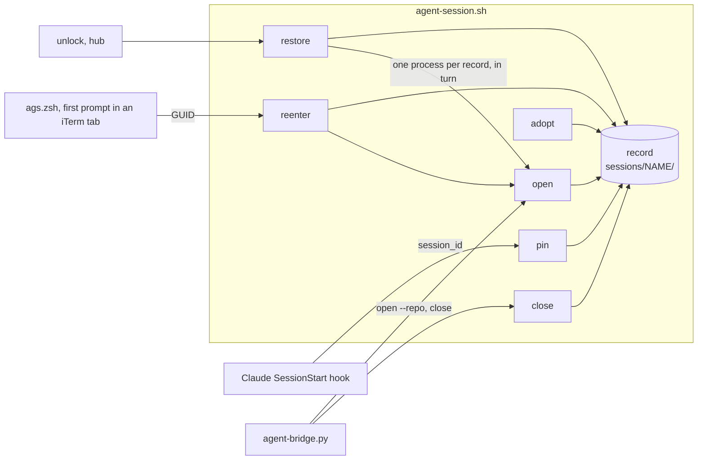

# ags save and restore, the Mac port, and iTerm tabs that re-enter their session

> **Superseded.** This draft stopped after three gate rounds and was split. [0006](0006-ags-records.md) covers records and predictable starts on the hub. A planned 0007 covers the Mac port, and a planned 0008 covers iTerm re-entry once checks C1 and C3 below have run. Kept as a record of the review.

Line references point at commit `39439ee`. Numbers 0003 and 0004 are held by the issue drafts in `design/issues/voice-agents-next/`, so this is 0005. Claude Code facts were checked on the Mac's 2.1.281 on 2026-11-04, iTerm facts on 3.7.6 and the iTerm2 source on `master` the same day.

## Summary

`ags` keeps agent sessions alive across a dropped connection, but nothing survives a reboot. This change gives every session a small on-disk record, so a reboot becomes a restore:

- **A record per session.** `open` writes it, including the Claude conversation id the launcher chooses itself. The agent's hook follows `/clear` and `/resume`. `close` marks it closed. Nothing polls.
- **`ags restore`** rebuilds every open record, each resuming its own conversation. The hub's `ags unlock` runs it.
- **iTerm tabs re-enter.** A tab that attached a session is bound to it. When macOS reopens that tab after a restart, its first prompt goes straight back into the session.
- **Directory lookup gets predictable.** A name with a record uses the record. Otherwise the session starts where you are. Repository search becomes the opt-in `--repo`, which Telegram and `ags remote` always pass.
- **A new name never continues another session's conversation.** It starts fresh unless told `--resume`, and the launcher never types `claude --continue`.
- **The Mac gets ags.** tmux, the launcher and the hook, and nothing that talks to Telegram.

**Where to look:**

- **The tab binding rests on iTerm keeping a tab's GUID across a reboot** (check C1). The source says it does. A reboot confirms it before the iTerm half is built.
- **`close` stops deleting the conversation's trail** (D5). It marks the record closed, so a later `open` resumes exactly that conversation, which is what `close` already promises in Telegram. Telegram's close now goes through the launcher too.
- **Two defaults change on the hub too** (D2, D3): the start directory for an unknown name, and starting fresh instead of continuing.
- **The Mac moves its agents into tmux** (D7), which costs iTerm's own scrollback and per-tab Claude status inside sessions.

## Problem

After a reboot every `ags` session is gone, and so is the memory of which ones existed. On the Mac it is worse. The agents run straight in iTerm tabs, iTerm reopens the tabs with their old scrollback, and each one needs its conversation found by hand with `claude --resume` and a picker. Six tabs, several in the same directory, means six searches every restart.

Continuing by directory does not help, because "the newest conversation in this directory" is the wrong one whenever two sessions share a directory. The same flaw shows up without a reboot: `ags open house3` lands in the vault and continues whichever vault conversation is newest, usually the one open in another tab. And where a name with no repository starts depends on environment variables that differ between a terminal and the bridge's systemd unit, so the same name can land in different folders.

Better looks like this. A reboot loses nothing but in-flight turns. Each reopened tab is back in its own conversation without a keystroke. A new session never touches another session's thread.

**Non-goals**

- **Background Claude sessions** (`claude --bg`). They are Claude-only and do not respawn after a reboot (the daemon log shows `adopted=0 respawned=0 dead=3`). This works at the tmux layer for any agent.
- **Restoring scrollback, the shell and git windows' state, or a turn in flight.** The conversation is restored, the processes are new.
- **Exact pins for Codex and OpenCode.** They resume by directory as today, and only when D3 says so.
- **Tabs that run `ags remote`.** A tab whose shell is on the hub is not bound. `agsrv` gets back in.
- **paneport's `pp-*` sessions.** paneport creates them itself, so no verb ever records one.
- **Following a tab across `switch-client`, or a second tab on one session.** A tab is bound to the session it attached as the first client. A second tab joins as a grouped client and is never bound.
- **Expiring records.** A record stays until `close`. Revisit if, in any month, `restore` brings back more than two sessions that are closed again the same day.

## Glossary

| Term | Meaning |
|---|---|
| **Record** | A directory `sessions/NAME/` under the state directory, one small file per field. A record counts only when it holds `dir` |
| **State directory** | `$AGENT_SESSION_STATE`, else `/srv/services/agents/state` when `/srv/services/agents` is a writable directory (the hub), else `${XDG_STATE_HOME:-$HOME/.local/state}/ags` |
| **Open record** | A record without a `closed` file. Restore brings these back |
| **Pin** | The record's `conversation` file, holding the Claude session id the agent pane runs, in lower case |
| **Bound tab** | The record's `tab` file, holding the iTerm session GUID of the tab that attached it |
| **GUID** | The part of `$ITERM_SESSION_ID` after the colon. `w1t3p0:05921141-E25A-…` has GUID `05921141-E25A-…` |
| **Locked home** | A home that is ecryptfs and not mounted: `ecryptfs-mount-private` exists, `$HOME/.ecryptfs` exists, and `mount` shows no ecryptfs on `$HOME`, the same test `cmd_unlock` uses. Only the hub can have one |
| **Transcript** | `${CLAUDE_CONFIG_DIR:-$HOME/.claude}/projects/<encoded dir>/<ID>.jsonl`, with the encoding `has_conversation` uses (`agent-session.sh:203`) |

## Technical Plan

How sessions, windows and resuming work today is in [doc/remote-agent-sessions.md](../doc/remote-agent-sessions.md), sections "The launcher" and "Resuming". This changes the launcher and adds two small surfaces around it.



### D1. The record

One directory per session, `sessions/NAME/`, holding one file per field: `dir`, `agent`, `pane`, `conversation`, `tab`, `closed`. Each file is written by writing a temporary sibling and renaming it, so a reader never sees half a value, and two writers touching different fields never race. Nothing reads and rewrites a whole record. `dir` is stored as the physical path (`pwd -P`). `pane` is the agent pane's tmux id (`%12`). The state directory is created mode 0700.

**Names.** `NAME` is the session name after the existing sanitising of `.` and `:` to `-` (`agent-session.sh:326`). A name that would get a record must then match `[A-Za-z0-9_-]+`, otherwise `open` refuses it and names the allowed characters, so a name is always a safe path component and a safe shell word. A new record whose name equals an existing record's when both are lowered with `tr A-Z a-z` is refused on every platform, because macOS file systems are case-insensitive and a record made on the hub may later be compared on the Mac. Names starting `pp-` are never recorded by any verb.

| Writer | Writes |
|---|---|
| `open`, creating a session | After `new-session` succeeds and before anything is typed: `dir`, `agent`, `pane`, and for Claude `conversation`. Removes `closed`. Every refusal happens before this point, so a refused `open` writes nothing |
| `open`, `close` or `adopt` meeting a running session with no record | `dir` from tmux's `#{session_path}`, `pane` from the agent window, `agent` from that pane's foreground command (`codex`, `opencode`, a shell meaning `shell`, anything else `claude`), and for Claude the pin when the process lookup in D5 finds one |
| `open`, attaching a running Claude session whose record has no pin | The pin, by the same lookup |
| `open`, attaching from an iTerm tab | `tab` (D6) |
| `pin`, from the Claude hook | `conversation` |
| `open`, after a deliberate detach | removes `tab` |
| `close` | creates `closed`, removes `tab`, then kills the session |
| `close --forget` | removes the whole record, then kills the session |

A misclassified adopted agent, a renamed binary say, is fixed by `ags close NAME` and `ags open NAME <agent>`, which replaces the agent of a closed record (D2).

A session killed any other way, by a crash, by exiting its windows, or by a reboot, keeps an open record. That is the point: only `close` says a session is finished, because a crash and exiting every window look the same from outside.

### D2. Where a session starts

These rules apply only when `open` starts a session. A running session is attached as today, whatever agent or `--dir` was given.

`open NAME` picks the directory in this order, and says which rule won:

| Rule | Label in the printed line |
|---|---|
| 1. `--dir PATH` | `(--dir)` |
| 2. The record for `NAME`, open, or closed without `--fresh` | `(its record)` |
| 3. `--repo`: today's name search (`repo_for_name`, `agent-session.sh:160`) | `(repository)` |
| 3b. `--repo` with no match: the default root (`resolve_root`, `:139`) | `(default root, no repository named NAME)` |
| 4. The current directory, moved up to its git top level when inside a repository. `--dir .` keeps the exact subdirectory | `(current directory)` |

`--fresh` on a closed record skips rule 2, so a record that saved the wrong directory can be escaped from the phone with `/open NAME fresh`, which passes `--repo`.

**The agent.** An agent given on the command line is explicit. With none given, a recorded name uses its record's agent, and a new name uses `claude`.

**Disagreements.** An explicit agent or a `--dir` (compared by physical path) that differs from the record:

- On an **open** record is refused, naming the record's values and the way out: "close it first (`ags close NAME`, or `/close NAME` in Telegram), or use another name".
- On a **closed** record replaces that field and starts as if `--fresh` were given. So "`/close X`, then `/open X codex`", which the bridge already suggests (`agent-bridge.py:1956`), keeps working.

A record whose directory no longer exists is refused the same way.

**A locked home.** On a locked home `open` refuses a recorded name with "the home is locked, run `ags unlock` first", and refuses any agent but `shell` for a new name. A new `shell` session starts in the home and gets no record, so a directory seen before the mount never becomes permanent. All of this happens before any write.

The bridge always passes `--repo`, and so do `new` and `resume` (`cmd_start`, `:430`) and `ags remote open`. A phone has no current directory, and a remote command lands in the hub's home, so name search is the only meaning `/open skp` or `agsrv` can have. `--resolve`, which paneport calls, keeps name-based lookup (record, then repository, then root), because that is its documented contract, and the usage text says so.

The printed line names the rule and the conversation, with the full path as today: `Started house3 with claude in /Users/dv128778/Workspace/github/black-vault (current directory), fresh conversation.` For an attached open it is printed before attaching, so it stays in the tab's scrollback above tmux. The announcement keeps today's wording, with the conversation phrase from D3.

### D3. Which conversation a session starts with

For a new Claude conversation the launcher chooses the id itself, as `uuidgen | tr A-F a-f`, falling back to `/proc/sys/kernel/random/uuid`. It writes the id as the pin, then types `claude --session-id ID --name NAME`. Both flags exist on 2.1.281. So the pin never depends on the hook for a session the launcher starts, a session opened and never used restarts under the same id, and the name shows in Claude's `/resume` picker. Sanitised names need no quoting (D1).

The first rule that matches decides:

| # | When | Claude | Printed | Codex | OpenCode |
|---|---|---|---|---|---|
| 1 | `--fresh` | new id | fresh conversation | blank | blank |
| 2 | Pin whose transcript exists | `claude --resume PIN` | resuming its conversation | not applicable | not applicable |
| 3 | `--resume`, or a record with no pin | the directory's newest transcript that no record pins, open or closed, is written as the pin, then `claude --resume NEWEST`. With none, a new id | continuing its last conversation, or fresh conversation (nothing to resume) | `codex resume --last` when `has_conversation` finds one, otherwise blank | `opencode --continue` with `--resume` only, otherwise blank |
| 4 | Pin with no transcript (never used, or cleaned up) | `claude --session-id PIN --name NAME` | fresh conversation | not applicable | not applicable |
| 5 | No record | new id | fresh conversation | blank | blank |

OpenCode has no case in `has_conversation` (`:203`), so a recorded OpenCode session reopens blank unless told `--resume`, as it does today. A Codex record never has a pin, so it always meets rule 3, which continues the directory's newest Codex conversation, the per-directory flaw this change leaves to Codex.

The newest transcript is the first `ls -t` entry in the transcript directory, and its file name is its session id. That id was checked to equal the hook's `session_id` and `--output-format json`'s `session_id`. Claude always starts in the record's directory, so the encoding matches. Ids are compared in lower case.

**Two records in one directory.** Rule 3 writes its choice as the pin before typing anything, so a second record meeting rule 3 sees that transcript as pinned and takes the next newest or starts fresh. `restore` starts records one after another, so it never races itself. Re-entering tabs run at once, but every session a tab can bind was opened or attached by the launcher, which pins it (rule 4, or the process lookup on attach). Two unpinned records in one directory reopened in the same second therefore needs the lookup to have failed for both, and the result is that both resume the same conversation, which a `/resume` in one of them fixes.

Rule 5 is the changed default. Today a new name continues whenever its directory has any conversation (`:355`). Now only a record or an explicit `--resume` continues, and the launcher never types `claude --continue`. The cost is one blank start for each session that existed before this change and was not adopted. `--resume` covers it.

### D4. The pin hook

A Claude Code `SessionStart` hook runs `agent-session.sh pin`, which follows a conversation the launcher did not start: `/clear`, an in-app `/resume`, or `claude` typed by hand in the agent pane. Checked on 2.1.281: the payload arrives on stdin as one JSON line carrying `session_id`, `cwd`, `hook_event_name` and `source`, which is `startup` on a new session and `resume` on `--resume` with the same id. `/clear` starts a new id with source `clear`, and an in-app `/resume` fires with source `resume` (Claude Code documentation, not run here, so both are in Acceptance).

`pin` does nothing and exits 0 unless every condition holds:

- `$TMUX_PANE` is set and equals the record's `pane`. The record is found through that pane's session group, or its session name when it has no group, so a grouped `NAME-m` client pins into `NAME`.
- The pane's shell (`#{pane_pid}`) is at most three parent steps above `pin`: hook shell, `claude`, pane shell. A `claude -p` run by a tool inside the agent pane sits at least four steps down (its own `claude`, the tool's shell, the interactive `claude`, the pane shell), so it never moves the pin. Check C2 confirms this on the real binary.
- The payload's `cwd`, resolved with `pwd -P`, equals the record's `dir`.
- The payload's `session_id` is a 36-character UUID in either case. It is stored lowered.

It extracts the fields with `sed` and walks parents with `ps -o ppid= -p`, so it needs neither `jq` nor Python. **It prints nothing on stdout**, because a `SessionStart` hook's stdout is added to the conversation's context. It never calls the bridge, so it adds no network path from either machine.

The dispatch handles `pin` and `reenter` before the launcher's top-level `tmux` check (`:592`), so a Claude started where tmux is missing never sees a hook error. The top-level code above that check, the `PATH` prepend (`:81`) and `TMUX_CONF="$(resolve_config)"` (`:107`), only reads and stays where it is.

The hook entry is the same on both machines, with no matcher, in the form the baseline hooks already use:

```json
{"hooks": [{"type": "command", "command": "[ -x \"$HOME/.dotfiles/scripts/agent-session.sh\" ] && \"$HOME/.dotfiles/scripts/agent-session.sh\" pin || true"}]}
```

The guard keeps a removed checkout from turning into an error on every Claude start. On the hub Claude runs only after the unlock, so `~/.dotfiles` is always there when the hook fires.

Codex and OpenCode get no pin. Codex hooks exist and could pin later through the same verb, which would need only a hook entry and a payload check.

### D5. `close`, `ls`, `adopt` and `restore`

- **`close NAME`** adopts a running session that has no record, creates `closed`, removes `tab`, then kills the session. Marking first matters when `close` runs inside the session it kills. A stopped session with a record can be closed too, and announces the same way. Only a name with neither a session nor a record is an error. A later `open NAME` resumes the pinned conversation, which is what the bridge already tells the user after a close (`agent-session.sh:558`).
- **`close NAME --forget`** deletes the record instead. That is the only path that does.
- **The bridge's close** (`/close`, `/kill`, `agent-bridge.py:2017`, and the panel's `kill-confirm`, `:1409`) runs the launcher's `close` with `AGENT_BRIDGE_QUIET=1` and posts its own message as today. `/close NAME forget` passes `--forget`. It drops its `tmux.exists` check, so a stopped record can be closed from the phone. The launcher's error text is posted when it fails. The panel keeps offering Close only for a running session, and `/close` covers a stopped one.
- **The bridge's open.** The panel's agent pickers name an agent, so on an open stopped record with a different agent the launcher refuses, and the bridge posts that refusal in the panel. Its text already names `/close`.
- **`ls`** adds a row for each open record with no running session: RUNNING `stopped`, ATTACHMENT and WINDOWS `-`, DIRECTORY from the record. It prints these rows even when no tmux server is running, which is the usual state after a reboot. `ls --all` adds closed records with RUNNING `closed`. The bridge's `/ls` reads tmux directly (`agent-bridge.py:1903`), so it lists running sessions only.
- **`adopt [NAME]`** writes records for running sessions that have none, as in D1. With no name it adopts every such session except `pp-*` and grouped clients. For a Claude pane it looks up the pin once: the `claude` child of `#{pane_pid}` (`pgrep -P`), then `sessionId` in `~/.claude/sessions/<pid>.json`, read with `sed`. That file is internal to Claude Code, so a missing file or field leaves the record unpinned and `adopt` prints `NAME: no pin, reopens the directory's newest unpinned conversation`. It runs once on the hub at rollout, so the sessions already open survive the first reboot.
- **`restore`** runs the launcher again as a separate process, `"$0" open NAME --detached`, once per open record with no running session, one after another. A fresh process sees the PATH as it is now, and a refused record cannot stop the loop. It prints each line and ends with `Restored N, failed M.`, exiting 1 when any failed. `restore --dry-run` lists the names and starts nothing. On the hub each start announces into the session's existing topic, which the bridge reuses by name.
- **`unlock`** runs `"$0" restore` after `ecryptfs-mount-private` succeeds, and also when the home was already unlocked, since `restore` only starts open records that are not running. A home unlocked at the desktop login runs nothing by itself, and `ags restore` covers it. A systemd user unit that runs `restore` once the home is mounted would remove that step, and is left until a desktop login actually skips it.

### D6. iTerm tabs

**Binding.** When `open` attaches a session as its first client, outside tmux, outside SSH, with `$TERM_PROGRAM` equal to `iTerm.app` and a GUID in `$ITERM_SESSION_ID`, it writes the GUID to the record's `tab` and removes that GUID from any other record. One tab owns at most one session. The grouped second-client path (`attach_grouped`, `:517`) neither binds nor unbinds.

**Unbinding on detach.** `open` no longer ends with the attach. When the attach exits 0 and the session still exists, the user detached on purpose, so `open` removes `tab` when it still holds this GUID. A reboot ends the attach differently. Closing the tab hangs up its terminal, which sends SIGHUP to the foreground process group, the launcher and the tmux client alike, and the launcher dies with its default disposition before it can unbind. A client killed by a signal on its own exits non-zero, and if the tmux server dies first the session no longer exists. Every one of these keeps the binding, and tests cover the hang-up and a SIGTERM to the client alone.

**Re-entering.** `shell/zsh/ags.zsh` adds a one-shot function to `precmd_functions`. It is sourced at the end of `~/.zshrc`, after Powerlevel10k registers its own hook, so it runs after p10k's first `precmd` has replaced the instant prompt. Check C3 confirms that an attach from there draws cleanly. If it does not, the function moves to a one-shot `zle-line-init` widget, which runs once the prompt is fully drawn.

The function removes itself, then calls `agent-session.sh reenter` when the shell is interactive, `$TERM_PROGRAM` is `iTerm.app`, `$ITERM_SESSION_ID` is set, and `$TMUX`, `$SSH_CONNECTION`, `$AGS_NO_REENTER` and `$AGS_REENTERED` are empty. It exports `AGS_REENTERED=1` first, so a shell started later inside the same tab does not re-enter. `reenter` looks for the GUID in the `tab` files of open records. A match runs `open NAME`, which resumes or attaches. No match exits 0 silently, at the cost of one `grep` over a few small files.

A tab opened today gets a fresh GUID, so it never matches. A failing `open`, a missing directory for example, prints its error and leaves the shell at its prompt, and the hook does not retry. Restoring a saved iTerm arrangement may reuse GUIDs too. That re-enters the same way, and a session already attached elsewhere is joined as a grouped client.

**Several tabs at once.** After a restart every tab re-enters within the same second, and `restore` may run beside them. When `new-session` fails and the session now exists, `open` treats it as already running and attaches, writing nothing. When it fails because a server was starting, it retries once after half a second. A test runs four `open --detached` calls on a cold server at once.

**Check C1.** iTerm stores each session's `Session GUID` in its restorable state (`~/Library/Application Support/iTerm2/SavedState/restorable-state.sqlite`, seen in this Mac's copy). The restore path adopts the saved GUID (`sources/PTYSession/PTYSession.m`, "GUID will be set for new saved arrangements since late 2014"). Whether the new shell's `$ITERM_SESSION_ID` carries that adopted GUID after a real reboot is unverified, and it settles the design. It runs before step 7 is built, with the restart dialog's "Reopen windows when logging back in" ticked, macOS "Close windows when quitting an application" off and iTerm's "Startup: Use system window restoration setting", both recorded with the result:

```bash
# before a restart, in two tabs
echo "$ITERM_SESSION_ID" >> ~/ags-c1.txt
# after the restart, in the same two tabs
echo "$ITERM_SESSION_ID"; cat ~/ags-c1.txt
```

If the GUIDs differ, the fallback is a user variable: `open` sets `user.ags=NAME` with the `SetUserVar` escape when it binds, and `reenter` reads it back with `ReportVariable`. iTerm saving user variables across a reboot is itself unverified, so the fallback starts with the same restart test. Reading it back costs a terminal round trip at every shell start, so it is the fallback, not the default.

### D7. The Mac

The dotfiles are not installed on this Mac. Its `~/.zshrc` is its own oh-my-zsh file and tmux is absent. Installing the whole repository would replace that shell setup, so the Mac gets a narrow branch of `restoration_scripts/51-agent-sessions.sh`, run on its own with `DOTFILES_PATH` set. It runs on any macOS restore and does only this:

- `brew install tmux` when missing (`os/mac/brew/Brewfile` already lists it).
- `~/.dotfiles` linked to the checkout when absent, so the hook, `tmux.conf` and alias paths that say `~/.dotfiles` resolve. A different existing target is reported and left alone.
- `~/.tmux.conf` linked to `config/tmux/tmux.conf` when absent. An existing real file is reported and left alone.
- One line appended to `~/.zshrc`, `source "$HOME/.dotfiles/shell/zsh/ags.zsh"  # ags (dotfiles 51-agent-sessions.sh)`, when no line carries that marker. When `~/.zshrc` is a symlink it is left alone and the line is printed.
- The pin hook (D4) appended to `hooks.SessionStart` in `~/.claude/settings.json` when no entry's command contains `agent-session.sh" pin`, by a short `python3` edit that writes a temporary file and renames it, after a one-time backup to `settings.json.pre-ags`. A missing file or missing keys are created. That list already holds iTerm's `cc-status`, which is why the add-only seeder (`02-seed-runtime-configs.sh`, which never extends an existing list) cannot do it, and why `config/claude/settings.json` does not gain the entry.

The repository's rule is that home links go in `symlinks/*.yaml`. Those are applied by dotbot, which this branch exists to avoid running, so the two links are made here, only when absent.

It installs no `Stop` or `Notification` hook, stages nothing under `/srv`, and touches no bridge, Telegram, sshd or firewall configuration. The launcher's announcements already do nothing without the bridge and its environment file (`agent-session.sh:227`), so **no session output leaves the Mac**.

**Shell surfaces.** `aliases/.tmux-aliases` stays the only alias file. Its paths become `${DOTFILES_PATH:-$HOME/.dotfiles}`, so the same file works on a full install and here. `ags.zsh` sources it, sets `AGENT_SESSION_REPOS` on macOS to `$HOME/Workspace/github:$HOME/Workspace/genai:$HOME/Workspace/aipl` when unset (read only by `--repo`), and holds the re-entry function. A full install does not source `ags.zsh`, since its only other content is iTerm re-entry.

**bash 3.2.** The launcher runs under macOS `/bin/bash` 3.2. It passes `bash -n` there. One GNU-only flag breaks at runtime: `head -q` in Codex conversation detection (`:210`), which BSD `head` rejects, so Codex sessions would always start fresh. It becomes an `awk 'FNR==1'`. BSD `xargs -r` works.

**What changes inside tmux on the Mac:**

- **Scrollback** is tmux's, scrolled with the mouse (`mouse on`), not iTerm's.
- **Copying.** `tmux.conf` sends copies to `scripts/tmux-clipboard.sh`, which today discards them outside Linux and relies on OSC 52. iTerm blocks OSC 52 by default, so the script gains a macOS branch that pipes to `pbcopy`.
- **iTerm's per-tab environment.** A pane inherits the global environment of the tmux server, seeded by whichever client started it, so another tab's identity would reach every pane, along with the `cc-status` hooks that read it. The launcher runs `new-session` under `env -u` for `ITERM_SESSION_ID`, `TERM_SESSION_ID`, `ITERM_PROFILE`, `LC_TERMINAL` and `LC_TERMINAL_VERSION`, and clears the same names with `tmux set-environment -gu` on a server it did not start. Inside a session, `cc-status` sees no iTerm tab and shows nothing, which is the accepted cost.

### D8. The hub

The hub branch of the same script needs an unlocked home, since it edits `~/.claude/settings.json`, and stops with a message when the home is locked. It creates `/srv/services/agents/state` (mode 0700) and adds the pin hook with the same append. The hub user `black` owns `/srv/services/agents`, runs the terminal sessions and runs the bridge (`User=black` in `agent-bridge.service`), so one account reads and writes every record. Records live outside the encrypted home, so a bridge `/open` before unlock reads them and refuses as D2 says, instead of guessing a directory.

Rollout order: the hub before the Mac, because the Mac's `ags remote open` passes `--repo`, which an old hub launcher reads as a directory. On the hub, run the script (which re-stages the launcher), restart the bridge, then `ags adopt`. A bridge passing `--repo` to an old staged launcher would have the same problem. Checks run on the hub before the hub half is relied on:

- **H1.** `open vault --resolve` gives the same directory from a login shell and from the bridge's environment, run from `/` as `bash -c 'set -a; . /srv/services/agents/bridge.env; set +a; /srv/services/agents/bin/agent-session open vault --resolve'`. If they differ, `AGENT_SESSION_ROOT` goes into `bridge.env` and `os/linux/srv/agents/bridge.env.sample`, so both sides agree on the root that `--repo` falls back to.
- **H2.** `claude --help` on the hub lists `--session-id` and `--name`. After the script runs, `~/.claude/settings.json` holds exactly one pin entry, and `/clear` in a session opened with `ags open` rewrites its `conversation` file within seconds. A day later, after the session has been used, its `conversation` still names the transcript it is writing.
- **H3.** After `ags adopt`, every adopted Claude session has a `conversation` file, or appears in adopt's no-pin lines.
- **C2, on both machines.** In a recorded session, asking the agent to run `claude -p 'say ok'` through its shell tool leaves `conversation` unchanged, and exiting Claude and typing `claude` in the agent pane moves it.

## Alternatives

| Question | Chosen | Rejected, and why |
|---|---|---|
| What triggers saving | Events: `open`, `close`, the hook | **A periodic snapshot** (a timer running `tmux list-sessions` or `claude agents --json`). Measured at 0.17 s and 2.6 KB a run, so cost was not the issue. A snapshot records whatever happened to be running, including sessions stopped on purpose, and misses the last minute. Revisit if sessions start being created by tools that never call the launcher |
| | | **tmux-resurrect and tmux-continuum.** They snapshot every pane on a timer and restore pane commands by process name, so `claude` comes back with no conversation id. They solve the general tmux problem, not this one. Revisit if the shell and git windows' layouts become worth keeping |
| Which conversation to resume | An id the launcher chooses, followed by the hook | **The hook alone.** A session opened and never used has no transcript, so its pin would point nowhere, and every start would depend on the hook firing |
| | | **`claude --continue` per directory.** Wrong whenever two sessions share a directory, which is the common case in the vault |
| | | **Reading `~/.claude/sessions/<pid>.json` as the main source.** It maps a live process to its `sessionId`, but it is undocumented and exists only while the process lives, so it cannot be read after a crash. Used only by `adopt` and attach, once, as a best effort. Revisit if Claude Code documents it |
| Which hook runs may pin | Only the recorded pane's top-level `claude`, by pane id, parent distance and directory | **Any run inside the agent window.** A `claude -p` from a tool would move the pin to a one-shot transcript |
| Record format | A directory of one-value files | **One JSON or key=value file per session.** Every update becomes read, modify, write, which races between the hook and `open` and needs a lock. macOS has no `flock`, and bash 3.2 has no JSON parser |
| | | **One state file for all sessions.** The same race, widened to every session |
| What ends a session for good | `close` only | **Exiting every window also counts.** A crash looks the same from outside, and a crash is exactly what restore is for |
| What `close` does | Marks the record closed | **Delete the record.** Then `open` after `close` starts blank, contradicting the bridge's "`/open NAME` picks the conversation up again", and the pin is lost. `--forget` deletes for whoever wants that |
| Start directory without a record | Current directory, git top level, `--repo` opt-in | **Name search first, as today.** Surprising matches (`skills` finding `skills-registry`), and a miss falls to an environment-dependent root |
| | | **Strip a trailing number** (`house3` uses `house`'s directory). The current-directory rule already gives the same result when typed from that directory, with one rule less |
| A new name and existing conversations | Blank unless `--resume` | **Continue unless pinned elsewhere.** Still continues conversations from sessions without a record, including plain `claude` tabs, which is the hijack this fixes |
| Tab identity | The iTerm GUID | **A user variable** (`SetUserVar`). Kept as C1's fallback, since reading it back costs a terminal round trip at every shell start |
| | | **Tab position** (`w1t3`). Positions shift when a window or tab closes |
| | | **tmux `-CC` integration.** iTerm restores tmux windows as native tabs, but only while the tmux server is alive, and a reboot kills the server |
| Re-entry behaviour | Immediately at the first prompt | **A one-second countdown, Ctrl-C to stay.** Costs a second per tab for a choice rarely made. `AGS_NO_REENTER=1` and detaching cover it |
| | | **Ask y/N.** Six answers after every restart |
| A detach and the binding | Detach unbinds | **The binding stays until `close`.** A tab detached on purpose and reused would be pulled back into the session after a restart |
| Sessions no tab owns | `ags restore` by hand, and from `unlock` on the hub | **A launchd agent on the Mac.** Starts every recorded Claude headless at login, a few hundred MB each, on a work machine. Revisit if the tab path proves unreliable |
| The Mac's agents | In tmux, through `ags` | **No tmux on the Mac.** The hook maps tab GUID to conversation and `reenter` types `claude --resume ID` straight into the tab. It avoids the tmux costs in D7, but the agent dies with its tab, the shell and git windows and `ags ls`/`restore` do not exist there, and the Mac gets a second resume path beside the launcher. Revisit if the tmux costs outweigh having one tool on both machines |
| How the Mac gets it | A narrow Mac branch of `51-agent-sessions.sh` | **`dot self install` on the Mac.** It replaces the Mac's own shell setup |
| | | **The add-only seeder for the hook.** It never extends an existing list, and this Mac's `SessionStart` list already exists |

## Detailed Implementation

In work order. Each step keeps `python3 -m unittest scripts/test_agent_session.py scripts/test_agent_bridge.py` green.

1. **`scripts/agent-session.sh`, the record (D1).** Add `state_dir`, `record_get`, `record_set` (temp file and `mv`), `record_has` (requires `dir`), `record_open`, `valid_record_name` (the character set, the `tr` case check, `pp-`), `home_locked`, `claude_pid_conversation PANE` (the `pgrep -P` and `sed` lookup) and `adopt_record`.
2. **`scripts/agent-session.sh`, start directory and agent (D2).** Add `--repo` to `cmd_open`'s parser and track whether the agent was explicit. On a running session, attach as today before any of the following. Replace the `start_dir` default with the D2 rules and their labels, including `--fresh` skipping a closed record. Keep `--resolve` name-based through a separate branch. Apply the open and closed record disagreement rules and the locked-home rule, all before any write. `cmd_start` passes `--repo`, and `--agent` only when one was given. `cmd_remote` adds `--repo` when the forwarded verb is `open`. Rewrite the usage paragraphs "Starting a session continues…" (`:28`), the `--resume` and `--resolve` option lines, and "Where a session starts" (`:40`), and add `--repo`.
3. **`scripts/agent-session.sh`, conversation (D3).** Replace the `has_conversation` call at `:355` with the D3 rules in order. Add `new_conversation_id`, `transcript_exists DIR ID`, `newest_unpinned_claude_conversation DIR`, counting open and closed records. Replace `agent_command`'s Claude case so it never prints `--continue`, and give it `--session-id ID --name NAME` and `--resume ID`. Replace `head -qn1` at `:210` with `awk 'FNR==1'`.
4. **`scripts/agent-session.sh`, creating a session.** Run `new-session -P -F '#{pane_id}'` under `env -u` for the D7 names, and `set-environment -gu` for them when the server already ran. Then write the record, then create the shell and git windows and type the command. On a failed `new-session`, attach when the session now exists, otherwise retry once after 0.5 s. Print the start line before attaching as well as when detached. On attaching a running Claude session with an unpinned record, run the pid lookup.
5. **`scripts/agent-session.sh`, `pin` (D4).** Dispatched with `reenter` before the top-level tmux check. Read stdin, extract and validate `session_id` and `cwd`, check the pane id, the session group or name, the parent distance and the directory, then write `conversation` lowered. Silent, exit 0 on every path.
6. **`scripts/agent-session.sh`, `close`, `ls`, `adopt`, `restore`, `unlock` (D5).** `cmd_close` adopts, marks, then kills, announces for a stopped record too, and gains `--forget`. `cmd_ls` prints stopped rows, with or without a server, and takes `--all`. New `cmd_adopt`, printing the no-pin lines, and `cmd_restore` (with `--dry-run`). `cmd_unlock` runs `"$0" restore` in both of its exits. Add `adopt` and `restore` to the dispatch and the usage text.
7. **`scripts/agent-session.sh`, iTerm (D6).** After C1. `bind_tab` and `unbind_tab`. `cmd_open` adopts and binds before the first-client attach, and unbinds when the attach exits 0 and the session still exists. New `reenter`, with `--dry-run` printing the matched name. Leave `pin` and `reenter` out of the usage, which documents user verbs.
8. **`scripts/test_agent_session.py`.** Every case, the existing ones included, sets `AGENT_SESSION_STATE`, `HOME` and transcripts inside its temp directory through a shared helper, and unsets `TMUX`, `SSH_CONNECTION`, `ITERM_SESSION_ID` and `CLAUDE_CONFIG_DIR`, so a run on the hub never touches the live state. On macOS the harness runs the script with `/bin/bash` explicitly, so 3.2 is what is tested. Rewrite `test_open_finds_the_repository_and_continues_by_default` (`:87`) to pass `--repo` and expect a blank start. Add a fake `claude` beside today's fake `codex`, recording its arguments, and a fake one that runs a hook-like child at a chosen parent depth. New cases:
   - Opening writes `dir`, `agent`, `pane` and a lower-case UUID pin, and types `--session-id PIN --name NAME`. The pin is on disk before the fake `claude` starts.
   - A new name starts blank although a transcript exists, and `--resume` resumes the newest unpinned one by id. No case ever sees `--continue` typed for Claude.
   - A pin with a transcript resumes it. A pin without one restarts with `--session-id`. An unpinned record resumes the newest transcript, unless another record pins it.
   - Two unpinned records in one directory, reopened one after the other, type different commands, and the second starts fresh when only one transcript exists.
   - A recorded Codex session reopens as Codex with no agent given. An explicit other agent is refused on an open stopped record, replaces a closed one and starts blank, and is ignored for a running session, which is attached.
   - The current directory, moved to its git top level, and `--dir .` keeping the subdirectory. A disagreeing `--dir` on an open record is refused. `--fresh` on a closed record skips its directory.
   - `--repo` with a hit, and a miss falling back to the root with its label.
   - A name with a space is refused, and so is `Vault` beside a `vault` record. `pp-x` gets no record from `open`, `close` or `adopt`.
   - A faked locked home refuses a recorded name and a new `claude` session, starts a new `shell` one, and writes nothing.
   - `pin` writes `conversation` lowered and prints nothing at depth 3. It writes nothing at depth 4, from another pane of the agent window, with a different `cwd`, or for a grouped `NAME-m` pane whose group has no record.
   - `close` marks closed before killing, also when run from inside the session, and a later `open` resumes. `--forget` deletes. Closing a running session with no record adopts it first. Closing a stopped record works.
   - `ls` shows a stopped record with no server running, and `ls --all` a closed one.
   - `adopt` records a running session with no record, skipping `pp-*` and `NAME-m`, and prints the no-pin line when the fake pid file is absent.
   - `restore --dry-run` starts nothing. `restore` over one refused record and one good one starts the good one, reports `Restored 1, failed 1.` and exits 1.
   - `reenter --dry-run` prints the bound name, and prints nothing for an unknown GUID or a closed record.
   - Through `pty.fork`, so the attach has a controlling terminal, an attached `open` binds the fake GUID. `tmux detach-client` makes it remove `tab`. Closing the pseudo-terminal leaves `tab` in place, and so does a SIGTERM to the tmux client alone.
   - Four concurrent `open --detached` calls against a cold server all succeed.
9. **`scripts/agent-bridge.py` and `scripts/test_agent_bridge.py`.**
   - `launch` takes an optional agent and omits it from the argv when none was named. `/open` passes `agents[0]` only when given (`:1961`), and `/new` and `/resume` likewise (`:1996`). The `open` argv at `:1737` gains `--repo`. A launcher refusal is posted where the request came from, the panel included.
   - A `close_session` method runs the launcher's `close` with `AGENT_BRIDGE_QUIET=1`, adding `--forget` for `/close NAME forget`. `/close`, `/kill` (`:2017`) and `kill-confirm` (`:1409`) use it in place of `self.tmux.kill`, without the `tmux.exists` check.
   - Texts that promise continuing by directory now say a session resumes its own conversation and a new name starts fresh: the guide (`:199`), the panel's `open-agent` text (`:1324`), the `launch` docstring (`:1725`), `:1800` and the `/open` help (`:2064`), which also gains `/close NAME forget`. The empty `/ls` reply (`:1907`) says sessions stopped by a reboot come back with `ags unlock`, or `ags restore` once the home is unlocked.
   - Tests: the argv at `test_agent_bridge.py:351` gains `--repo`. `test_open_stopped_session_continues_unless_fresh` (`:364`) expects `launch('skp', None, mode='open')` for `/open skp` and keeps the explicit-agent cases. The panel close test (`:546`) asserts the launcher's `close` argv instead of `tmux.kill`, and new cases do the same for `/close` on a stopped session and for `/close NAME forget`.
10. **`shell/zsh/ags.zsh` and `aliases/.tmux-aliases`.** The new file sources the aliases, sets the macOS `AGENT_SESSION_REPOS` default and holds the re-entry function with the `AGS_REENTERED` export. The aliases' paths become `${DOTFILES_PATH:-$HOME/.dotfiles}`.
11. **`scripts/tmux-clipboard.sh`.** A macOS branch piping to `pbcopy`.
12. **`restoration_scripts/51-agent-sessions.sh`.** A macOS branch ahead of the Linux guard, doing D7 and returning. An `ensure_claude_pin_hook` function used by both branches, creating the file when missing. The hub branch stops on a locked home and creates `$AGENT_ROOT/state` mode 0700.
13. **`os/linux/srv/agents/bridge.env.sample`.** Gains `AGENT_SESSION_ROOT` only if H1 shows the two environments differ.
14. **`doc/remote-agent-sessions.md`.** The record, `restore`, `adopt`, `--repo` and the start-directory order, the conversation rules, `close --forget` and `/close NAME forget`, the pin hook, iTerm re-entry, and a Mac section listing what changes inside tmux and stating that nothing reaches Telegram from it. Update the layer table's managed files.
15. **`CLAUDE.md`.** The agent sessions block gains `ags restore`, `ags adopt`, `--repo`, and the Mac setup line.
16. **Vault, separate repository.** `02 - Personal/06 - Tech/03 - Guides/Remote Agent Sessions.md` gets the reboot procedure for both machines and the C1, C2, C3, H1, H2 and H3 results. It travels in the vault bundle, since this Mac never pushes the personal repositories.

## Rollout

Nothing switches on by itself. C1 runs first, on the Mac, before step 7 is built. The hub is updated before the Mac (D8).

On the Mac the switch is running the Mac branch of `51-agent-sessions.sh` once, then moving each working tab into a session. Exit the plain `claude` in that tab first, so two processes never write one transcript. Then run `ags open NAME` and pick the conversation with `/resume` inside Claude, after which the hook pins it.

Until C1 and C3 pass, `ags restore` plus `ags open` in each tab is the documented path, and that path depends only on the record and the pin. H1, H2, H3 and C2 block relying on the hub half. They run when the bundle reaches the hub, in the order in D8.

Switching off: delete the marked line from `~/.zshrc` to stop re-entry, and remove the pin entry from `~/.claude/settings.json`. Records left on disk are inert without the launcher reading them. The changed defaults (D2, D3) are part of the launcher and go only by reverting it.

## Acceptance

- The test suite above passes with no case skipped, on the Mac under `/bin/bash` 3.2 with Homebrew tmux, and on the hub.
- On the Mac: open three sessions in iTerm tabs, two of them in the vault. Run one turn in each. Restart the Mac. Each reopened tab is back in its own conversation with no keystroke, and the two vault sessions hold different conversations.
- **C3.** One of those tabs runs Powerlevel10k with instant prompt on, and its re-entry draws tmux with no leftover prompt and no p10k warning.
- A session closed with `ags close` before the restart is not reopened by its tab or by `ags restore`, and `ags open` on it resumes its conversation.
- A tab detached before the restart reopens as a plain shell.
- `/clear` in a recorded session, then `ags close` and `ags open`, resumes the post-clear conversation. The same holds for a conversation picked with the in-app `/resume`.
- `ags open house3` typed in the vault starts blank in the vault, and leaves every other vault session's conversation untouched.
- A copy made with the mouse in a Mac session reaches the clipboard.
- On the hub: after `ags adopt` and a reboot, `ags unlock` brings every open record back, each announced once in its own topic. A session closed from Telegram before the reboot stays closed. C2, H1, H2 and H3 recorded in the vault guide.
- No new outbound network call on the Mac: `pin`, `reenter`, `adopt` and `restore` make none, and `announce_session` still returns early there.
