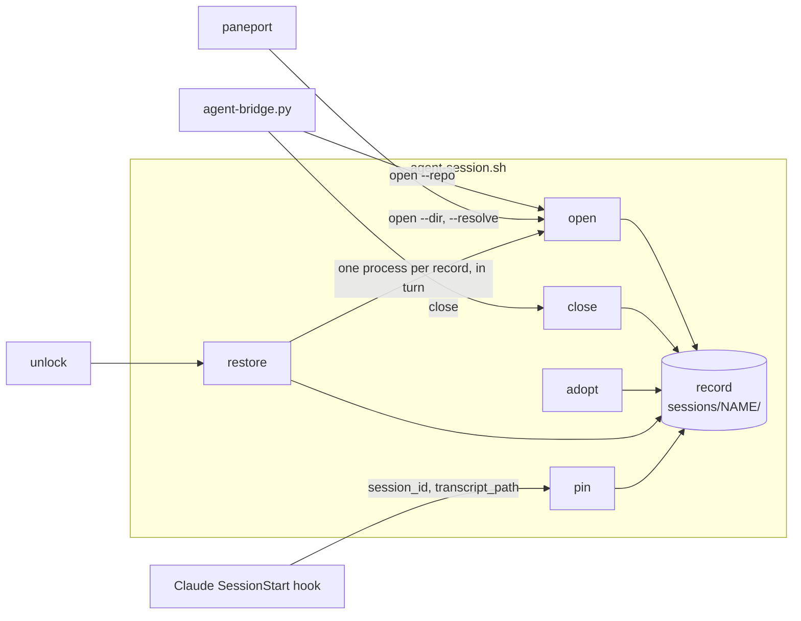

# ags records, restore after a reboot, and starts that never take another session's conversation

Line references point at commit `39439ee`, and the code has not changed since. paneport paths are relative to its repository, `~/Workspace/repos/github/tools/paneport`. This is the first of three docs split out of [0005](0005-ags-restore.md), which stopped after three gate rounds. It covers the hub. The Mac port and iTerm tabs that re-enter their session follow as their own docs. Claude Code facts were checked on the Mac's 2.1.281 on 2026-11-04. The hub runs an older version (2.1.268 per the vault guide), so H2 re-checks each one there before anything is rolled out.

## Summary

- **A record per session.** `open` writes it, including the Claude conversation id the launcher chooses itself. A Claude hook follows `/clear` and an in-app `/resume`. `close` marks it closed. Nothing polls.
- **`ags restore`** rebuilds every open record, each resuming its own conversation. `ags unlock` runs it.
- **Directory lookup gets predictable.** A name with a record uses the record. Otherwise the session starts in the current directory, refusing `/` and the home directory. Repository search becomes the opt-in `--repo`, which Telegram, `new`, `resume` and `ags remote open` always pass.
- **A new name never continues another session's conversation.** It starts fresh unless told `--resume`, and the launcher never types `claude --continue`.
- **Telegram's close goes through the launcher**, so a session closed from the phone is closed the same way, and `/close NAME forget` deletes its record.

**Where to look:**

- **`close` stops losing the conversation** (D5). It marks the record closed, so a later `open` resumes exactly that conversation, which is what `close` already promises in Telegram. This holds for as long as Claude keeps the transcript, 30 days by default (D3).
- **Two defaults change** (D2, D3): the start directory for an unknown name, and starting fresh instead of continuing.
- **paneport must adopt the launcher's `close` and records before it drives production sessions** (D6). Until then its `pp-*` names stay unrecorded.

## Problem

After a reboot every `ags` session is gone, and so is the memory of which ones existed. Each has to be reopened by hand, and each reopened Claude continues "the newest conversation in this directory", which is the wrong one whenever two sessions share a directory. The same flaw shows up without a reboot: `ags open house3` lands in the vault and continues whichever vault conversation is newest, usually the one open in another session. And where a name with no repository starts depends on environment variables that differ between a terminal and the bridge's systemd unit, so the same name can land in different folders.

Better looks like this. A reboot loses nothing but in-flight turns, and one command brings every session back in its own conversation. A new session never touches another session's thread, and starts where it was asked to.

**Non-goals**

- **The Mac and iTerm.** tmux is not installed on the Mac, and its `ags` aliases (`aliases/.tmux-aliases`) run the checkout's launcher, which stops at the tmux check (`:592`) for every verb, `remote` included. So nothing here changes the Mac's behaviour. The Mac doc brings tmux, the pin hook and the state directory together. The launcher code stays portable to bash 3.2 so that doc can reuse it.
- **Background Claude sessions** (`claude --bg`). They are Claude-only and do not respawn after a reboot (the daemon log shows `adopted=0 respawned=0 dead=3`). This works at the tmux layer for any agent.
- **Restoring scrollback, the shell and git windows' state, or a turn in flight.** The conversation is restored, the processes are new.
- **Exact pins for Codex and OpenCode.** They resume by directory as today, and only when D3 says so. Two Codex records in one directory both restore onto its newest Codex conversation. Revisit when a Codex hook can report its rollout id, which the `pin` verb could then accept.
- **Keeping transcripts longer than Claude does.** Claude deletes transcripts after `cleanupPeriodDays` (30 by default, unset on the Mac). A record stopped longer than that reopens fresh and says so (D3). Revisit, by raising `cleanupPeriodDays` on the hub, if `restore.log` shows a `notfound ... missing` line with an age of 30 days or more in any month.
- **Very long directory paths.** Claude shortens a project directory's encoded name past 200 characters with a hash the launcher does not reproduce. A record in such a directory finds no transcript and starts fresh each time. `open` prints a warning when the encoded name exceeds 200 characters. Revisit if that warning is ever printed.
- **Expiring records.** A record stays until `close`, including one whose session ended by `exit`. `restore --dry-run` lists them. Revisit if `restore.log` shows, in any month, more than two names with a `restore` line and a `close` line on the same day.
- **A Close button for stopped sessions in the Telegram panel.** The panel needs record knowledge it does not have, and paneport replaces the panel at its step 9. `/close NAME` covers it, and the launcher's refusals name it.
- **Following `tmux rename-session`.** A session renamed outside the launcher keeps its old record and runs unrecorded. `ags close OLD --forget` and `ags adopt NEW` fix it.

## Glossary

| Term | Meaning |
|---|---|
| **Record** | A directory `sessions/NAME/` under the state directory, one small file per field. A record counts only when it holds `dir` |
| **State directory** | `$AGENT_SESSION_STATE`, else `/srv/services/agents/state` when `/srv/services/agents` exists (the hub), else `${XDG_STATE_HOME:-$HOME/.local/state}/ags` |
| **Open record** | A record without a `closed` file. Restore brings these back |
| **Pin** | The record's `conversation` file, holding the Claude session id the agent pane runs, in lower case |
| **Project directory** | `${CLAUDE_CONFIG_DIR:-$HOME/.claude}/projects/<encoded dir>/`, where Claude keeps a directory's transcripts. The encoding is the one `has_conversation` uses (`:203`) |
| **Usable transcript** | For rule 3's search only: a file `<ID>.jsonl` in the project directory, whose `ID` is a UUID, whose first `entrypoint` value does not start with `sdk-` (an absent key counts as usable), and which holds a `"type":"user"` line |
| **Grouped client** | A tmux session whose `#{session_group}` is set and differs from its own name, such as the `NAME-m` that `attach_grouped` (`agent-session.sh:517`) creates for a second client. Its group name is the session it joined |
| **Locked home** | `AGENT_SESSION_LOCKED=1`, or, when that variable is unset, `ecryptfs-mount-private` is on `PATH` and `mount` shows no ecryptfs on `$HOME`, the test `cmd_unlock` uses (`:578`, `:583`). `AGENT_SESSION_LOCKED=0` means unlocked. The override exists so the tests run on the hub, where the helper is installed |
| **Valid name** | A session name, after the existing sanitising of `.` and `:` to `-` (`:326`), that matches `[A-Za-z0-9_][A-Za-z0-9_-]{0,63}`, the rule paneport already applies. A **recordable name** is a valid name that does not start with `pp-` |

## Technical Plan

How sessions, windows and resuming work today is in [doc/remote-agent-sessions.md](../doc/remote-agent-sessions.md), sections "The launcher" and "Resuming". This changes the launcher, adds a hook that calls it, and moves the bridge's close onto it.



### D1. The record

One directory per session, `sessions/NAME/`, holding one file per field: `dir`, `agent`, `pane`, `conversation`, `closed`, and `conversation.prev`, the last pin replaced. Each file is written to a temporary sibling and renamed, so a reader never sees half a value and two writers touching different fields never race. Nothing reads and rewrites a whole record. `dir` is the physical path (`pwd -P`). `pane` is the agent pane's tmux id (`%12`). The state directory is created mode 0700. Fields are additive, so a launcher that does not know a field ignores its file, and the record carries no version.

**Write order.** A new record writes `agent`, `pane` and `conversation` first and `dir` last, because `dir` is what makes it a record. Reopening a closed record writes its fields, then removes `closed`, so a reader in between sees the old record with some new fields, which only `ls --all` would show.

**Names.** `open` refuses a new session whose name is not valid, and one whose name differs only in case from an existing record's (compared with `tr A-Z a-z`, because the Mac's file system ignores case and the code is meant to be shared). Both refusals happen before anything is created. A running session of any name is still attached, closed and listed as today. Lookups list `sessions/` and compare exact names rather than testing a path. A valid name starting `pp-` is started without a record.

| Writer | Writes |
|---|---|
| `open`, creating a session | After `new-session` succeeds and before anything is typed: `agent`, `pane`, for Claude `conversation`, then `dir`. Removes `closed`. Every refusal happens before this point, so a refused `open` writes nothing |
| `open`, meeting a running Claude session whose record has no pin | The pin, by the process lookup in D5, whether it then attaches or is `--detached` |
| `adopt`, and `close` meeting an unrecorded running session | A record, under the rules in D5 |
| `pin`, from the Claude hook | `conversation`, and `pane` when D4 accepts a new agent pane |
| `close` | creates `closed`, then kills the session |
| `close --forget` | removes the whole record, then kills the session |

Whenever anything overwrites an existing pin, the old id moves to `conversation.prev` and `restore.log` gets a `replaced` line naming both ids, so no conversation id is ever lost, only displaced.

A grouped client is never recorded, and `close` on one kills only that client, as today. A misclassified adopted agent is fixed by `ags close NAME` then `ags open NAME <agent>`, which replaces the agent of a closed record (D2).

A session killed any other way, by a crash, by exiting its windows, or by a reboot, keeps an open record. Only `close` says a session is finished, because a crash and exiting every window look the same from outside.

**An unwritable state directory.** `open` (when creating), `adopt` and `restore` fail with a message naming the directory before touching tmux. `close` warns and still kills, as today. `ls` lists running sessions with a warning. `pin` stays silent. Verbs that never read records are unaffected.

### D2. Where a session starts

These rules apply only when `open` starts a session. A running session is attached as today, whatever agent or `--dir` was given.

| Rule | Label in the printed line |
|---|---|
| 1. `--dir PATH` | `(--dir)` |
| 2. The record for `NAME`, open or closed | `(its record)` |
| 3. `--repo`: today's name search (`repo_for_name`, `:160`) | `(repository)` |
| 3b. `--repo` with no match: the default root (`resolve_root`, `:139`) | `(default root, no repository named NAME)` |
| 4. The current directory, moved up to its git top level when inside a repository. `--dir .` keeps the exact subdirectory | `(current directory)` |

**Refused directories.** Rules 3b and 4 refuse a result of `/`, and rule 4 refuses a result equal to `$HOME` (both checked after moving up to the git top level), each naming `--repo` and `--dir .`. `/` is where a caller with no meaningful directory lands, such as a systemd unit with no `WorkingDirectory`, which is what the bridge is (`agent-bridge.service`), and `resolve_root` ends at `pwd` (`:139`). The home directory is where a terminal lands, and `ags open skp` typed there means the repository, not a session in `~` that its record would keep forever. `--dir .` and `--dir ~` still start there on purpose.

**The agent.** An agent given on the command line is explicit. With none given, a recorded name uses its record's agent, and a new name uses `claude`.

**Disagreements.** An explicit agent or a `--dir` (compared by physical path) that differs from the record:

- On an **open** record is refused, naming the record's values and the way out: "close it first (`ags close NAME`, or `/close NAME` in Telegram), or use another name".
- On a **closed** record replaces that field, and the session starts fresh in the resulting directory, before any other D3 rule, `--resume` included. So "`/close X`, then `/open X codex`", which the bridge already suggests (`agent-bridge.py:1956`), opens Codex in X's directory with a blank conversation.

`--fresh` changes only the conversation, never the directory. A record whose directory no longer exists is refused, naming `--dir` (which replaces it on a closed record) and `close --forget`. From the phone, `/close X forget` then `/open X` starts again by name search.

**A locked home.** On a locked home `open` refuses a recorded name with "the home is locked, run `ags unlock` first", and refuses any agent but `shell` for a new name. A new `shell` session starts in `--dir` when given (refused when missing, as rule 1), otherwise in the default root (`resolve_root`, whose fallbacks include the plaintext vault), labelled `(home locked)`. It gets no record and carries the tmux session option `@ags-unrecorded 1`, which `adopt` and `close` honour by never recording it, so a session started before the mount never becomes permanent, even after the unlock. `adopt` refuses while the home is locked. All of this happens before any write.

**Who passes `--repo`.** The bridge on `open`, `cmd_start` itself for `new` and `resume` (`:430`, so `new` stays `open --fresh --detached --repo` and the bridge never passes `--repo` to `new` or `resume`), and `cmd_remote` when the forwarded verb is `open`. A phone has no current directory and a remote command lands in the hub's home, so name search is the only meaning `/open skp` or `agsrv` can have. paneport always passes `--dir` and `--agent` (`src/paneport/core/sessions.py`, `start`), so rule 1 decides its sessions.

**`--resolve`**, which paneport calls, keeps today's contract (`start_dir`, `:267`, and `test_resolve_prints_the_directory_without_tmux`): `--dir` first, then the record's `dir`, then the repository, then the default root, exiting 1 with nothing printed when the result does not exist or is `/`. It does not check the lock, as today.

The printed line names the rule and the conversation, with the full path as today: `Started house3 with claude in /home/black/Workspace/github/black-vault (current directory), fresh conversation.` A `shell` session's line names no conversation, and Codex's says `continuing its last conversation` or `fresh conversation`. The announcement keeps today's wording, with the same conversation phrase.

### D3. Which conversation a session starts with

For a new Claude conversation the launcher chooses the id itself, as `uuidgen | tr A-F a-f`, falling back to `/proc/sys/kernel/random/uuid`. It writes the id as the pin, then types `claude --session-id ID --name NAME`. A resumed one is typed `claude --resume ID`, with no `--name`. Both flags exist on 2.1.281, and H2 confirms them on the hub before rollout. So the pin never depends on the hook for a session the launcher starts, and the name shows in Claude's `/resume` picker. Valid names need no shell quoting.

The first rule that matches decides:

| # | When | Claude | Printed |
|---|---|---|---|
| 1 | `--fresh`, or a field of a closed record replaced (D2) | new id | fresh conversation |
| 2 | A pin whose `<PIN>.jsonl` exists in the project directory and holds a `"type":"user"` line | `claude --resume PIN` | resuming its conversation |
| 3 | `--resume`, a record with no `conversation` file, or a `pp-*` name | the newest usable transcript in the directory that no record pins, open or closed, is written as the pin (when there is a record), then `claude --resume ID`. With none, a new id | continuing its last conversation, or fresh conversation (nothing to resume) |
| 4 | Anything else: a new recordable name, or a pin rule 2 rejected | new id | fresh conversation |

**A pin rule 2 rejects is reported** before rules 3 and 4 apply. The line printed before the start line says `pinned conversation ID not found` when the file is absent, or `pinned conversation ID was never used` when it holds no user line. `restore.log` gets `notfound NAME ID missing|empty AGE`, where AGE is the pin file's age in days. A never-used session (no transcript at all, or one with no user line, as 3 of the Mac's 1,767 have) reports `empty` or a young `missing`, and a transcript Claude deleted reports an old `missing`, which is what the retention trigger in Non-goals counts. The rejected id moves to `conversation.prev` when rule 3 or 4 writes the new one, as D1 says, so `claude --resume` with it still works by hand if the guess was wrong. A new id also avoids depending on whether `--session-id` accepts an id whose file already exists, which was not checked.

Rule 2 trusts the pin and does not apply rule 3's interactive filter, since the pin was written by the launcher or by an accepted hook run. Rule 3's filter is there to keep the search from picking a one-shot run. Checked on 2.1.281 in a scratch directory: the first `entrypoint` in a `claude -p` transcript is `"sdk-cli"`, and in an interactive one `"cli"`. Among the newest 400 transcripts on the Mac, 24 were `cli` and 376 `sdk-cli`, so without the filter rule 3 would usually pick a one-shot run. A missing key counts as usable, so a renamed key degrades to today's behaviour. H2 checks the values on the hub. Rule 3 walks `*.jsonl` files only, newest first by modification time, reads each with `grep -m1` for its first `entrypoint`, and stops at the first usable one, which skips the per-session subdirectories and `memory/` that share the project directory. Ids are compared in lower case.

**Codex and OpenCode** keep today's commands. `--resume` types `codex resume --last` or `opencode --continue` as today (`test_agent_session.py:72`), except after a replaced field, where rule 1 wins. Without it, a Codex record continues when `has_conversation` finds a conversation in the directory, and a Codex or OpenCode new recordable name starts blank. OpenCode has no case in `has_conversation`, so a recorded OpenCode session reopens blank unless told `--resume`, as today. A `pp-*` session of any agent keeps today's default of continuing when `has_conversation` finds a conversation, through rule 3 for Claude.

**Two records in one directory.** Rule 3 writes its choice as the pin before typing anything, so a second record meeting rule 3 skips that transcript. `restore` starts records one after another, so it never races itself. Two people opening two unpinned records in one directory in the same second can still pick the same conversation, which `/resume` in one of them fixes. An unpinned record exists only when the process lookup failed at adoption.

**A clean environment for the agent.** Claude keeps an inherited `CLAUDE_CODE_ENTRYPOINT` instead of setting its own (the 2.1.281 binary returns early when it is set), and a tmux server inherits the environment of whatever starts it. A server first started from inside a Claude tool run would then mark every pane's Claude as `sdk-cli`, which D4 refuses to pin. So the launcher removes the per-process variables Claude sets for its children, as the scratch hook in D4 saw them: `CLAUDECODE`, `CLAUDE_PID`, `CLAUDE_CODE_ENTRYPOINT`, `CLAUDE_CODE_SESSION_ID`, `CLAUDE_CODE_CHILD_SESSION`, `CLAUDE_CODE_SESSION_ATTENDED`, `CLAUDE_PROJECT_DIR`, `CLAUDE_ENV_FILE`, `CLAUDE_CODE_EXECPATH`, `CLAUDE_CODE_MESSAGING_SOCKET` and `CLAUDE_CODE_MESSAGING_TOKEN`. `tmux_with_conf` adds them to the `-u` list it already builds for `AGENT_BRIDGE_QUIET` and `PANEPORT_*` (`:113`), and `cmd_open` runs `set-environment -g -u` for each before `new-session`, ignoring errors, so a server started dirty is cleaned. Configuration such as `CLAUDE_CODE_USE_VERTEX` is kept.

Rule 4 for a new name is the changed default. Today a new name continues whenever its directory has any conversation (`:355`). Now only a record, an explicit `--resume` or a `pp-*` name continues, and the launcher never types `claude --continue`. The cost is one blank start for each session that existed before this change and was not adopted. `--resume` covers it.

### D4. The pin hook

A Claude Code `SessionStart` hook runs `agent-session.sh pin`, which follows a conversation the launcher did not start: `/clear`, an in-app `/resume`, or `claude` typed by hand in the agent pane. Checked on 2.1.281 with a scratch hook: the payload arrives on stdin as one JSON line carrying `session_id`, `transcript_path`, `cwd`, `hook_event_name` and `source`. The hook's environment carries `CLAUDE_PID`, the pid of the Claude process that fired it, and `CLAUDE_CODE_ENTRYPOINT`, which was `sdk-cli` under `claude -p`. `/clear` starts a new id with source `clear`, and an in-app `/resume` fires with source `resume`, per the Claude Code documentation. H2 runs both on the hub.

`pin` does nothing and exits 0 unless every condition holds:

- `$TMUX_PANE` is set. Its session, or the group a grouped client belongs to, has an open record whose `agent` is `claude`.
- `$TMUX_PANE` equals the record's `pane`. When the recorded pane is empty, no longer exists, or now belongs to another session (pane ids restart after a reboot), and `$TMUX_PANE` is in this session's window named `agent`, it is accepted and written as the new `pane`.
- `CLAUDE_PID` is set and its parent (`ps -o ppid= -p`) is the pane's shell, `#{pane_pid}`. A Claude started by a tool inside the agent's own Claude has that Claude, or a shell under it, as its parent.
- `CLAUDE_CODE_ENTRYPOINT` does not start with `sdk-`, so a `claude -p` typed into the agent pane does not move the pin. The launcher's clean environment (D3) keeps an inherited value from reaching the agent.
- `transcript_path` is `<session_id>.jsonl` in the record directory's project directory. That is where rule 2 looks, so a transcript filed anywhere else would be lost at the next open anyway. This replaces comparing `cwd`, because the agent's working directory moves during a session while its transcripts stay under the launch directory.
- `session_id` is a 36-character UUID in either case. It is stored lowered.
- No other record pins that id. So an in-app `/resume` of another session's conversation leaves this record on its old pin rather than letting two records restore onto one transcript.

It extracts the fields with `sed`, so it needs neither `jq` nor Python. **It prints nothing on stdout**, because a `SessionStart` hook's stdout is added to the conversation's context. It never calls the bridge. The dispatch handles `pin` before the launcher's top-level `tmux` check (`:592`), so a Claude started where tmux is missing never sees a hook error. The top-level code above that check, the `PATH` prepend (`:81`) and `TMUX_CONF="$(resolve_config)"` (`:107`), only reads and stays where it is.

The hook entry, in the form the baseline hooks already use, with the checkout's absolute path written in by the script (shown here for `~/.dotfiles`):

```json
{"hooks": [{"type": "command", "command": "[ -x \"/home/black/.dotfiles/scripts/agent-session.sh\" ] && \"/home/black/.dotfiles/scripts/agent-session.sh\" pin || true"}]}
```

The guard keeps a removed checkout from turning into an error on every Claude start. `51-agent-sessions.sh` writes `$DOTFILES_PATH/scripts/agent-session.sh`, the checkout it runs from, so a checkout outside `~/.dotfiles` still pins.

The script adds the entry to `hooks.SessionStart` in `~/.claude/settings.json` when no entry's command contains `agent-session.sh" pin`, with a short `python3` edit that writes a temporary file and renames it, after a one-time backup to `settings.json.pre-ags`. A missing file or missing keys are created. The add-only seeder (`02-seed-runtime-configs.sh`) never extends an existing list, which is why it cannot do this, and it also means a later baseline `SessionStart` entry never reaches the hub on its own, as for any list today. The baseline `config/claude/settings.json` stays untouched. Claude reads hooks when it starts, so Claude processes already running at rollout do not follow `/clear` until restarted (Rollout).

Codex and OpenCode get no pin (Non-goals).

### D5. `close`, `ls`, `adopt`, `restore`, `unlock` and the bridge

- **`close NAME [--forget]`**, with `--forget` accepted before or after the name. The name is sanitised as `open` does. On a running session with a recordable name, no record and no `@ags-unrecorded`, on an unlocked home, it adopts first. When adoption is skipped it prints adopt's reason and kills without a record. Then, in this order: it creates `closed` (or, with `--forget`, removes the record), appends a `close` line to `restore.log`, announces, kills the session's grouped clients, and kills the session last. Everything that must happen comes before the last kill, because `close` run inside its own session dies with it, and killing the clients means no copy of the agent survives in `NAME-m` to run beside the next `open`. On a grouped client it kills only that client. A stopped record can be closed too, and announces the same way. A name with neither a session nor a record fails with `No session or record named NAME.` After `--forget` the announcement says `/open NAME` starts it again by name.
- **The process lookup** finds the pin of a running Claude: each child of the agent pane's `#{pane_pid}` (`pgrep -P`) is checked for `${CLAUDE_CONFIG_DIR:-$HOME/.claude}/sessions/<pid>.json`, and its `sessionId` is read with `sed`. That file is internal to Claude Code, so a miss, or an id another record already pins, leaves the record unpinned.
- **`ls [--all]`** prints running sessions as today, then a row for each open record with no running session, sorted by name: RUNNING `stopped`, ATTACHMENT and WINDOWS `-`, DIRECTORY from the record. It prints these rows even when no tmux server is running, which is the usual state after a reboot. `--all` adds closed records with RUNNING `closed`. With nothing to show it prints `No sessions.` as today. Any other argument is an error with the usage.
- **`adopt [NAME [AGENT]]`** writes records for running sessions. A candidate has a recordable name that clashes with no record by case, no record, no `@ags-unrecorded`, is not a grouped client, and has a window named `agent`, which every session the launcher starts has. That leaves out the tmux default numbered sessions and helpers such as `hindsight-backend` (`scripts/opencode-session.sh:122`). The agent comes from `AGENT` when given, else from that window's `#{pane_current_command}`: `codex`, `opencode`, a shell meaning `shell`, and `claude` or a bare version number such as `2.1.268` (native installs name their process after the version) meaning `claude`. Any other command is skipped, naming `ags adopt NAME AGENT`. `dir` is `#{session_path}` resolved with `pwd -P`, `pane` the agent window's, and for Claude the pin comes from the process lookup. It prints one line per session: `adopted NAME (AGENT in DIR)`, plus `, no pin: reopens the directory's newest unpinned conversation` when the lookup found nothing usable, and for `shell` `, if an agent exited here, close it with --forget and adopt it again with its agent`. A skipped session prints `skipped NAME: REASON` (grouped client of X, no agent window, name not recordable, name clashes with Y, unknown command C, already recorded, not running, started while locked). With no name it considers every running session. It exits 1 when a named session was not adopted, and refuses on a locked home.
- **`restore [--dry-run]`** runs `"$0" open NAME --detached` as a separate process for each open record with no running session, sorted by name, one after another with `AGENT_SESSION_RESTORE_GAP` seconds (default 5) between starts, so a 2015 laptop is not asked to boot every agent at once. A refused record cannot stop the loop, and each start sees the current `PATH`. It prints each line and ends with `Restored N, failed M.`, exiting 1 when any failed. An interrupted restore is finished by running it again. `--dry-run` lists the names and starts nothing.
- **`restore.log`** in the state directory gets one line per event, `<ISO date and time> <event> NAME [fields]`: `restore NAME` for each start that succeeded, `close NAME`, `notfound NAME ID missing|empty AGE` (D3) and `replaced NAME OLD NEW` (D1). `--dry-run` writes nothing. It is the history of conversation ids, feeds the revisit triggers in Non-goals, and is never read by code. It grows by a few lines a day and is not rotated.
- **`unlock`** runs `"$0" restore` after `ecryptfs-mount-private` succeeds, and also when the home was already unlocked, since `restore` starts only open records that are not running. The usage says so. It exits with `restore`'s status once the home is mounted. A home unlocked at the desktop login runs nothing by itself, and `ags restore` covers it.
- **The bridge's close.** `/close [NAME] [forget]` and `/kill` take an optional `forget`. It is the flag when it follows a name, or when it is the only argument inside a session's topic. In General, `/close forget` names a session called `forget`. A new `close_session(session, forget=False)` method runs the launcher's `close`, adding `--forget`, with `AGENT_BRIDGE_QUIET=1`, and replaces `self.tmux.kill` in `/close`, `/kill` (`agent-bridge.py:2017`) and the panel's `kill-confirm` (`:1409`). It drops the `tmux.exists` check in all three, so a stopped record can be closed from the phone, including from a stale confirm. It posts today's reply, or after `forget` `Closed NAME and forgot its record. /open NAME starts it again by name.`, or `could not close NAME: ` and the launcher's error. `/close`'s usage text (`:2020`) gains `[forget]`.
- **The bridge's open.** `/open`, `/new` and `/resume` pass an agent only when one was named. `/open` adds `--repo`. A launcher refusal comes back through `launch`'s existing `could not start NAME: ...` path (`:1745`) and is posted as today. The running-session reply of `/new` and `/resume` (`:2006` to `:2010`) names `AGENT` as a placeholder when no agent was given. The panel's `open-run`, `new-run` and `resume-run` (`:1403` to `:1407`) keep passing the agent picked by button, so a pick matching the record works, a different pick on an open stopped record is refused with the `/close` hint, and on a closed record it replaces the agent with a fresh start, which the posted start line says.
- **Seeing stopped sessions from the phone.** The panel's home page already lists every session with a topic (`agent-bridge.py:1308`), and topics outlive sessions, so after a reboot the stopped ones are there. `/ls` keeps reading tmux, and its empty reply points at `ags unlock` and `ags restore`.

### D6. The hub, and paneport

`51-agent-sessions.sh` creates `/srv/services/agents/state` mode 0700 and adds the pin hook (D4). It runs only from an unlocked home, since it needs the checkout. The hub user `black` owns `/srv/services/agents`, runs the terminal sessions and runs the bridge (`User=black` in `agent-bridge.service`), so one account reads and writes every record. Records live outside the encrypted home, so a bridge `/open` before the unlock reads them and refuses as D2 says. They hold directory paths, agent names, pane ids and conversation ids, never conversation content, so plaintext under `/srv` exposes which projects have sessions and nothing more.

The hook runs the checkout's copy and the bridge runs the staged copy under `/srv`. The script stages the launcher in the same run that adds the hook, and fields are additive (D1), so a brief skew between the two copies reads correctly.

**paneport.** Its beside-run sessions are named `pp-*` by its own design (`design/0001-architecture.md:556`), not by its code, which accepts any valid name. That is why `pp-*` is the one valid prefix never recorded. Its `close` kills tmux sessions directly (`src/paneport/core/sessions.py`, `close`), and it always passes `--agent`. Both are harmless for unrecorded names. Its design's step 9 moves production to paneport, at which point it replaces the bridge's phone path. So **before paneport's step 9** it must match what D5 gives the bridge. That means `close` through the launcher, with `--forget` and also for stopped records, `--agent` only when the user named one, launcher refusals shown to the user, and stopped rows from `ls`. That requirement is written as an issue draft in paneport (step 13 below).

Checks, results recorded in the vault guide:

- **H1, before rollout.** `open vault --resolve` gives the same directory from a login shell and from the bridge's environment, run from `/` as `bash -c 'set -a; . /srv/services/agents/bridge.env; set +a; /srv/services/agents/bin/agent-session open vault --resolve'`. It needs only today's launcher. If they differ, `AGENT_SESSION_ROOT` set to the login shell's answer goes into `bridge.env` and `os/linux/srv/agents/bridge.env.sample`.
- **H2, before rollout.** `claude --help` on the hub lists `--session-id` and `--name`. If either is missing, Claude on the hub is updated first. A scratch hook as in D4, run once in a scratch tmux pane interactively and once under `claude -p`, shows `transcript_path`, `TMUX_PANE`, `CLAUDE_PID` whose parent is the pane's shell, and `CLAUDE_CODE_ENTRYPOINT` (`cli` and `sdk-cli`), and each transcript's first `entrypoint` matches. If any is absent, D3 and D4 are revised before rollout.
- **H2, after rollout.** `~/.claude/settings.json` holds exactly one pin entry. In a session opened with `ags open`: `/clear` rewrites `conversation` within seconds. An in-app `/resume` of an older conversation of the same directory rewrites it. Asking the agent to run `claude -p 'say ok'` through its shell tool leaves it unchanged. Asking the agent to `cd` into a subdirectory and then `/clear` either rewrites it or, if Claude files that transcript under the subdirectory, is recorded as a known limit. `time ags open X --resume --detached` for an unpinned record in the vault takes under 5 seconds. A day later, after the session has been used, `conversation` still names the transcript it is writing.
- **H3.** After `ags adopt` and the restarts below, each adopted Claude session's `conversation` equals the `sessionId` in `~/.claude/sessions/<pid>.json` for its pane's Claude, or the session appears in adopt's no-pin lines.

## Alternatives

| Question | Chosen | Rejected, and why |
|---|---|---|
| What triggers saving | Events: `open`, `close`, the hook | **A periodic snapshot** (a timer running `tmux list-sessions` or `claude agents --json`). Measured at 0.17 s and 2.6 KB a run, so cost was not the issue. A snapshot records whatever happened to be running, including sessions stopped on purpose, and misses the last minute. Revisit if sessions start being created by tools that never call the launcher |
| | | **tmux-resurrect and tmux-continuum.** They snapshot every pane on a timer and restore pane commands by process name, so `claude` comes back with no conversation id. Revisit if the shell and git windows' layouts become worth keeping |
| Which conversation to resume | An id the launcher chooses, followed by the hook | **The hook alone.** Every start would depend on the hook having fired, and a session opened and never used would have nothing to resume by id |
| | | **`claude --continue` per directory.** Wrong whenever two sessions share a directory, which is the common case in the vault |
| | | **`~/.claude/sessions/<pid>.json` as the main source.** Undocumented, and it exists only while the process lives, so it cannot be read after a crash. Used only by adoption and attach, as a best effort. Revisit if Claude Code documents it |
| A pin whose transcript is gone | A new id, the old one kept in `conversation.prev`, printed and logged | **`--session-id PIN` again.** Keeps the id, but whether Claude accepts an id whose file already exists is unchecked |
| | | **Search every project directory for the pin.** Whether `claude --resume ID` finds a transcript filed under another directory is unchecked, and the pin hook already refuses to pin one |
| | | **Fall through to rule 3's search.** That is the newest-conversation guess this doc removes, applied without being asked |
| Which hook runs may pin | The recorded pane's own `claude`, by `CLAUDE_PID`'s parent, an interactive entrypoint and the transcript's location | **A parent-distance limit.** A guessed constant, wrong for a tool that runs `claude -p` through one shell fewer |
| | | **The payload's `cwd` equal to the record directory.** The agent's working directory moves during a session, so a `/clear` after a `cd` would be dropped |
| Record format | A directory of one-value files | **One JSON or key=value file per session.** Every update becomes read, modify, write, which races between the hook and `open` and needs a lock. macOS has no `flock`, and bash 3.2 has no JSON parser |
| | | **One state file for all sessions.** The same race, widened to every session |
| Recognising a grouped client | `#{session_group}` differs from the session name | **The `-m` suffix**, as the bridge's `/ls` does. A real session named `team-m` would never be recorded |
| What ends a session for good | `close` only | **Exiting every window also counts.** A crash looks the same from outside, and a crash is exactly what restore is for |
| | | **Claude's `SessionEnd` reason**, which tells a typed exit from a kill. A reboot kills Claude like a crash, it covers Claude only, and leaving Claude while keeping the shell is not ending the session |
| What `close` does | Marks the record closed | **Delete the record.** Then `open` after `close` starts blank, contradicting the bridge's "`/open NAME` picks the conversation up again", and the pin is lost. `--forget` deletes for whoever wants that |
| Start directory without a record | Current directory, git top level, `--repo` opt-in, refusing `/` and `$HOME` | **Name search first, as today.** Surprising matches (`skills` finding `skills-registry`), and a miss falls to an environment-dependent root |
| | | **Current directory, `$HOME` allowed.** `ags open skp` typed in a fresh terminal would record `~` as skp's directory, and the phone and every restore would follow it there |
| | | **Strip a trailing number** (`house3` uses `house`'s directory). The current-directory rule gives the same result when typed from that directory, with one rule less |
| What `--fresh` does to a closed record | Only the conversation | **Also re-resolve the directory.** One flag would behave two ways depending on record state, and `--dir` or `forget` already escape a wrong directory |
| A new name and existing conversations | Blank unless `--resume` | **Continue unless pinned elsewhere.** Still continues conversations from sessions without a record, including plain `claude` runs, which is the hijack this fixes |
| Sessions after a reboot | `ags restore` by hand, and from `unlock` | **A boot-time unit that restores.** The agents and their configuration live in the encrypted home, which is locked until someone unlocks it, so a boot unit could only start shells |

## Detailed Implementation

In work order. Each step keeps `python3 -m unittest scripts/test_agent_session.py scripts/test_agent_bridge.py` green. New launcher code avoids bash 4 features, so the Mac doc can reuse it.

1. **`scripts/agent-session.sh`, the record (D1).** Add `state_dir`, `record_get`, `record_set` (temp file and `mv`), `record_has` (exact name, requires `dir`), `record_open`, `set_pin` (moving the old pin to `conversation.prev` and logging `replaced`), `valid_name`, `name_clashes`, `group_of SESSION`, `home_locked` (with the `AGENT_SESSION_LOCKED` override), `project_dir DIR`, `log_event`, `claude_pid_conversation PANE` and `adopt_session NAME [AGENT]`. Add the Claude variables of D3 to `tmux_with_conf`'s scrub list.
2. **`scripts/agent-session.sh`, start directory and agent (D2).** Add `--repo` to `cmd_open`'s parser and track whether the agent was explicit. On a running session, attach as today before any of the following, running the process lookup when the record has no pin. Validate the name, then replace the `start_dir` default with the D2 rules and labels, with the `/` and `$HOME` refusals. Keep `--resolve` on its contract, adding the record between `--dir` and the repository. Apply the disagreement rules, the missing-directory refusal and the locked-home rule (setting `@ags-unrecorded`), all before any write. `cmd_start` passes `--repo`, and `--agent` only when one was given. `cmd_remote` adds `--repo` when the forwarded verb is `open`. Rewrite the usage paragraphs "Starting a session continues…" (`:28`), the `--fresh`, `--resume` and `--resolve` option lines, the `new` line, and "Where a session starts" (`:40`), and add `--repo`, `close --forget`, `ls --all`, `adopt`, `restore` and what `unlock` now runs. `AGENT_SESSION_STATE`, `AGENT_SESSION_LOCKED` and `AGENT_SESSION_RESTORE_GAP` go beside the other environment variables the usage names.
3. **`scripts/agent-session.sh`, conversation (D3).** Replace the `has_conversation` call at `:355` with the D3 rules in order, keeping `has_conversation` for Codex and for `pp-*`. Add `new_conversation_id`, `pin_alive DIR ID` (rule 2), `newest_unpinned_transcript DIR` (rule 3) and the rejected-pin report. Replace `agent_command`'s Claude case so it never prints `--continue`, giving it `--session-id ID --name NAME` and `--resume ID`. Before `new-session`, unset the D3 variables in the server's global environment. Warn when the encoded directory name exceeds 200 characters.
4. **`scripts/agent-session.sh`, creating a session.** Run `new-session` with `-P -F '#{pane_id}'` added after today's arguments, write the record, then create the shell and git windows and type the command. An empty pane id (as the fake tmux gives) writes an empty `pane`, which D4 accepts replacing. When `new-session` fails and the session now exists, attach and write nothing, otherwise report the error. Print the start line before attaching as well as when detached.
5. **`scripts/agent-session.sh`, `pin` (D4).** Dispatched before the top-level tmux check. Read stdin, extract and validate `session_id` and `transcript_path`, resolve the record through the group, check its agent, the pane (accepting a new agent pane), `CLAUDE_PID`'s parent, the entrypoint, the transcript's location and uniqueness, then write `conversation` lowered through `set_pin`. Silent, exit 0 on every path. Leave it out of the usage, which documents user verbs.
6. **`scripts/agent-session.sh`, `close`, `ls`, `adopt`, `restore`, `unlock` (D5).** `cmd_close` in D5's order. `cmd_ls` receives `"$@"` from the dispatch. New `cmd_adopt` and `cmd_restore`. `cmd_unlock` runs `"$0" restore` in both of its exits and returns its status. The dispatch gains `adopt`, `restore` and `pin`.
7. **`scripts/test_agent_session.py`.** A shared helper builds each case's environment on top of what the existing cases set today, `TMUX_TMPDIR`, `AGENT_BRIDGE_BIN` and `AGENT_BRIDGE_ENV` pointing into the case's temp directory (`:35`, `:106`, `:153`, `:216`), and refuses to run a case without `TMUX_TMPDIR`, so a run on the hub never reaches the live tmux server or the real bridge. It adds `AGENT_SESSION_STATE`, `HOME`, `XDG_STATE_HOME`, `CODEX_HOME`, `AGENT_SESSION_REPOS` and `AGENT_SESSION_ROOT` inside the temp directory, `AGENT_SESSION_LOCKED=0` and `AGENT_SESSION_RESTORE_GAP=0`, removes `TMUX`, `TMUX_PANE`, `SSH_CONNECTION`, `CLAUDE_CONFIG_DIR`, `AGENT_BRIDGE_QUIET`, `PANEPORT_*` and the D3 Claude variables, and runs from a temp git repository. Fixture transcripts carry `"entrypoint":"cli"` and a user line unless a case says otherwise. The fake `claude` writes none, so a case that expects a resume creates `<pin>.jsonl` itself. `pin` cases send `C-c` to the agent pane of a real test tmux server to stop the fake `claude`, then run `sh -c 'CLAUDE_PID=$$ ... agent-session.sh pin < payload'` there by `send-keys`, so the pid's parent is the pane's shell, and a nested `sh -c` for the wrong-parent case. Grouped clients are created directly with `new-session -d -t NAME -s NAME-m`. Existing cases that change:
   - `test_open_finds_the_repository_and_continues_by_default` (`:87`) passes `--repo`, and expects a blank first start and, after its `close` and a fabricated transcript, `--resume` of the pinned id on the next open.
   - The shared lifecycle case keeps `resume fixture codex` typing `codex resume --last` (`:72`), and its `new fixture` now searches with `--repo`.
   - The paneport case (`:227`) still finds `new-session -d -s paneport`, since `-P -F` goes after.
   - `test_resolve_prints_the_directory_without_tmux` (`:187`) passes unchanged.

   New cases:
   - Opening writes `dir`, `agent`, `pane` and a lower-case UUID pin, and types `--session-id PIN --name NAME`. The pin is on disk before the fake `claude` starts. No case ever sees `--continue` typed for Claude.
   - A new name starts blank although a usable transcript exists, and `--resume` resumes it by id.
   - A pin with a user line resumes it, including an `sdk-cli` one and one with no `entrypoint` key. A missing pin and a message-less one each get a new id, print their line, log `notfound` with the right reason, move the old id to `conversation.prev` and log `replaced`, also under `--resume`, which then searches. An unpinned record resumes the newest usable transcript, skipping a newer `sdk-cli` one, a subdirectory and one another record pins.
   - Two unpinned records in one directory, reopened one after the other, type different commands, and the second starts fresh when only one usable transcript exists.
   - A `pp-` name writes no record and continues the newest usable transcript. `a b`, `a+b`, `-x` and `Vault` beside a `vault` record are refused and write nothing.
   - A recorded Codex session reopens as Codex with no agent given. An explicit other agent is refused on an open stopped record, replaces a closed one in the same directory with a fresh start even with `--resume`, logging `replaced`, and is ignored for a running session, which is attached.
   - The current directory, moved to its git top level, `--dir .` keeping the subdirectory, and `/` and `$HOME` refused. A disagreeing `--dir` on an open record is refused. `--fresh` on a closed record keeps its directory.
   - `--repo` with a hit, and a miss falling back to the root with its label. `--resolve` prints a record's directory, prefers `--dir`, and exits 1 for a record whose directory is gone.
   - With `AGENT_SESSION_LOCKED=1`: a recorded name and a new `claude` session are refused, a new `shell` one starts labelled `(home locked)` with `@ags-unrecorded`, `adopt` refuses, and nothing is written. After switching to `AGENT_SESSION_LOCKED=0`, `adopt` and `close` still write no record for it.
   - A server started with `CLAUDE_CODE_ENTRYPOINT=sdk-cli` in its environment gives a new agent pane an environment without it.
   - `pin` writes `conversation` lowered and prints nothing. It writes nothing with the wrong parent, from another pane, with `CLAUDE_CODE_ENTRYPOINT=sdk-cli`, with a transcript path in another project directory, with an id another record pins, for a `shell` record, or from a pane whose session has no record. From a grouped client's pane it pins into the group's record. With the recorded pane killed, or its id set to a pane of another session, and a new agent pane, it pins and rewrites `pane`.
   - `close` on a grouped client kills only the client and writes nothing. `close` on the original kills the client too.
   - `close` marks closed and logs before killing, also when run from inside the session, and a later `open` resumes. `--forget` deletes, before or after the name. Closing an unrecorded running session adopts it first, and one adopt skips is killed with its reason. Closing a stopped record works. Closing an unknown name fails with its message.
   - `ls` shows a stopped record with no server running, `ls --all` a closed one, an empty state prints `No sessions.`, and an unknown argument is an error.
   - `adopt` records a launcher-made session, skips a grouped client, a session with no `agent` window, an unknown command, a case clash and an unrecordable name with their lines, accepts `adopt NAME codex`, treats a version-number command as Claude, prints the no-pin line when the fake pid file is absent, and exits 1 for a named session it skipped.
   - `restore --dry-run` starts nothing and logs nothing. `restore` over one refused record and one good one starts the good one, reports `Restored 1, failed 1.`, logs one `restore` line and exits 1.
   - A fake tmux whose `new-session` fails while `has-session` then succeeds attaches and writes no record.
8. **`scripts/agent-bridge.py` and `scripts/test_agent_bridge.py`.**
   - `launch` takes `agent: str | None` and accepts `None` in its agent check. The argv becomes `[launcher, "open", session, "--repo", "--detached"]`, `[launcher, "new", session]` and `[launcher, "resume", session]`, with the agent after the session only when named. Its fallback messages name the agent only when one was given. `/open` passes `agents[0]` only when given (`:1961`), and `/new` and `/resume` likewise (`:1996`), with their running-session reply (`:2006`) as D5 says.
   - The `close_session` method and the `forget` parsing, used by `/close`, `/kill` (`:2017`) and `kill-confirm` (`:1409`) as D5 says, and `/close`'s usage text (`:2020`).
   - Texts that promise continuing by directory now say a session resumes its own conversation and a new name starts fresh: the guide (`:199` to `:210`, including "TOPICS OUTLIVE SESSIONS"), the panel's `resume-agent` and `open-agent` texts (`:1323`, `:1324`), the `launch` docstring (`:1725`), the comment at `:1937`, `:1800` and the `/open` help (`:2064`), which also gains `/close NAME forget`. The empty `/ls` reply (`:1907`) says sessions stopped by a reboot come back with `ags unlock`, or `ags restore` once the home is unlocked.
   - Tests: the argv at `test_agent_bridge.py:351` becomes the new shape. `test_open_stopped_session_continues_unless_fresh` (`:364`) expects `launch('skp', None, mode='open')` for `/open skp` and `None` for `skp --fresh`, and keeps the explicit-agent cases. `test_launch_uses_selected_agent_and_resume_mode` (`:588`) is unchanged, since the panel keeps its picked agent. The panel close test (`:546`) asserts the launcher's `close` argv instead of `tmux.kill`. New cases cover `/close` on a stopped session, `/close NAME forget` and its reply, `/close forget` inside a topic, `/close forget` in General naming a session `forget`, `/new skp` on a running session naming `AGENT`, and a launcher refusal posted as `could not start`.
9. **`restoration_scripts/51-agent-sessions.sh`.** Create `$AGENT_ROOT/state` mode 0700. Add `ensure_claude_pin_hook` (D4), writing `$DOTFILES_PATH`'s launcher path.
10. **`os/linux/srv/agents/bridge.env.sample`.** Gains `AGENT_SESSION_ROOT` only if H1 shows the two environments differ.
11. **`doc/remote-agent-sessions.md`.** In "The launcher": the record and where it lives, `--repo` and the start-directory order, `--resolve` with the record, `adopt`, `restore` and `close --forget`. In "Resuming": the conversation rules, the pin hook, the clean environment and the retention limit. In the Telegram command list: `/close NAME forget` and what `/open` does now. A reboot procedure section. In "Verification" (`:628`), the scratch session is closed with `kill scratch --forget` so it leaves no record. The layer table's managed files gain the state directory and the hook.
12. **`CLAUDE.md`.** The agent sessions block gains `ags restore`, `ags adopt`, `--repo` and `close --forget`. `aliases/.tmux-aliases` is unchanged, since `agsrv` gains `--repo` through `cmd_remote`.
13. **paneport, issue draft.** A new `design/issues/launcher-records.md` in the paneport repository states D6's requirement before step 9, pointing at this doc. It is not posted from this Mac.
14. **Vault, separate repository.** `02 - Personal/06 - Tech/03 - Guides/Remote Agent Sessions.md` gets the reboot procedure and the H1, H2 and H3 results. It travels in the vault bundle, since this Mac never pushes the personal repositories.

## Rollout

Nothing switches on by itself. In order:

1. **H1 and the first half of H2 on the hub**, with today's launcher. A missing flag or variable stops the rollout here.
2. **The bundle reaches the hub.** Run `51-agent-sessions.sh` (which re-stages the launcher and adds the hook), then `sudo systemctl restart agent-bridge` straight after. In between, the old bridge calls the new launcher without `--repo` and from `/`, so D2 refuses its opens, it still passes an explicit agent, and its `/close` kills without marking. A retry after the restart works, and a session closed in that window is closed again with `ags close`.
3. **`ags adopt`**, then for each adopted Claude session, once it is idle, `ags close NAME && ags open NAME --detached`, which resumes its pin and loads the hook. A session adopt left unpinned is better restarted after a `/resume` by hand.
4. **The second half of H2, and H3.** Until they pass, `ags restore` is run by hand and its output read.

Switching off: remove the pin entry from `~/.claude/settings.json`. Records left on disk are inert without the launcher reading them. The changed defaults (D2, D3) go only by reverting the launcher, and the launcher and the bridge are reverted together, then the bridge restarted, because the new bridge passes `--repo`, which the old launcher reads as a directory.

## Acceptance

- The test suite above passes on the hub with no case skipped, and the hub's live tmux sessions are untouched by the run.
- On the hub: open three sessions, two of them in the vault, and run one turn in each. Reboot and run `ags unlock`. Each comes back in its own conversation, the two vault sessions hold different ones, and each is announced once in its own topic.
- A session closed from Telegram before the reboot stays closed, and `/open` on it resumes its conversation.
- `/clear` in a recorded session, then `ags close` and `ags open`, resumes the post-clear conversation. The same holds for one picked with the in-app `/resume`.
- `ags open house3` typed in the vault starts blank in the vault, and leaves every other vault session's conversation untouched. `ags open skp` typed in `~` is refused, naming `--repo`.
- `/open skp` from the phone starts in the `skp` repository, and `/open notarepo` in the default root with its label.
- H1, H2 and H3 recorded in the vault guide.
