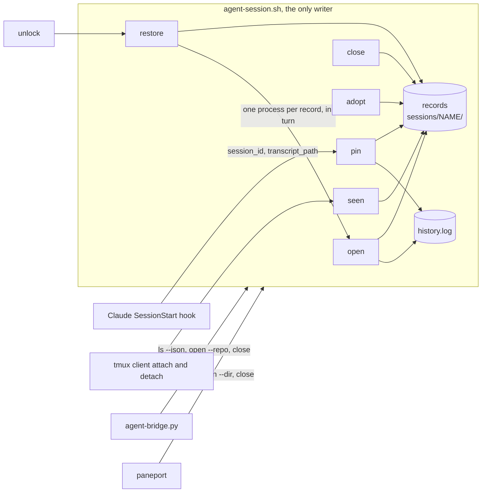

# ags records, restore after a reboot, expiry and history, and starts that never take another session's conversation

Line references point at commit `39439ee`, and the scripts have not changed since. paneport paths are relative to its repository, `~/Workspace/repos/github/tools/paneport`. This doc split out of [0005](0005-ags-restore.md), which stopped after three gate rounds. It also defines the contract paneport adopts in a design of its own (D8). The Mac port and iTerm tabs that re-enter their session will follow as separate docs. Claude Code facts were checked on the Mac's 2.1.281 on 2026-11-04. The hub runs a different version (2.1.310 when the agent gateway hooks were checked on 2026-10-26), so H2 re-checks each one there before anything is rolled out.

## Summary

- **A record per session.** `open` writes one, including the Claude conversation id, which the launcher now chooses itself. A Claude hook follows `/clear` and an in-app `/resume`. `close` marks the record closed. Nothing polls.
- **`ags restore`** rebuilds every open record, each resuming its own conversation, and `ags unlock` runs it. A record idle for 14 days is not brought back. It expires into a closed record that `open` can still resume.
- **History.** Every conversation a name has had is logged. `ags history NAME` lists them, and `ags open NAME --conversation ID` reopens one, for as long as Claude keeps its transcript (30 days).
- **Directory lookup gets predictable.** A name with a record uses the record. Otherwise the session starts in the current directory, refusing `/` and the home directory. Repository search becomes the opt-in `--repo`. Telegram, `new`, `resume` and `ags remote open` always pass it.
- **A new name never continues another session's conversation.** It starts fresh unless told `--resume`, and the launcher never types `claude --continue`.
- **One owner for records.** The bridge and paneport read records through `ags ls --json` and close through `ags close`. The Telegram panel resumes a stopped Codex or Claude session in one tap with its recorded agent.

**Where to look:**

- **`close` stops losing the conversation** (D5). It marks the record closed, so a later `open` resumes exactly that conversation. That is what `close` already promises in Telegram, and now it holds for as long as Claude keeps the transcript.
- **Two defaults change** (D2, D3): the start directory for an unknown name, and starting fresh instead of continuing.
- **paneport must adopt the launcher's `close` and `ls --json`** (D8) before the last step here starts recording its `pp-*` sessions.

## Problem

After a reboot every `ags` session is gone, and so is the memory of which ones existed. Each has to be reopened by hand. Each reopened Claude then continues "the newest conversation in this directory", which is the wrong one whenever two sessions share a directory. The same flaw shows up without a reboot. `ags open house3` lands in the vault and continues whichever vault conversation is newest, usually the one open in another session. And where a name with no repository starts depends on environment variables that differ between a terminal and the bridge's systemd unit, so the same name can land in different folders.

Better looks like this. A reboot loses nothing but in-flight turns. One command brings every live session back in its own conversation, forgotten ones stop coming back, and any recent conversation can still be found by name. A new session never touches another session's thread, and starts where it was asked to.

**Non-goals**

- **The Mac and iTerm.** tmux is not installed on the Mac. Its `ags` aliases (`aliases/.tmux-aliases`) run the checkout's launcher, which stops at the tmux check (`:592`) for every verb, `remote` included. So nothing here changes the Mac's behaviour, and `agsrv` gains `--repo` only on a client that has tmux. The Mac doc brings tmux and the state directory. New launcher code stays portable to bash 3.2 and BSD tools so that doc can reuse it. Existing code that is not (`has_conversation` uses GNU `xargs -r` and `head -q`) is left to the Mac doc.
- **Background Claude sessions** (`claude --bg`). They are Claude-only and do not respawn after a reboot (the daemon log shows `adopted=0 respawned=0 dead=3`). This design works at the tmux layer for any agent.
- **Restoring scrollback, the shell and git windows' state, or a turn in flight.** The conversation is restored. The processes are new.
- **Exact pins for Codex and OpenCode.** Their records restore them with their agent, resuming by directory as today, and only when D3 says so. Two Codex records in one directory both restore onto its newest Codex conversation, and `history` lists only Claude conversations. Revisit when H2's Codex check shows a Codex `SessionStart` hook receiving its session id. `pin` could then accept it and `codex resume ID` reopen it.
- **Keeping transcripts longer than Claude does.** Claude deletes transcripts after `cleanupPeriodDays`, which is 30 by default and unset on both hosts. On the Mac the oldest transcript is exactly 30 days old, and the whole `projects/` tree, subagent and tool-result files included, holds 4.0 GB, so a year of retention would cost at most about 48 GB at that rate. An expired record therefore stays resumable for about 16 days, and `history` marks a deleted conversation `gone`. Revisit, by raising `cleanupPeriodDays` on the hub or archiving pinned transcripts, if `history.log` shows a `notfound ... missing` line aged 30 days or more in any month.
- **Expiring a running session.** Killing a session for being idle would lose work. Expiry acts only at restore, on records with no running session. `ls` shows how long a stopped one has been idle.
- **Very long directory paths.** Claude shortens a project directory's encoded name past 200 characters with a hash the launcher does not reproduce. A record in such a directory finds no transcript and starts fresh each time. `open` warns on stderr when the encoded name exceeds 200 characters. Revisit if that warning is ever printed.
- **Following `tmux rename-session`.** A session renamed outside the launcher keeps its old record and runs unrecorded. `ags close OLD --forget` and `ags adopt NEW` fix it.
- **Following a conversation into another directory.** Claude files a transcript under the project directory where the conversation began, so an in-app `/resume` of a conversation begun elsewhere is not pinned (D4), and `--conversation` cannot reach it. The record stays on its previous pin. Revisit if `history.log` or a user report shows cross-directory resumes are common.

## Glossary

| Term | Meaning |
|---|---|
| **Record** | A directory `sessions/NAME/` under the state directory, one small file per field. A record counts only when it holds `dir` |
| **State directory** | `$AGENT_SESSION_STATE`, else `/srv/services/agents/state` when `/srv/services/agents` exists (the hub), else `${XDG_STATE_HOME:-$HOME/.local/state}/ags`. The first verb that writes creates it, mode 0700 |
| **Open record** | A record without a `closed` file. Restore brings these back |
| **Pin** | The record's `conversation` file, holding the Claude session id the agent pane runs, in lower case |
| **Project directory** | `${CLAUDE_CONFIG_DIR:-$HOME/.claude}/projects/<encoded dir>/`, where Claude keeps a directory's transcripts. The encoding is the one `has_conversation` uses (`:203`) |
| **Usable transcript** | For rule 3's search only: a file `<ID>.jsonl` in the project directory whose `ID` is a UUID, whose first `entrypoint` value does not start with `sdk-` (an absent key counts as usable), which holds a `"type":"user"` line, and whose `ID` no running Claude holds: no `${CLAUDE_CONFIG_DIR:-$HOME/.claude}/sessions/<pid>.json` newer than the boot names it as `sessionId` while the pid in its `pid` field answers `kill -0`. A file older than the boot is left by a crash, and its pid may since belong to another process. Without this, rule 3 would type `claude --resume` on a conversation a hand-started `claude` or a `pp-*` session is still writing, and Claude would fork a copy into the second pane |
| **Last activity** | The newer of the record's `seen` file, by modification time (`date -r FILE +%s`, which GNU and BSD `date` both accept), and, for a Claude record, the top-level `timestamp` of the last line in its pinned transcript whose top-level `type` is `user` or `assistant` (found with `grep` and `tail -1`). Its first 19 characters are read as UTC with `date -u -d` and, where that fails, BSD's `date -j -u -f '%Y-%m-%dT%H:%M:%S'`, so the code stays portable. Not the transcript's modification time, because a bare `claude --resume` writes to the file before any message (checked on 2.1.281 on the Mac). A transcript with no such line, or whose last such line has no `timestamp`, adds nothing. On a locked home the transcript cannot be read, so `seen` alone counts |
| **Host's last activity** | The newest last activity of any record, open or closed, that is older than the host's boot time (`btime` in `/proc/stat`, or `AGENT_SESSION_BOOT_EPOCH` when set, for tests). When none is older, it is now. Expiry measures idleness up to this time rather than up to now, so days the hub spent off or locked count against no record, and an `/open` or a login between the boot and `restore` does not move it (D6) |
| **Idle days** | Whole days, rounded down, between a last activity and the time it is measured against |
| **Grouped client** | A tmux session whose `#{session_group}` is set and differs from its own name, such as the `NAME-m` that `attach_grouped` (`agent-session.sh:517`) creates for a second client. Its group name is the session it joined |
| **Locked home** | `AGENT_SESSION_LOCKED=1`. When that variable is unset: `ecryptfs-mount-private` is on `PATH`, `/home/.ecryptfs/$USER` exists, and `mount` shows no ecryptfs on `$HOME`. That is the test `cmd_unlock` uses at `:578` and `:583`, plus the directory, so a host with the tools and no encrypted home is never locked. `AGENT_SESSION_LOCKED=0` means unlocked. The override exists so the tests run on the hub |
| **Valid name** | A session name that, after the existing sanitising of `.` and `:` to `-` (`:326`), matches `[A-Za-z0-9_][A-Za-z0-9_-]{0,63}`, the rule paneport already applies |
| **Recordable name** | A valid name that, until step 16 (D8), does not start with `pp-`. Only a recordable name ever gets a record |

## Technical Plan

How sessions, windows and resuming work today is in [doc/remote-agent-sessions.md](../doc/remote-agent-sessions.md), sections "The launcher" and "Resuming". This change touches the launcher, adds a hook that calls it, and moves the bridge onto it for listing and closing.



### D1. The record

One directory per session, `sessions/NAME/`, with one file per field: `dir`, `agent`, `pane`, `conversation`, `seen` and `closed`. Each file is written to a temporary sibling and renamed. A reader never sees half a value, and two writers touching different fields never race. Nothing reads and rewrites a whole record.

- `dir` is the physical path (`pwd -P`). `open` refuses a `--dir` containing a newline or another control character, since each field is one line.
- `pane` is the agent pane's tmux id (`%12`).
- `seen` is empty. Only its modification time matters.
- `closed` holds the reason, `close` or `expired`.

Fields are additive. A launcher that does not know a field ignores its file, so the record carries no version.

**Write order.** A new record writes `agent`, `pane`, `conversation` and `seen` first and `dir` last, because `dir` is what makes it a record. Reopening a closed record writes its fields, then removes `closed`. A closed Claude record reopened as another agent has its `conversation` file removed, and one reopened as Claude with a replaced field gets a new pin, so a stale pin never shows as `current` or blocks another record from pinning that id. Only creating a record makes the directory `sessions/NAME/`. Every other write (`pin`, `seen`, `closed`) does nothing when the directory or its `dir` is missing, so a write racing `close --forget` cannot leave a directory with no `dir`.

**Names.** `open` refuses a new session whose name is not valid. It also refuses one whose name differs only in case from an existing record's (compared with `tr A-Z a-z`), because the Mac's file system ignores case and the code is meant to be shared. Both refusals happen before anything is created. A running session of any name is still attached, closed and listed as today. Lookups list `sessions/` and compare exact names rather than testing a path. A valid name that is not recordable (`pp-*` until step 16, D8) is started without a record.

| Writer | Writes |
|---|---|
| `open`, creating a session | After `new-session` succeeds and before anything is typed: `agent`, `pane`, for Claude `conversation`, `seen`, then `dir`. Removes `closed`. Every refusal happens before this point, so a refused `open` writes nothing. Its `history.log` lines are written here too, so a failed start logs nothing |
| `open`, attaching | `seen`, and the pin by the process lookup (D5) when the record has none |
| `seen`, from the tmux hooks | `seen` (D6) |
| `adopt`, and `close` meeting an unrecorded running session | A record, `seen` and the two client hooks, under the rules in D5 |
| `pin`, from the Claude hook | `conversation`, and `pane` when D4 accepts a new agent pane |
| `close` | `closed` holding `close`, then kills the session |
| `close --forget` | Removes the whole record, then kills the session |
| `restore` | `closed` holding `expired`, for a record past its expiry (D6) |

**Changing the pin.** Every write of `conversation` goes through one function, `set_pin NAME ID SOURCE DIR`, which takes the directory as an argument because a new record writes `dir` last. Writing the id already pinned writes nothing and logs nothing. That is the usual case, since the hook fires at every start. A different id is written and logged to `history.log` as `pin NAME ID SOURCE DIR` (D6), so no conversation id is lost when a pin moves.

A grouped client is never recorded, and `close` on one kills only that client, as today. A misclassified adopted agent is fixed by `ags close NAME` then `ags open NAME <agent>`, which replaces the agent of a closed record (D2).

A session killed any other way (a crash, exiting its windows, a reboot) keeps an open record. Only `close` and expiry say a session is finished, because a crash and exiting every window look the same from outside.

**An unwritable state directory.** `open` (when creating), `adopt`, `restore` and `history` fail with a message naming the directory before touching tmux. `close` warns and still kills, as today. `ls` lists running sessions with a warning. `pin` and `seen` stay silent. Verbs that never read records are unaffected.

### D2. Where a session starts

These rules apply only when `open` starts a session. A running session is attached as today, whatever agent or `--dir` was given.

| Rule | Label in the printed line |
|---|---|
| 1. `--dir PATH` | `(--dir)` |
| 2. The record for `NAME`, open or closed | `(its record)` |
| 3. `--repo`: today's name search (`repo_for_name`, `:160`) | `(repository)` |
| 3b. `--repo` with no match: the default root (`resolve_root`, `:139`) | `(default root, no repository named NAME)` |
| 4. The current directory, moved up to its git top level (`git -C . rev-parse --show-toplevel`) when inside a repository. `--dir .` keeps the exact subdirectory | `(current directory)` |

**Refused directories.** Rules 3b and 4 refuse a result of `/`. Rule 4 also refuses a result equal to `$HOME`. Both compare after `pwd -P` on each side and after moving up to the git top level, and each refusal names `--repo` and `--dir .`. `/` is where a caller with no meaningful directory lands, such as the bridge's systemd unit, which has no `WorkingDirectory`. The home directory is where a terminal lands, and `ags open skp` typed there means the repository, not a session in `~` that its record would keep forever. `--dir .` and `--dir ~` still start there on purpose.

**The agent.** An agent given on the command line is explicit. With none given, a recorded name uses its record's agent and a new name uses `claude`.

**Disagreements.** An explicit agent, or a `--dir` (compared by physical path), that differs from the record:

- On an **open** record, it is refused. The message names the record's values and the way out: "close it first (`ags close NAME`, or `/close NAME` in Telegram), or use another name".
- On a **closed** record, it replaces that field, and the session starts fresh in the resulting directory. This comes before every D3 rule except rule 0, `--resume` included, so `--conversation` still picks the conversation in the replaced directory. So "`/close X`, then `/open X codex`", which the bridge already suggests (`agent-bridge.py:1956`), opens Codex in X's directory with a blank conversation.

`--fresh` changes only the conversation, never the directory. A record whose directory no longer exists is refused, naming `--dir` (which replaces it on a closed record) and `close --forget`.

**A locked home.** On a locked home, `open` refuses a recorded name with "the home is locked, run `ags unlock` first". For a new name it refuses any agent but `shell`. A new `shell` session starts in `--dir` when given (refused when missing, as rule 1), otherwise in the default root, refused when that is `/`. It is labelled `(home locked)`. It gets no record and carries the tmux session option `@ags-unrecorded 1`. `adopt` and `close` honour that option by never recording the session, so a session started before the mount never becomes permanent. `adopt` and `restore` refuse once, before doing anything, while the home is locked.

**Who passes `--repo`.** The bridge on `open`. `cmd_start` itself for `new` and `resume` (`:430`), so `new` stays `open --fresh --detached --repo`. `cmd_remote` when the forwarded verb is `open`. A phone has no current directory and a remote command lands in the hub's home, so name search is the only meaning `/open skp` or `agsrv` can have.

**`--resolve`.** paneport calls it (`src/paneport/core/sessions.py`, `resolve`) to choose the `--dir` it then passes. It resolves the way `open --repo` would: `--dir`, then the record's `dir`, then the repository, then the default root. It prints the directory as a physical path and exits 0. It exits 1 and prints nothing when the name is not valid, the result does not exist, or the result is `/`. It does not check the lock, as today. `test_resolve_prints_the_directory_without_tmux` (`:187`) passes unchanged.

**The printed line.** `open` prints one line on stdout before attaching or returning, because the bridge posts the first line (`agent-bridge.py:1755`). It names the rule and the conversation, with the full path as today: `Started house3 with claude in /home/black/Workspace/github/skp (current directory), fresh conversation.` A rejected pin is reported inside that line: `fresh conversation (pinned 6f1c... not found)`. A `shell` session's line names no conversation. Codex's says `continuing its last conversation` or `fresh conversation`. Warnings go to stderr. The announcement keeps today's wording with the same conversation phrase. A start by `restore` says `restored after a reboot` instead of `started at a terminal` (`:380`).

### D3. Which conversation a session starts with

For a new Claude conversation the launcher chooses the id itself, as `uuidgen | tr A-F a-f`, falling back to `/proc/sys/kernel/random/uuid`. It writes the id as the pin, then types `claude --session-id ID --name NAME`. A resumed one is typed `claude --resume ID`, with no `--name`. Both flags exist on 2.1.281. `--resume ID` continues under the same id (forking is the separate `--fork-session`). H2 confirms all three on the hub before rollout. So the pin never depends on the hook for a session the launcher starts, and the name shows in Claude's `/resume` picker.

The first rule that matches decides:

| # | When | Claude | Printed |
|---|---|---|---|
| 0 | `--conversation ID` (D6) | `claude --resume ID` | resuming conversation ID |
| 1 | `--fresh`, or a field of a closed record replaced (D2) | new id | fresh conversation |
| 2 | A pin whose `<PIN>.jsonl` exists in the project directory and holds a `"type":"user"` line | `claude --resume PIN` | resuming its conversation |
| 3 | `--resume`, a record with no `conversation` file, or a valid name that is not recordable | The newest usable transcript in the directory that no record pins, open or closed, is written as the pin (when there is a record), then `claude --resume ID`. With none, a new id | continuing its last conversation, or fresh conversation (nothing to resume) |
| 4 | Anything else: a new name, or a pin rule 2 rejected | new id | fresh conversation |

**A pin rule 2 rejects is reported** in the printed line, as `(pinned ID not found)` when the file is absent or `(pinned ID was never used)` when it holds no user line. `history.log` gets `notfound NAME ID missing|empty AGE`, where AGE is the days since the pin was written. A never-used session reports `empty` or a young `missing` (no transcript at all, or one with no user line, as 3 of the Mac's 1,767 have). A transcript Claude deleted reports an old `missing`, which is what the retention trigger in Non-goals counts. The rejected id stays in `history.log`, so `ags history` shows it, and `claude --resume` with it still works by hand if the guess was wrong. A new id also avoids depending on whether `--session-id` accepts an id whose file already exists, which was not checked.

Rule 2 trusts the pin and skips rule 3's interactive filter, since the pin was written by the launcher or by an accepted hook run. Rule 3's filter keeps the search from picking a one-shot run. Checked on 2.1.281 in a scratch directory: the first `entrypoint` in a `claude -p` transcript is `"sdk-cli"`, and in an interactive one `"cli"`. Among the newest 400 transcripts on the Mac, 24 were `cli` and 376 `sdk-cli`, so without the filter rule 3 would usually pick a one-shot run. A missing key counts as usable, so a renamed key degrades to today's behaviour. A `claude -p` run from inside a Claude's Bash tool, whose environment says `CLAUDE_CODE_ENTRYPOINT=cli`, still records `sdk-cli`, in its transcript and in its own environment (checked on 2.1.281 on the Mac). After `/clear`, the `sessionId` in the sessions file moves to the new id (checked on 2.1.281 on the Mac), so the live check and the process lookup (D5) see a conversation `/clear` started. H2 repeats these checks on the hub, and a different result there stops rollout until D3 is revised. Rule 3 walks `*.jsonl` files only, newest first by modification time. It reads each with `grep -m1` for its first `entrypoint` and stops at the first usable one. That skips the per-session subdirectories and `memory/` that share the project directory. Ids are compared in lower case.

**Codex and OpenCode** keep today's commands. `--resume` types `codex resume --last` or `opencode --continue` as today (`test_agent_session.py:72`), except after a replaced field, where rule 1 wins. Without it, a Codex record continues when `has_conversation` finds a conversation in the directory, and a new Codex or OpenCode name starts blank. OpenCode has no case in `has_conversation`, so a recorded OpenCode session reopens blank unless told `--resume`, as today. A session whose name is not recordable, of any agent, keeps today's default of continuing when `has_conversation` finds a conversation, through rule 3 for Claude. `--conversation` is refused for any agent but Claude.

**Two records in one directory.** Rule 3 writes its choice as the pin before typing anything, so a second record meeting rule 3 skips that transcript. `restore` starts records one after another, so it never races itself. Two people opening two unpinned records in one directory in the same second can still pick the same conversation, which `/resume` in one of them fixes. An unpinned record exists only when the process lookup failed at adoption.

**A clean environment for the agent.** An interactive Claude keeps an inherited `CLAUDE_CODE_ENTRYPOINT` instead of setting its own (the 2.1.281 binary returns early when it is set, and only `-p` overrides it, as checked in rule 3), and a tmux server inherits the environment of whatever starts it. A server first started from inside a Claude tool run would then mark every pane's Claude as `sdk-cli`, which D4 refuses to pin. So the launcher removes the per-process variables Claude sets for its children, as the scratch hook in D4 saw them: `CLAUDECODE`, `CLAUDE_PID`, `CLAUDE_CODE_ENTRYPOINT`, `CLAUDE_CODE_SESSION_ID`, `CLAUDE_CODE_CHILD_SESSION`, `CLAUDE_CODE_SESSION_ATTENDED`, `CLAUDE_PROJECT_DIR`, `CLAUDE_ENV_FILE`, `CLAUDE_CODE_EXECPATH`, `CLAUDE_CODE_MESSAGING_SOCKET` and `CLAUDE_CODE_MESSAGING_TOKEN`, plus what Claude's Bash tool adds: `CLAUDE_EFFORT`, `COREPACK_ENABLE_AUTO_PIN`, and `GIT_EDITOR` when it is `true`, which would otherwise make every `git commit` in a pane skip the editor. It removes every `AGENT_BRIDGE_*` variable except `AGENT_BRIDGE_BIN` and `AGENT_BRIDGE_ENV`, since a server the bridge starts would otherwise carry the bot token into every pane. Those two are paths with no secret, and announcing reads them, so a test pane keeps pointing at its fake bridge instead of falling back to the live one. It also removes `AGENT_SESSION_VIA`, so the server `restore` starts after a reboot does not mark every later start as restored.

- **At server start.** `tmux_with_conf` adds the names to the `-u` list it already builds for `AGENT_BRIDGE_QUIET` and `PANEPORT_*` (`:113`). It takes the `AGENT_BRIDGE_*` names from the launcher's own environment with `compgen -e`, which bash 3.2 has.
- **On a running server.** `cmd_open` runs `set-environment -g -u` for each before `new-session`, ignoring errors, so a server started dirty is cleaned. It takes the `AGENT_BRIDGE_*` names from `tmux show-environment -g`, because the server's environment, not the terminal's, holds them.

Configuration such as `CLAUDE_CODE_USE_VERTEX` is kept.

Rule 4 for a new name is the changed default. Today a new name continues whenever its directory has any conversation (`:355`). Now only a record, an explicit `--resume` or a name that is not recordable continues, and the launcher never types `claude --continue`. The cost is one blank start for each session that existed before this change and was not adopted. `--resume` covers it.

### D4. The pin hook

A Claude Code `SessionStart` hook runs `agent-session.sh pin`. It follows a conversation the launcher did not start: `/clear`, an in-app `/resume`, or `claude` typed by hand in the agent pane. Checked on 2.1.281 with a scratch hook: the payload arrives on stdin as one JSON line carrying `session_id`, `transcript_path`, `cwd`, `hook_event_name` and `source`. The hook's environment carries `CLAUDE_PID`, the pid of the Claude process that fired it, and `CLAUDE_CODE_ENTRYPOINT`, which was `sdk-cli` under `claude -p`. Per the Claude Code documentation, `/clear` starts a new id with source `clear`, and an in-app `/resume` fires with source `resume`. H2 runs both on the hub.

`pin` reads all of stdin first. It then does nothing and exits 0 unless every condition holds. They are checked in this order, so the common case on the hub, a `claude -p` run outside tmux, costs no `tmux` or `ps` call:

- `CLAUDE_CODE_ENTRYPOINT` does not start with `sdk-`, so a `claude -p` typed into the agent pane does not move the pin. The clean environment (D3) keeps an inherited value from reaching the agent.
- `$TMUX_PANE` is set. Its session, or the group a grouped client belongs to, has an open record whose `agent` is `claude`.
- `$TMUX_PANE` equals the record's `pane`. Pane ids restart after a reboot, so a recorded pane may be empty, gone, or now in another session. In those cases a `$TMUX_PANE` in this session's window named `agent` is accepted and written as the new `pane`.
- `CLAUDE_PID` is set and its parent (`ps -o ppid= -p`) is the pane's shell, `#{pane_pid}`. A Claude started by a tool inside the agent's own Claude has that Claude, or a shell under it, as its parent.
- `transcript_path` is `<session_id>.jsonl` in the record directory's project directory. That is where rule 2 looks, so a transcript filed anywhere else would be lost at the next open anyway. This replaces comparing `cwd`, because the agent's working directory moves during a session while a conversation's transcripts stay under the project directory where it began. An in-app `/resume` of a conversation begun in another directory is therefore not followed (Non-goals).
- `session_id` is a 36-character UUID in either case. It is stored lowered.
- No other record pins that id. So an in-app `/resume` of another session's conversation leaves this record on its old pin, rather than letting two records restore onto one transcript.

It extracts the fields with `sed`, so it needs neither `jq` nor Python. **It prints nothing on stdout**, because a `SessionStart` hook's stdout is added to the conversation's context. The dispatch handles `pin` before the launcher's top-level `tmux` check (`:592`), so a Claude started where tmux is missing never sees a hook error. The top-level code above that check, the `PATH` prepend (`:81`) and `TMUX_CONF="$(resolve_config)"` (`:107`), only reads and stays where it is.

**Where the hook lives.** The entry goes in the baseline `config/claude/settings.json`, beside the existing hooks and in their form. Every host that seeds from the baseline gets it, and paneport's planned `SessionStart` entry (`design/0001-architecture.md:500`) joins the same list:

```json
{"hooks": [{"type": "command", "command": "[ -x \"$HOME/.dotfiles/scripts/agent-session.sh\" ] && \"$HOME/.dotfiles/scripts/agent-session.sh\" pin || true"}]}
```

The guard keeps a host without the checkout (the Mac has no `~/.dotfiles`) from turning into an error on every Claude start. A host with the checkout but no tmux returns at the first check.

The seeder (`02-seed-runtime-configs.sh`) merges add-only and never extends an existing list. A host whose live file already has `hooks.SessionStart` would never receive a new baseline entry. `51-agent-sessions.sh` closes that gap for `SessionStart` alone. A baseline entry counts as present when any live entry holds a hook with the same `command` as any of its hooks. Each baseline `SessionStart` entry not present is appended, with a short `python3` edit that writes a temporary file and renames it, after a one-time backup to `settings.json.pre-ags`. A user-added entry is kept, and a present entry is never rewritten. With no live `~/.claude/settings.json` (02 has not run) it warns and adds nothing. This departs from the seeding rule "live wins" in `.wiki/architecture/install-safety.md` for one list, and that page says so in the same change. Claude reads hooks when it starts, so Claude processes already running at rollout do not follow `/clear` until restarted (Rollout).

### D5. `close`, `ls`, `adopt`, `restore`, `unlock`

**`close NAME [--forget]`.** `--forget` is accepted before or after the name, and the name is sanitised as `open` does.

- On a running session with a recordable name, no record and no `@ags-unrecorded`, on an unlocked home, it adopts first. When adoption is skipped it prints adopt's reason and kills without a record.
- On a running recorded Claude session with no pin, it fills the pin by the process lookup. A pin already written is left alone, since the hook keeps it current.
- Then, in this order: it writes `closed` (or, with `--forget`, removes the record), appends a `close` line to `history.log`, starts the announcement in the background under `nohup` with `--no-create` and a new `--no-buttons`, kills the session's grouped clients, and kills the session last. `nohup` lets the announcement outlive a `close` run inside its own session, the terminal never waits on Telegram, and `--no-buttons` keeps Peek and Esc off a closed session's message even when the bridge still sees it running. Everything that must happen comes before the last kill, because `close` run inside its own session dies with it. Killing the clients means no copy of the agent survives in `NAME-m`.
- On a grouped client it kills only that client.
- A stopped record can be closed too, and announces the same way.
- A record already closed or expired, with no running session, succeeds with `NAME is already closed.` and changes, logs and announces nothing. With `--forget` it removes the record and says so. So the bridge's Change agent works on a closed record.
- A name with neither a session nor a record fails with `No session or record named NAME.`
- After `--forget` the announcement says `/open NAME` starts it again by name.

**The process lookup** finds the conversation of a running Claude. Each child of the agent pane's `#{pane_pid}` (`pgrep -P`) is checked for `${CLAUDE_CONFIG_DIR:-$HOME/.claude}/sessions/<pid>.json`, and its `sessionId` is read with `sed`. That file is internal to Claude Code, so a miss, an id another record pins, or an id with no transcript in the project directory changes nothing. The lookup only ever fills an empty pin (attach, `close`, `adopt`). It never replaces one. The file followed `/clear` on the Mac (H2), but it is internal and the hook is the documented source, so the hook's pin wins.

**`ls [--all] [--json]`.** It prints running sessions as today, then a row for each open record with no running session, sorted by name: RUNNING `stopped Nd` (idle days up to now), ATTACHMENT and WINDOWS `-`, DIRECTORY from the record. It prints these rows even when no tmux server is running, which is the usual state after a reboot. `--all` adds closed records with RUNNING `closed` or `expired`. With nothing to show it prints `No sessions.` as today. Any other argument is an error with the usage.

`--json` prints one JSON array instead, `[]` when empty, with one object per row. It leaves out grouped clients, which the plain listing still shows, so a reader needs no `-m` rule. It also leaves out a running session whose name holds a control character, since no recordable name can:

| Key | Value |
|---|---|
| `name` | The session name |
| `state` | `running`, `stopped`, `closed` or `expired` |
| `agent`, `dir` | From the record, both `null` for an unrecorded running session |
| `recorded` | `true` or `false` |
| `attached` | `true` or `false`, `null` when not running |
| `windows` | A number, `null` when not running |
| `idle_days` | Idle days up to now, `null` while running |

`name` and `dir` are escaped for `\` and `"`, which is enough because D1 refuses control characters in `dir` and the rows above leave them out of `name`.

**`adopt [NAME [AGENT]]`** writes records for running sessions. With no name it considers every running session.

- A candidate has a recordable name that clashes with no record by case, no record, no `@ags-unrecorded`, is not a grouped client, and has a window named `agent`, which every session the launcher starts has. That leaves out the tmux default numbered sessions and helpers such as `hindsight-backend` (`scripts/opencode-session.sh:122`).
- The agent comes from `AGENT` when given, else from that window's `#{pane_current_command}`: `codex`, `opencode`, a shell meaning `shell`, and `claude` or a bare version number such as `2.1.268` meaning `claude` (native installs name their process after the version). Any other command is skipped, naming `ags adopt NAME AGENT`.
- `dir` is `#{session_path}` resolved with `pwd -P`, and `pane` is the agent window's. For Claude the pin comes from the process lookup. It touches `seen` and sets the two client hooks (D6), as `open` does for a session it creates, so an adopted Codex or shell session counts its attaches from the start.
- It prints one line per session: `adopted NAME (AGENT in DIR)`. It adds `, no pin: reopens the directory's newest unpinned conversation` when the lookup found nothing usable, and for `shell` `, if an agent exited here, close it with --forget and adopt it again with its agent`.
- A skipped session prints `skipped NAME: REASON` (grouped client of X, no agent window, name not recordable, name clashes with Y, unknown command C, already recorded, not running, started while locked).
- It exits 1 when a named session was not adopted.

**`restore [--dry-run]`** takes a lock first, by creating the directory `restore.lock` in the state directory, writing its pid into `restore.lock/pid`, and removing it on exit. A second restore meeting the lock exits 1 with `a restore is already running`, unless the pid it holds is not running or the lock is older than the boot, judged by the `restore.lock` directory's modification time. Such a lock is left by a power cut mid-restore, and is removed and taken. It then expires (D6). Then, for each remaining open record with no running session, sorted by name, it runs `"$0" open NAME --detached` as a separate process with `AGENT_SESSION_VIA=restore` for the announcement's wording. Starts run one after another, `AGENT_SESSION_RESTORE_GAP` seconds apart (default 5), so a 2015 laptop is not asked to boot every agent at once. A refused record cannot stop the loop, and each start sees the current `PATH`. A start counts as restored when it exits 0 and the session is running, and `restore` then logs its `restore` line. It prints each line and ends with `Restored N, expired E, failed M.`, exiting 1 when any failed. On Linux it then warns when the tmux server has `NoNewPrivs: 1` in `/proc/<pid>/status`, the mark of a server the bridge's sandboxed unit started, whose panes cannot `sudo`. The warning says what to do: when the server holds only sessions started while the home was locked, `tmux kill-server`, then `ags restore` again. An interrupted restore is finished by running it again. `--dry-run` prints `would expire NAME (idle N days)` and `would start NAME (AGENT in DIR)` lines, and changes and logs nothing.

**`unlock`** runs `"$0" restore` after `ecryptfs-mount-private` succeeds. It also runs it when the home was already unlocked, since `restore` starts only open records that are not running. The usage says so. Once the home is mounted, it exits with `restore`'s status. A home unlocked at the desktop login runs nothing by itself, and `ags restore` covers it.

### D6. Expiry and history

**Activity.** `open` touches `seen` when it creates or attaches, except a start run by `restore` (`AGENT_SESSION_VIA=restore`), so a session nobody uses keeps aging across reboots instead of being reset by each one. It also sets two session hooks on every session it creates, `client-attached` and `client-detached`, each running `run-shell -b '"LAUNCHER" seen NAME'`. LAUNCHER is the absolute path `"$(cd "$(dirname "$0")" && pwd -P)/$(basename "$0")"`, which needs no `readlink -f`. A symlink such as `~/.local/bin/agent-session` stays a symlink, which is fine for running it. `adopt` sets the same hooks. `attach_grouped` (`:517`) sets a `client-attached` hook running `seen NAME` on the `NAME-m` client it creates, and its `client-detached` hook runs `seen NAME` before its `kill-session`, so a second client counts too. So a desk session counts as active whenever a client comes or goes, including an SSH link dropped by a Mac reboot. The bridge runs `LAUNCHER seen NAME` without waiting after each message `type_text` delivers, so a session driven from the phone counts too. `seen` touches the file when the record is open, and exits 0 silently otherwise. A Claude record's transcript also covers work done while attached. A Codex, OpenCode or shell session attached without a break through a hub reboot can look idler than it was. That costs one `/open NAME`, as below.

**Expiry.** `restore` marks a record expired, rather than starting it, when the record is open, not running, and its idle days measured up to the host's last activity reach `AGENT_SESSION_EXPIRE_DAYS` (default 14). Measuring up to the host's last activity, not up to now, means two weeks with the hub off or locked expire nothing, while a record left behind by sessions still in use does expire. Activity since the boot is left out of that reference, so a session opened from the phone before `ags unlock` cannot turn the reference into now. A record active since the boot never expires, so a `restore` run by hand long after a boot expires only what was already idle before it. The Mac's boot time is 0007's to define. It writes `closed` holding `expired`, logs `expired NAME DAYS`, and prints `expired NAME (idle DAYS days), /open NAME resumes it`. An expired record is a closed record. `ags open NAME` or `/open NAME` brings it back resuming its pin by rule 2, while Claude keeps the transcript, which leaves about 16 days at the default retention. `AGENT_SESSION_EXPIRE_DAYS=0` turns expiry off. Nothing else expires a record, and nothing ever expires a running session.

**`history.log`** in the state directory gets one line per event: `<local time, YYYY-MM-DDTHH:MM:SS+ZZZZ> <event> NAME [fields]`.

| Event | Fields | Written by |
|---|---|---|
| `restore` | none | `restore`, for each start that counted as restored (D5) |
| `close` | none | `close` |
| `expired` | `DAYS` | `restore` |
| `notfound` | `ID missing\|empty AGE` | `open`, rule 2 rejecting a pin (D3) |
| `pin` | `ID SOURCE DIR` | Every pin change. SOURCE is `new`, `search`, `hook`, `adopt`, `lookup` or `conversation`. DIR comes last, so a path with spaces stays one field |

`--dry-run` writes nothing. The log grows by a few lines a day and is not rotated. A deleted record's lines stay, so `close --forget` leaves its history.

**`ags history [NAME]`** reads the log and lists each name's conversations, newest first, one per line: the date first pinned, the id, its source, `current` for the record's pin, and `kept` or `gone` by whether `<ID>.jsonl` is still in DIR's project directory. Without a name it lists every name in the log, sorted, each under a line holding the name. It only reads. On a locked home the project directories cannot be read, so it prints `unknown` in place of `kept` or `gone`.

**`ags open NAME --conversation ID`** reopens one of them (rule 0). The id is lowered and must be a UUID whose transcript exists in the start directory's project directory, and no other record may pin it. A running session refuses it with the `close` hint. Otherwise the pin is written with source `conversation` and the session resumes it. It combines with `--dir` and with a closed record's replaced directory. It is refused with `--fresh` or `--resume`.

### D7. The bridge

- **One source of sessions.** A new `sessions()` method runs the launcher's `ls --all --json` and returns its rows. When the launcher is missing, exits non-zero or prints something `json.loads` rejects or that is not a list, it falls back to today's tmux listing, so a broken state directory degrades to today's panel. JSON rows hold no grouped clients, so the bridge's `-m` filter (`:1307`, `:1903`) applies only to the fallback rows. The panel's home page lists the union of these rows and topics (`agent-bridge.py:1308`), labelled `🟢 NAME · RUNNING`, `⚪ NAME · Stopped, AGENT, Nd idle`, `⚪ NAME · Closed, AGENT`, or `⚪ NAME · Expired, AGENT`. A running session's page keeps reading its foreground program from tmux, as today, since the JSON rows carry none. `/ls` adds the stopped rows after the running ones, and its empty reply (`:1907`) points at `ags unlock` and `ags restore`.
- **A stopped session's page.** For a session with a record (open, closed or expired), the page names its agent and offers its buttons. `▶️ Resume (AGENT)` launches with no agent in mode `open`, so the record decides the agent and D3 the conversation, and a pin that rule 2 rejects starts fresh rather than searching, while a record with no pin searches by rule 3. An OpenCode record uses mode `resume` instead, because OpenCode has no conversation check and mode `open` would start it blank under a Resume label. `✨ Start fresh` launches with no agent in mode `fresh`. `🔁 Change agent` opens the four-button picker. A pick there runs `close_session` and then launches fresh with the picked agent, which D2 turns into a replaced agent with a blank conversation. When `close_session` returns an error, it posts `could not close NAME: ` with it and launches nothing. An open record's page also offers `⏹ Close session`, which goes through `kill-confirm` as a running session's does. A stopped session with a topic and no record keeps today's two buttons and picker. A new session's flow (`➕ New session`, then the picker) is unchanged.
- **The bridge's close.** `/close [NAME] [forget]` and `/kill` take an optional `forget`. It is the flag when it follows a name, or when it is the only argument inside a session's topic. In General, `/close forget` names a session called `forget`. A new `close_session(session, forget=False)` method runs the launcher's `close`, returning `launch`'s launcher-not-found error when `find_launcher()` finds none, adding `--forget`, with `AGENT_BRIDGE_QUIET=1`. It returns `None` or an error string, as `tmux.kill` does. It replaces `self.tmux.kill` in `/close`, `/kill` (`:2017`) and the panel's `kill-confirm` (`:1409`), and drops the `tmux.exists` check in all three, so a stopped record can be closed from the phone, including from a stale confirm. The callers post today's reply, or after `forget` `Closed NAME and forgot its record. /open NAME starts it again by name.`, or `could not close NAME: ` followed by the error. The launcher reaches the default tmux server, so `AGENT_BRIDGE_TMUX_SOCKET` stays unset in production.
- **Activity from the phone.** After `type_text` delivers a message to a session, the bridge starts `LAUNCHER seen NAME` with `subprocess.Popen`, not waiting and discarding its output, when `find_launcher()` finds one (D6).
- **The bridge's open.** `/open`, `/new` and `/resume` pass an agent only when one was named. `/open` adds `--repo`. A launcher refusal comes back through `launch`'s existing `could not start NAME: ...` path (`:1746`). `launch`'s fallback texts (`:1759` to `:1761`) and the running-session reply of `/new` and `/resume` (`:2006` to `:2010`) name the agent only when one was given.

### D8. The hub, and paneport

`51-agent-sessions.sh` creates `/srv/services/agents/state` mode 0700 and adds the baseline `SessionStart` entries (D4). It runs only from an unlocked home, since it needs the checkout. The hub user `black` owns `/srv/services/agents`, runs the terminal sessions and runs the bridge (`User=black` in `agent-bridge.service`), so one account reads and writes every record. Records live outside the encrypted home, so a bridge `/open` before the unlock reads them and refuses as D2 says. Records and `history.log` hold directory paths, agent names, pane ids and conversation ids, never conversation content. Plaintext under `/srv` therefore exposes which projects have sessions, client repositories included, and nothing more. The vault guide's data section says so.

The hook runs the checkout's copy and the bridge runs the staged copy under `/srv`. The script stages the launcher in the same run that adds the hook, and fields are additive (D1), so a brief skew between the two copies still reads correctly.

**paneport.** It starts sessions through the launcher with `--agent` and `--dir` (`src/paneport/core/sessions.py`, `start`), which D2 serves unchanged. It closes by killing tmux sessions itself (`close`). Its draft crews design (`design/0005-crews.md`) opens `crew-*` sessions through the launcher and closes them the same way. Under records, a direct kill leaves an open record that `restore` would revive. So paneport aligns with this scheme in a design of its own, drafted beside this one as paneport's next design:

- `close` through the launcher, with `--forget` for crews, since their worktrees are deleted.
- Open records read from `ls --json`. paneport lists only open records, so it reads the plain listing, while the bridge reads `--all` for its closed-record pages.
- `--agent` only when the user named one.
- Launcher refusals shown to the user.
- Its step 6 extends `51`'s ensure step to its own hook events, since the seeder's limit applies to every event.

Expiry is the safety net for anything a direct kill leaves behind. Until paneport's alignment is deployed on the hub, `pp-*` names are not recordable. The last implementation step removes that exception, and runs only after it.

The exception goes by name, not by caller, which holds only while paneport opens `pp-*` names alone, as its beside-run config does. Two later paneport steps open other names: its cut-over (its 0001 D9) and crews (`crew-*`, its 0005). Both come after its alignment in paneport's own order, so by then paneport closes through the launcher and its other names are safe to record.

Checks, with results recorded in the vault guide:

- **H1, before rollout.** `open vault --resolve` gives the same directory from a login shell and from the bridge's environment, run from `/` as `bash -c 'set -a; . /srv/services/agents/bridge.env; set +a; /srv/services/agents/bin/agent-session open vault --resolve'`. It needs only today's launcher. If they differ, `AGENT_SESSION_ROOT` set to the login shell's answer goes into `bridge.env` and `os/linux/srv/agents/bridge.env.sample`. Also, `ls ~/.dotfiles/scripts/agent-session.sh` succeeds, since the baseline hooks name that path.
- **H2, before rollout.** `bash design/checks/0006-h2.sh [SYMLINKED_VAULT]` runs every Claude item below in a private tmux server with a scratch hook passed by `--settings`, and prints one verdict each. It passed on the Mac on 2.1.281 apart from the symlink item, which needs a symlinked path.
  - `claude --help` on the hub lists `--session-id`, `--name` and `--fork-session`. If either of the first two is missing, Claude on the hub is updated first.
  - A scratch hook as in D4, run once in a scratch tmux pane interactively and once under `claude -p`, shows `transcript_path`, `TMUX_PANE`, a `CLAUDE_PID` whose parent is the pane's shell, and `CLAUDE_CODE_ENTRYPOINT` (`cli` and `sdk-cli`). Each transcript's first `entrypoint` matches.
  - `claude -p` run from the symlinked path given as `SYMLINKED_VAULT`, when one exists, files its transcript under the encoding of the physical path (`readlink -f`).
  - `claude --resume ID` keeps writing `ID.jsonl`, and its `SessionStart` hook carries `ID`.
  - In the scratch pane, `/clear` and one message, then the `sessionId` in `~/.claude/sessions/<pid>.json` compared with the hook's new id. They match, as on the Mac.
  - In the scratch pane, the agent runs `claude -p 'say ok'` through its Bash tool, and the new transcript's first `entrypoint` is read. It is `sdk-cli`, as on the Mac.
  - `~/.claude/sessions/<pid>.json` for a running interactive Claude holds `pid` and `sessionId`, which rule 3's live check reads.
  - A Codex `SessionStart` hook, if Codex lists one, shows whether it receives a session id (the Non-goals trigger).
  - If any Claude item fails, D3 and D4 are revised before rollout.
- **H2, after rollout.**
  - `~/.claude/settings.json` holds exactly one pin entry.
  - In a session opened with `ags open`, `/clear` rewrites `conversation` within seconds and logs one `pin ... hook` line. An in-app `/resume` of an older conversation of the same directory rewrites it. Asking the agent to run `claude -p 'say ok'` through its shell tool leaves it unchanged.
  - Asking the agent to `cd` into a subdirectory and then `/clear` either rewrites it or, if Claude files that transcript under the subdirectory, is recorded as a known limit.
  - `time ags open X --resume --detached` for an unpinned record in the vault takes under 5 seconds.
  - A day later, after the session has been used, `conversation` still names the transcript it is writing.
  - H2 runs again whenever the hub's Claude minor version changes, since D3 and D4 rest on details Claude does not document.
- **H3.** After `ags adopt` and the restarts in Rollout, each adopted Claude session's `conversation` equals the `sessionId` in `~/.claude/sessions/<pid>.json` for its pane's Claude, or the session appears in adopt's no-pin lines.

## Alternatives

| Question | Chosen | Rejected, and why |
|---|---|---|
| What triggers saving | Events: `open`, `close`, the hooks | **A periodic snapshot** (a timer running `tmux list-sessions` or `claude agents --json`). Measured at 0.17 s and 2.6 KB a run, so cost was not the issue. A snapshot records whatever happened to be running, including sessions stopped on purpose, and misses the last minute. Revisit if sessions start being created by tools that never call the launcher |
| | | **tmux-resurrect and tmux-continuum.** They snapshot every pane on a timer and restore pane commands by process name, so `claude` comes back with no conversation id. Revisit if the shell and git windows' layouts become worth keeping |
| Which conversation to resume | An id the launcher chooses, followed by the hook | **The hook alone.** Every start would depend on the hook having fired, and a session opened and never used would have nothing to resume by id |
| | | **`claude --continue` per directory.** Wrong whenever two sessions share a directory, which is the common case in the vault |
| | | **`~/.claude/sessions/<pid>.json` as the main source.** Undocumented, and it exists only while the process lives, so it cannot be read after a crash. Used only to fill an empty pin at adoption, attach and close, as a best effort, never to replace one. It followed `/clear` on the Mac in H2, which is not enough to rely on an internal file. Revisit if Claude Code documents it |
| A pin whose transcript is gone | A new id, the old one kept in the history, reported in the start line | **`--session-id PIN` again.** Keeps the id, but whether Claude accepts an id whose file already exists is unchecked |
| | | **Fall through to rule 3's search.** That is the newest-conversation guess this doc removes, applied without being asked |
| Which hook runs may pin | The recorded pane's own `claude`, by `CLAUDE_PID`'s parent, an interactive entrypoint and the transcript's location | **A parent-distance limit.** A guessed constant, wrong for a tool that runs `claude -p` through one shell fewer |
| | | **The payload's `cwd` equal to the record directory.** The agent's working directory moves during a session, so a `/clear` after a `cd` would be dropped |
| Where the pin hook is installed | The baseline settings, plus `51` adding missing baseline `SessionStart` entries | **`51` writing only its own entry.** The live list it creates would block every later baseline `SessionStart` entry, paneport's planned one included, because the seeder never extends a list |
| Record format | A directory of one-value files | **One JSON or key=value file per session.** Every update becomes read, modify, write, which races between the hook and `open` and needs a lock. macOS has no `flock`, and bash 3.2 has no JSON parser |
| Who reads records | The launcher only, others through `ls --json` | **The bridge and paneport reading the files.** Three readers of one format drift, and the rules for open, closed, expired and idle would be written three times |
| Recognising a grouped client | `#{session_group}` differs from the session name, and `ls --json` leaves them out | **The `-m` suffix**, as the bridge's `/ls` does. A real session named `team-m` would never be recorded |
| What ends a session for good | `close`, and expiry at restore | **Exiting every window also counts.** A crash looks the same from outside, and a crash is exactly what restore is for |
| | | **Claude's `SessionEnd` reason.** A reboot kills Claude like a crash, it covers Claude only, and leaving Claude while keeping the shell is not ending the session |
| What `close` does | Marks the record closed | **Delete the record.** Then `open` after `close` starts blank, contradicting the bridge's "`/open NAME` picks the conversation up again", and the pin is lost. `--forget` deletes for whoever wants that |
| How long a stopped session comes back | 14 days of inactivity, then expired into a closed record | **No expiry.** Every forgotten session returns after every reboot, forever |
| | | **30 days.** Claude deletes the transcript at the same age, so an expired session would usually reopen blank |
| | | **Expire running sessions too.** Killing an idle session can lose work, and a running session costs nothing until a reboot stops it anyway |
| How far back history reaches | Claude's 30 days, kept | **90 days on the hub.** About three times the transcript disk, measured on the Mac at 4.0 GB a month, on a 2015 laptop. Revival trigger in Non-goals |
| | | **Archive pinned transcripts at expiry.** Long recovery for little disk, but resuming from a transcript put back by hand was never checked |
| How a session's activity is known | `seen`, touched by `open`, `adopt`, tmux client hooks and the bridge's messages, plus the pinned transcript | **A timer reading `#{session_activity}`.** Polling, which this doc rejects, and the value dies with the server at a reboot |
| | | **A shutdown unit writing activity.** Misses crashes, and adds a systemd unit for a value expiry only needs roughly |
| What idleness is measured against | The host's last activity before the boot | **Now.** Two weeks with the hub off or locked would expire every record at the first unlock, exactly when restoring them matters most. **The host's last activity including the time since the boot.** One `/open` from the phone before `ags unlock` would make it now, with the same result |
| | | **A `last-up` stamp touched by `restore` or `ls`.** One more file and writer, for the same answer the records already give |
| Resuming a stopped session from the panel | One tap with the recorded agent, the picker behind Change agent | **The picker with the record's agent marked.** One more tap every time, and a wrong pick on an open record is refused |
| Start directory without a record | Current directory, git top level, `--repo` opt-in, refusing `/` and `$HOME` | **Name search first, as today.** Surprising matches (`skills` finding `skills-registry`), and a miss falls to an environment-dependent root |
| | | **Current directory, `$HOME` allowed.** `ags open skp` typed in a fresh terminal would record `~` as skp's directory, and the phone and every restore would follow it there |
| What `--resolve` answers | Where `open --repo` would start | **Where a bare `open` would start.** Its only caller, paneport, runs under systemd with `/` as its directory, so the current-directory rule would refuse every new name |
| A new name and existing conversations | Blank unless `--resume` | **Continue unless pinned elsewhere.** Still continues conversations from sessions without a record, including plain `claude` runs, which is the hijack this fixes |
| paneport's sessions | Recorded once paneport closes through the launcher | **A `--no-record` flag for programmatic callers.** paneport sessions would never come back after a reboot, and a second class of session is what this doc removes |
| Sessions after a reboot | `ags restore` by hand, and from `unlock` | **A boot-time unit that restores.** The agents and their configuration live in the encrypted home, which is locked until someone unlocks it, so a boot unit could only start shells |

## Detailed Implementation

In work order. Each step keeps `python3 -m unittest scripts/test_agent_session.py scripts/test_agent_bridge.py` green. New launcher code avoids bash 4 features and GNU-only flags, so the Mac doc can reuse it.

1. **`scripts/agent-session.sh`, the record (D1).** Add `state_dir`, `record_get`, `record_set` (temp file and `mv`, doing nothing when the record has no `dir`), `record_create` (makes the directory, writes every field, `conversation` included when there is a pin, before `dir`, and logs the first `pin` line itself with the source that chose it, `new`, `search`, `conversation`, or `adopt` when `adopt_session` creates it, so `set_pin` only serves an existing record), `record_has` (exact name, requires `dir`), `record_open`, `set_pin NAME ID SOURCE DIR` (no-op for the same id, otherwise write and log `pin`), `valid_name`, `recordable_name`, `name_clashes`, `group_of SESSION`, `home_locked`, `project_dir DIR`, `idle_days EPOCH REF`, `last_activity NAME` (the glossary's last activity), `host_last_activity` (activity older than the boot only, D6), `log_event`, `launcher_path`, `set_seen_hooks NAME`, `claude_pid_conversation PANE` and `adopt_session NAME [AGENT]`. Add the Claude variables, `AGENT_SESSION_VIA` and the `AGENT_BRIDGE_*` names (D3) to `tmux_with_conf`'s scrub list.
2. **`scripts/agent-session.sh`, start directory and agent (D2).**
   - Add `--repo` and `--conversation` to `cmd_open`'s parser, and track whether the agent was explicit.
   - On a running session, attach as today before any of the following, touching `seen` and running the process lookup when the record has no pin.
   - Validate the name, then replace the `start_dir` default with the D2 rules, labels and refusals. Make `--resolve` follow `open --repo`.
   - Apply the disagreement rules, the missing-directory refusal and the locked-home rule (setting `@ags-unrecorded`), all before any write.
   - `cmd_start` passes `--repo`, and `--agent` only when one was given. `cmd_remote` adds `--repo` when the forwarded verb is `open`.
   - Usage: rewrite "Starting a session continues…" (`:28`), the `--fresh`, `--resume` and `--resolve` option lines, the `new` line, and "Where a session starts" (`:40`). Add `--repo`, `--conversation`, `close --forget`, `ls --all` and `--json`, `adopt`, `restore`, `history` and what `unlock` now runs. `AGENT_SESSION_STATE`, `AGENT_SESSION_LOCKED`, `AGENT_SESSION_RESTORE_GAP` and `AGENT_SESSION_EXPIRE_DAYS` go beside the other environment variables the usage names.
3. **`scripts/agent-session.sh`, conversation (D3).** Replace the `has_conversation` call at `:355` with the D3 rules in order, keeping `has_conversation` for Codex and for names that are not recordable. Add `new_conversation_id`, `pin_alive DIR ID` (rule 2) and `newest_unpinned_transcript DIR` (rule 3). Replace `agent_command`'s Claude case so it never prints `--continue`, giving it `--session-id ID --name NAME` and `--resume ID`. Before `new-session`, unset the D3 variables in the server's global environment, the `AGENT_BRIDGE_*` names read from `tmux show-environment -g`. Warn on stderr when the encoded directory name exceeds 200 characters.
4. **`scripts/agent-session.sh`, creating a session.** Run `new-session` with `-P -F '#{pane_id}'` added after today's arguments. Write the record and the start's `history.log` lines, set the two `seen` hooks (D6), then create the shell and git windows and type the command. An empty pane id (as the fake tmux gives) writes an empty `pane`, which D4 accepts replacing. When `new-session` fails and the session now exists, write nothing, and attach, or under `--detached` print `NAME is already running.` and exit 0. Otherwise report the error. Print the D2 line, and have the announcement use `AGENT_SESSION_VIA` for its wording. Under `--detached` the existing second line, `Use ags open NAME to attach.`, stays.
5. **`scripts/agent-session.sh`, `pin` and `seen` (D4, D6).** Both are dispatched before the top-level tmux check, silent, exit 0 on every path, and left out of the usage. `pin` reads stdin, extracts and validates `session_id` and `transcript_path`, and resolves the record through the group. It checks the entrypoint first, then the agent, the pane (accepting a new agent pane), `CLAUDE_PID`'s parent, the transcript's location and uniqueness, then calls `set_pin` with source `hook`.
6. **`scripts/agent-session.sh`, `close`, `ls`, `adopt`, `restore`, `history`, `unlock` (D5, D6).** `cmd_close` follows D5's order, succeeds quietly on a closed record, and announces under `nohup` with `--no-buttons`. `cmd_ls` receives `"$@"` from the dispatch. Add `cmd_adopt`, `cmd_restore` (the lock, then expiry) and `cmd_history`. `attach_grouped` gains the `seen` hooks (D6). `cmd_unlock` runs `"$0" restore` in both of its exits and returns its status. The dispatch gains `adopt`, `restore`, `history`, `pin` and `seen`.
7. **`scripts/test_agent_session.py`.**

   **The environment.** A shared helper builds every case's environment, the fake-tmux cases (`:171`) included, on a temp directory with `home/` and a git repository `repo/` as separate subdirectories.
   - It sets `HOME`, `AGENT_SESSION_STATE`, `XDG_STATE_HOME`, `CODEX_HOME`, `AGENT_SESSION_REPOS` and `AGENT_SESSION_ROOT` inside it, plus `AGENT_SESSION_LOCKED=0` and `AGENT_SESSION_RESTORE_GAP=0`.
   - It keeps each case's own `TMUX_TMPDIR`, and sets `AGENT_BRIDGE_BIN` and `AGENT_BRIDGE_ENV` to the case's fake bridge, or to a missing path when the case has none. D3 keeps those two in the tmux server's environment, so commands typed into a test pane announce to the fake too.
   - It removes `TMUX`, `TMUX_PANE`, `SSH_CONNECTION`, `CLAUDE_CONFIG_DIR`, `AGENT_BRIDGE_QUIET`, `AGENT_SESSION_VIA`, `PANEPORT_*` and the D3 Claude variables.
   - The fake `tmux`, `claude` and `codex` move to `home/.local/bin`, which the launcher puts first on `PATH` (`:81`) under the new `HOME`.
   - Every `subprocess.run` of the launcher passes `cwd=` the case's `repo/`, existing calls included, so rule 4 never resolves to the dotfiles checkout.
   - It refuses a case without `AGENT_SESSION_STATE`, and a real-tmux case without `TMUX_TMPDIR`, so a run on the hub never reaches the live state directory, tmux server or bridge.

   **Fixtures.** Fixture transcripts carry `"entrypoint":"cli"` and a user line unless a case says otherwise. The fake `claude` writes none, so a case that expects a resume creates `<pin>.jsonl` itself. `pin` cases send `C-c` to the agent pane of a real test tmux server to stop the fake `claude`, then type `sh -c 'CLAUDE_PID=$$ LAUNCHER pin < payload; :'` there, so the pid's parent is the pane's shell. For the wrong parent they type `sh -c 'sh -c "CLAUDE_PID=\$\$ LAUNCHER pin < payload; :"; :'`. The trailing `:` keeps each `sh` from exec'ing its last command. Grouped clients are created directly with `new-session -d -t NAME -s NAME-m`.

   **Existing cases that change:**
   - `test_shared_lifecycle_and_pane_controls` (`:14`), `test_open_finds_the_repository_and_continues_by_default` (`:87`) and `test_quiet_flags_stay_out_of_the_servers_environment` (`:140`) write `.tmux.conf` under the new `home/`, and `:165` asserts that `HOME`. `:127`'s history path follows `home/`.
   - `:87` passes `--repo`. It expects a blank first start and, after its `close` and a fabricated transcript, `--resume` of the pinned id on the next open.
   - The lifecycle case keeps `resume fixture codex` typing `codex resume --last` (`:72`), and its `new fixture` now searches with `--repo`.
   - The paneport case (`:206`) still finds `new-session -d -s paneport`, since `-P -F` goes after, and its names are written to the temp state directory.
   - `test_resolve_prints_the_directory_without_tmux` (`:187`) passes unchanged.

   **New cases:**
   - Opening writes `dir`, `agent`, `pane`, `seen` and a lower-case UUID pin, logs `pin NAME ID new DIR`, sets both client hooks, and types `--session-id PIN --name NAME`. The pin is on disk before the fake `claude` starts. No case ever sees `--continue` typed for Claude.
   - A new name starts blank although a usable transcript exists, and `--resume` resumes it by id.
   - `--resume` skips the newest transcript when a fake `~/.claude/sessions/<pid>.json` names it with the test's own pid, and takes it once that file names a pid that is not running (a child the test started and reaped) or the file is older than `AGENT_SESSION_BOOT_EPOCH`.
   - A pin with a user line resumes, including an `sdk-cli` one and one with no `entrypoint` key. A missing pin and a message-less one each get a new id, say so in the first stdout line, and log `notfound` with the right reason and a `pin` line, also under `--resume`, which then searches. An unpinned record resumes the newest usable transcript, skipping a newer `sdk-cli` one, a subdirectory and one another record pins.
   - `set_pin` with the current id, as a `pin` hook run with the launcher's own id, writes and logs nothing.
   - Two unpinned records in one directory, reopened one after the other, type different commands, and the second starts fresh when only one usable transcript exists.
   - A `pp-` name writes no record and continues the newest usable transcript. `a b`, `a+b`, `-x` and `Vault` beside a `vault` record are refused and write nothing.
   - A recorded Codex session reopens as Codex with no agent given. An explicit other agent is refused on an open stopped record, replaces a closed one in the same directory with a fresh start even with `--resume`, and is ignored for a running session, which is attached.
   - The current directory is moved to its git top level, `--dir .` keeps the subdirectory, and `/` and `$HOME` are refused. A disagreeing `--dir` on an open record is refused. `--fresh` on a closed record keeps its directory. A `--dir` holding a newline is refused.
   - `--repo` with a hit, and a miss falling back to the root with its label. `--resolve` prints a record's directory, prefers `--dir`, searches repositories for a new name, and exits 1 for a record whose directory is gone and for an invalid name.
   - With `AGENT_SESSION_LOCKED=1`: a recorded name and a new `claude` session are refused, a new `shell` one starts labelled `(home locked)` with `@ags-unrecorded`, `adopt` and `restore` refuse, and nothing is written. After switching to `AGENT_SESSION_LOCKED=0`, `adopt` and `close` still write no record for it.
   - The launcher started with `CLAUDE_CODE_ENTRYPOINT=sdk-cli`, `AGENT_BRIDGE_BOT_TOKEN` and `AGENT_SESSION_VIA=restore` in its own environment starts a server whose new agent pane has none of them. A server already running with the same three set by `set-environment -g` gives the next new agent pane none of them either. `GIT_EDITOR=true` is removed the same way, and `GIT_EDITOR=vim` is kept. In both, the pane keeps `AGENT_BRIDGE_BIN` and `AGENT_BRIDGE_ENV`.
   - `pin` writes `conversation` lowered and prints nothing. It writes nothing with the wrong parent, from another pane, with `CLAUDE_CODE_ENTRYPOINT=sdk-cli`, with a transcript path in another project directory, with an id another record pins, for a `shell` record, or from a pane whose session has no record. From a grouped client's pane it pins into the group's record. With the recorded pane killed, or its id set to a pane of another session, and a new agent pane, it pins and rewrites `pane`.
   - `seen` on an open record updates its time, and on a closed or missing one writes nothing and creates no directory. Attaching and detaching a client through the session's hooks, and through a `NAME-m` client made by `attach_grouped`, each update it.
   - `close` on a grouped client kills only the client and writes nothing. `close` on the original kills the client too.
   - `close` writes `closed` holding `close` and logs before killing, also when run from inside the session, and a later `open` resumes. `--forget` deletes, before or after the name, and `history` still lists the name. Closing an unrecorded running session adopts it first, and one that adopt skips is killed with its reason. Closing a stopped record works. Closing a closed or expired record prints the already-closed line and changes nothing, and with `--forget` removes it. Closing an unknown name fails with its message. On a pinned running Claude session whose fake pid file names another id with a transcript, `close` keeps the pin.
   - `ls` shows a stopped record with its idle days and no server running, `ls --all` shows a closed and an expired one, an empty state prints `No sessions.`, and an unknown argument is an error. `ls --all --json` parses with `json.loads` and holds the documented keys for a running unrecorded session, a stopped record, a closed one, and a name and a directory containing `"`. It leaves out a grouped client that the plain `ls` shows.
   - `adopt` records a launcher-made session, touches `seen` and sets both client hooks. It skips a grouped client, a session with no `agent` window, an unknown command, a case clash and an unrecordable name with their lines. It accepts `adopt NAME codex`, treats a version-number command as Claude, prints the no-pin line when the fake pid file is absent, and exits 1 for a named session it skipped.
   - A session started by `restore` keeps the `seen` time it had before the start.
   - `restore --dry-run` prints its `would` lines and changes and logs nothing. Every restore case fixes one epoch E, the test's start minus one hour, sets `AGENT_SESSION_BOOT_EPOCH` to E and every fixture time relative to it, `seen` with `touch -t` and a pinned transcript's line timestamps as written, so no result depends on the machine's uptime or on the second a fixture was written: a fresh record is E minus an hour, an old one E minus 15 days and an hour. `restore` over one refused record with a fresh `seen`, one good one with a fresh `seen`, and one whose `seen` is 15 days older (set with `touch -t`) starts the good one, expires the old one, reports `Restored 1, expired 1, failed 1.`, logs one `restore` and one `expired` line, and exits 1. With `AGENT_SESSION_EXPIRE_DAYS=0` the old one is started instead. With every record's `seen` set to one time, E minus 20 days, nothing expires, and still nothing after one of them is opened before the restore, since its new `seen` is newer than E. In a separate case, a Claude record whose `seen` is E minus 15 days and an hour, and whose transcript file was written at test time but whose last `user` and `assistant` lines are stamped at that same time, expires beside a second record whose `seen` is E minus an hour. A `restore.lock` holding a pid that is not running is taken over. An expired record reopened with `open` resumes its pin. A restore meeting a `restore.lock` whose directory's modification time is after E, and held by a running pid exits 1 and starts nothing. One whose modification time is older than E, holding a running pid, is taken over.
   - `history NAME` lists a name's pins newest first with `current`, `kept` and `gone`, and with `AGENT_SESSION_LOCKED=1` prints `unknown` in their place. `history` with no name lists each name under its own line.
   - Replacing a closed Claude record's agent with `codex` removes its `conversation` file. `open NAME --conversation ID` on a closed record resumes that id and logs it. It is refused for a running session, a missing transcript, an id another record pins, a non-Claude agent, and alongside `--fresh`.
   - A fake tmux whose `new-session` fails while `has-session` then succeeds writes no record, and under `--detached` prints the already-running line.
8. **`scripts/agent-bridge.py` and `scripts/test_agent_bridge.py`.**
   - `sessions()` (D7), used by the panel's home and session pages and by `/ls`.
   - The stopped-session page and its actions (D7). `resume-rec` launches with `None` in mode `open`, or `resume` for an OpenCode record, and `fresh-rec` with `None` in mode `fresh`. `change-agent` opens the picker, and its `change-run` calls `close_session`, posts its error and stops when it returns one, and otherwise calls `launch(session, agent, mode="fresh")`. An open record's page adds `⏹ Close session`, wired to `kill-confirm`. The page texts for `resume-agent` and `open-agent` (`:1323`, `:1324`) and the help (`:1353` to `:1355`) say a session resumes its own conversation, a new name starts fresh, and Change agent starts the picked agent blank.
   - `launch` takes `agent: str | None` and accepts `None` in its agent check (`:1731`). The argv becomes `[launcher, "open", session, "--repo", "--detached"]`, `[launcher, "new", session]` and `[launcher, "resume", session]`, with the agent after the session only when named. `/open` passes `agents[0]` only when given (`:1961`), and `/new` and `/resume` likewise (`:1996`), with their texts as D7 says.
   - The `close_session` method and the `forget` parsing, used by `/close`, `/kill` (`:2017`) and `kill-confirm` (`:1409`), and `/close`'s usage text (`:2020`).
   - In `act()`, after a `say` that `type_text` (`:901`) delivered, `subprocess.Popen([launcher, "seen", session])` with output discarded and `OSError` ignored, when `find_launcher()` finds one (D7). `sessions()` runs the launcher with a 5 second timeout and falls back on expiry, and `close_session` with a 30 second one, returning the timeout as its error.
   - `topic` gains `--no-buttons`, which leaves out the Peek and Esc buttons (`:2612`).
   - Other texts that promise continuing by directory: the guide (`:199` to `:210`, including "TOPICS OUTLIVE SESSIONS"), the `launch` docstring (`:1725`), the comment at `:1937`, `:1800`, and the `/open` help (`:2064`), which also gains `/close NAME forget`. The empty `/ls` reply (`:1907`) as D7 says.
   - Every test class's `setUp` (`:15`, `:521`, `:663`, `:729`) patches `find_launcher` to return `None`, so `sessions()` and the `seen` call take the fallback unless a case patches it itself, as `:349` and `:360` already do.
   - Existing tests: `test_launch_uses_detached_shared_verbs` (`:347`) expects the new argv. `test_open_stopped_session_continues_unless_fresh` (`:365`) expects `launch('skp', None, mode='open')` for `/open skp` and `None` for `skp --fresh`, and keeps the explicit-agent cases. `test_launch_uses_selected_agent_and_resume_mode` (`:589`) stays as the stopped-session picker test for a session with no record. `test_kill_requires_confirmation_and_old_button_cannot_repeat` (`:546`) asserts the launcher's `close` argv instead of `tmux.kill`. `test_unauthorised_control_callback_is_ignored` (`:580`) asserts `close_session` was not called.
   - New tests, with `sessions()` stubbed: the home page labels a stopped and a closed record with their agent. A recorded stopped page offers Resume with the agent, and its button launches with `None` in mode `open`, or `resume` for an OpenCode record. Change agent closes, then launches fresh with the pick, and launches nothing when the close fails. An open record's page offers Close session, and confirming it calls `close_session`. A delivered message starts the launcher's `seen` with the session's name. `topic NAME --no-buttons` posts with no keyboard. `sessions()` falls back to tmux when the launcher fails. `/ls` lists a stopped record. `/close` on a stopped session, `/close NAME forget` and its reply, `/close forget` inside a topic, and `/close forget` in General naming a session `forget`. `/new skp` on a running session without naming an agent. A launcher refusal posted as `could not start`.
9. **`config/claude/settings.json`.** Add the `SessionStart` entry (D4).
10. **`restoration_scripts/51-agent-sessions.sh`.** Create `$AGENT_ROOT/state` mode 0700. Add `ensure_session_start_hooks`, which adds missing baseline `SessionStart` entries to the live file under D4's comparison rule (an entry is present when any live hook command matches any of its commands), and warns without writing when the live file is missing.
11. **`os/linux/srv/agents/bridge.env.sample`.** Gains `AGENT_SESSION_ROOT` only if H1 shows the two environments differ, plus a comment that `AGENT_BRIDGE_TMUX_SOCKET` stays unset.
12. **`doc/remote-agent-sessions.md`.**
    - "The launcher" (`:71`): its intro (`:79` to `:82`) and its start-directory paragraph (`:134` to `:143`), which describe opening by directory, then the record and where it lives, `--repo` and the start-directory order, `--resolve`, `adopt`, `restore`, `history`, `--conversation`, `ls --json` and `close --forget`.
    - "Resuming" (`:164`): the conversation rules, the pin hook and where it is installed, the clean environment, expiry and the retention limit.
    - "The Telegram bridge" (`:248`): the command block (`:269` to `:271`), the `/open` paragraph (`:283` to `:290`), `/close NAME forget`, and the panel's stopped page.
    - "The encrypted-home problem" (`:594`): `ags unlock` now also restores, and a server the bridge started cannot `sudo`.
    - The `--resolve` paragraph (`:96` to `:102`): it answers as `open --repo` would. The topic announcement paragraph (`:312` to `:318`): the close announcement runs under `nohup`, so it survives a close run inside the session.
    - "Verification" (`:620`): the scratch session is closed with `kill scratch --forget`, so it leaves no record.
    - A new reboot procedure section. The layer table's managed files gain the state directory, `history.log` and the hook.
13. **`CLAUDE.md` and `.wiki/architecture/install-safety.md`.** The agent sessions block gains `ags restore`, `ags adopt`, `ags history`, `--repo` and `close --forget`. `install-safety.md` notes, beside its "live wins" rule (`:40`), the one exception: a missing baseline `SessionStart` entry is added to the live file (D4), and bumps `updated:`. `.wiki/index.md` (`:31`) names the same exception, and `.wiki/log.md` gets its `sync` line. `aliases/.tmux-aliases` is unchanged, since `agsrv` gains `--repo` through `cmd_remote`.
14. **paneport.** Its alignment design, drafted in its own repository as D8 lists, gated and approved there. Nothing is posted from this Mac.
15. **Vault, separate repository.** `02 - Personal/06 - Tech/03 - Guides/Remote Agent Sessions.md` gets the reboot procedure (`ecryptfs-mount-private`, then `/srv/services/agents/bin/agent-session unlock`, since `ags` is not dependable before the unlock), the H1, H2 and H3 results, and the plaintext records in its data section. Its "A reboot of the hub" table is updated, since tmux sessions now come back. It travels in the vault bundle, since this Mac never pushes the personal repositories.
16. **`scripts/agent-session.sh` and its tests, after paneport's alignment is deployed on the hub.** Remove the `pp-*` exception, so paneport's sessions are recorded like any other. The `pp-` cases in step 7 become recorded ones.

## Rollout

Nothing switches on by itself. In order, each from an SSH login shell outside any `ags` session:

1. **H1 and the first half of H2 on the hub**, with today's launcher. A missing flag or variable stops the rollout here.
2. **The bundle reaches the hub.** Run `02-seed-runtime-configs.sh` and `51-agent-sessions.sh` (which re-stages the launcher and adds the hook), then `sudo systemctl restart agent-bridge` straight after. The bridge already re-execs itself when its script changes (guide `:427` to `:430`), so the window is seconds and the restart only closes it at once. In between, the old bridge calls the new launcher without `--repo` and from `/`, so D2 refuses its opens of new names. It also still passes an explicit agent, and its `/close` kills without marking. A retry after the restart works, and a session closed in that window is closed again with `ags close`.
3. **`ags adopt`**, then for each adopted Claude session, once it is idle, `ags close NAME && ags open NAME --detached`, which resumes its pin and loads the hook. Run it from outside the session, since `close` kills the shell it runs in. A session adopt left unpinned is better restarted after a `/resume` by hand.
4. **The second half of H2, and H3.** Until they pass, `ags restore` is run by hand and its output read.
5. **paneport's alignment**, then step 16, then `sudo systemctl restart paneport`.

Switching off: remove the pin entry from `~/.claude/settings.json` and from the baseline `config/claude/settings.json`, or the next run of 51 adds it back. Records left on disk are inert without the launcher reading them. The changed defaults (D2, D3) go only by reverting the launcher. The launcher and the bridge are reverted together, then the bridge restarted, because the new bridge passes `--repo`, which the old launcher reads as a directory.

## Acceptance

- The test suite above passes on the hub with no case skipped, and the hub's live tmux sessions and `/srv/services/agents/state` are untouched by the run.
- On the hub: open three sessions, two of them in the vault, and run one turn in each. Reboot and run `ags unlock`. Each comes back in its own conversation, the two vault sessions hold different ones, and each is announced once in its own topic.
- A session closed from Telegram before the reboot stays closed, and `/open` on it resumes its conversation.
- A stopped Codex session's panel page resumes it as Codex in one tap.
- With the hub left off or locked for two weeks, `ags unlock` expires nothing.
- After a reboot, a scratch Claude record whose `seen` and transcript's last `user` and `assistant` timestamps were set 16 days back before the reboot (with `touch` and `sed`), with its agent stopped and no client attached, beside one used before the reboot, is expired by `ags unlock`, shows as expired in `ls --all`, and `/open` on it resumes its conversation.
- `/clear` in a recorded session, then `ags close` and `ags open`, resumes the post-clear conversation, and `ags history NAME` lists both conversations. After another `close`, `ags open NAME --conversation` with the pre-clear id resumes that one.
- `ags open house3` typed in the vault starts blank in the vault and leaves every other vault session's conversation untouched. `ags open skp` typed in `~` is refused, naming `--repo`.
- `/open skp` from the phone starts in the `skp` repository, and `/open notarepo` starts in the default root with its label.
- H1, H2 and H3 recorded in the vault guide.
